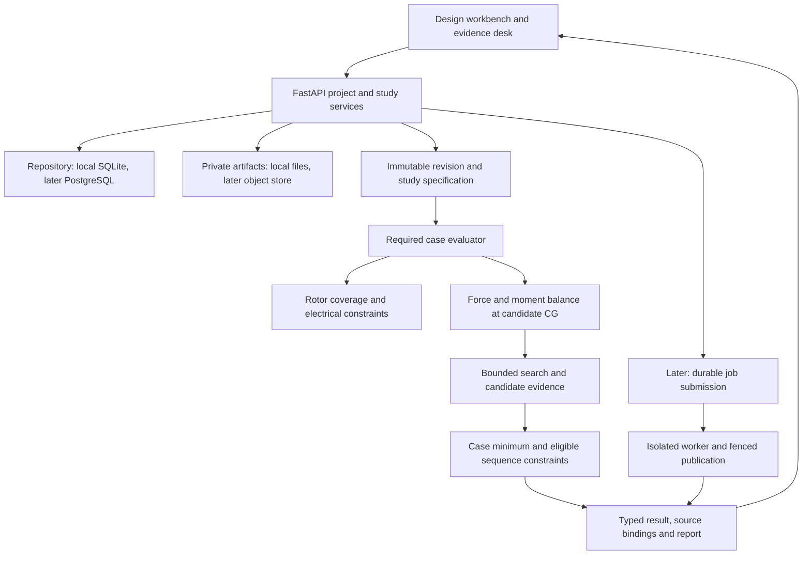

# PhysiCore Drone: implementation work order

**Date:** 4 October 2026. **Starting snapshot:** `b524340048b284e3ce7c1b3447342345e9354a93`, on GitHub `main`.
**Status:** approved delivery sequence with scoped local implementation underway. The broad slices remain open where acceptance or independent dependencies are outstanding; see section 9 for actual progress.
**Authority:** [root production plan](../../plan.md), [Pilot-1 acceptance](../pilots/pilot-1.md) and the user's decisions. This document breaks that roadmap into executable slices without replacing its release gates. New paths/API names below are proposals.

## 1. Recommended development path

Build a complete local payload study first with labelled fixtures. Then make the same workflow durable, private and recoverable on hosted infrastructure. Validate its performance claims against client measurements before releasing operational aircraft results.

| Approach | First outcome | Assessment |
|---|---|---|
| Local engineering workflow, then hosting | Saved design, supported trim, payload bound and inspectable limiting case | Recommended. Advances with available fixtures and follows the agreed Pilot-1 path. |
| Hosted platform first | Invitations, database and workers | Useful independent work once provider/policy decisions exist; making it a prerequisite delays the central payload demonstration. |
| Aircraft CFD first | Installed flow-model development | A later selected capability. Real geometry and validation inputs are missing, and CFD alone cannot resolve mass, propulsion or mission feasibility. |

The first client demonstration should answer: which design revision was evaluated, what payload was established as feasible within the declared model, and what limits it? It should show what changes when payload placement, rotor data or required cases change.

There is no fixed payload target. The required alternative cases determine the headline together. Chronological energy adds a mission-level constraint. Results from analytic/synthetic fixtures remain visibly illustrative.

## 2. Starting point and reuse

| Current capability | Reuse | Remaining gap |
|---|---|---|
| P00.1/P00.2 evidence and reviewed corrections | Frozen artifacts, publication identity, native integration and refusal policy | Later-checkout evidence verifier and retained investigations |
| P01.1 contracts | `projects/contracts.py`, `projects/serialization.py`, canonical bindings | Persistence, authorization and new result semantics for energy-limited mission capacity |
| Mass/mission helpers | `drone/mass.py`, `drone/models.py`, `drone/mission.py`, atmosphere/readiness | Payload-dependent mass/CG, method-specific readiness and supported chronological state |
| Supplied-point screening | `drone/screening.py`, `api/screening.py` | Keep the diagnostic; add maps, trim and search separately |
| Jobs and artifacts | `core/artifacts.py`, `core/jobs.py`, bounded runner | Hosted adapters, leases, fencing and private atomic publication |
| Browser | Existing HTML/JS, STL viewer, evidence desk and vendored three.js | Saved authoring and geometry-linked result explanations |
| CFD foundation | Exact pinned OpenCFD v2606, sphere and native outputs | Aircraft-specific capabilities and validation |

The starting snapshot has recorded acceptance evidence for 415 unit tests, 118 reference tests and three actual pinned-backend checks. These are historical receipts for their stated scope, not checks performed for future tasks. See [P01.1 acceptance](../qa/production-contracts-review.md) and [receipts](../qa/production-contracts-checks.json).

Real geometry, measured rotor maps, approved mass/electrical data and mission acceptance tolerances remain unavailable. The client is the human engineering owner; the named engineer/approver remains pending. Synthetic data cannot satisfy real-validation gates.

## 3. Implementation structure

Keep domain calculations independent of HTTP, storage and browser code. Reuse Python/FastAPI and the current browser technology. A framework migration or new workflow engine requires a separate decision based on an observed limitation.

Metadata and permissions are separate from immutable artifact bytes. Knowing a content hash never grants access to another project's source. Hosted workers receive scoped inputs; the public web process has no container-engine socket.

Proposed API groups: create/list/open project, expected-version draft save, revision freeze, bounded source upload, readiness inspection, study submission/status/cancellation and authorized result/export. Expensive studies become jobs. Define conflicts, retries, cancellation and revision semantics before wiring browser controls.

## 4. Delivery slices

Execute the earliest unblocked slice. Include domain behavior, API, visible interaction and relevant evidence together. Split large hosted slices into small reviewed PRs before implementation. A local subset does not complete a root-plan task with outstanding hosted/authoring acceptance.

### IP01. Saved local projects and revisions

**Root tasks:** local P01.2/P01.4. **Dependency:** accepted P01.1. Originally the next task; local implementation and remaining acceptance are recorded below.

Add a repository interface and local SQLite adapter in proposed `projects/repository.py` and `projects/sqlite.py`; add project service/routes and create/open/save/reopen controls. Store data outside public static directories. Preserve canonical bytes, revision hashes and retained sources. Saving compares the supplied expected version with the stored version transactionally. Freezing must bind the actual persisted draft and source inventory atomically. A local freeze is not authenticated human engineering approval.

**Acceptance:** restart/reload retains the project; two independent database connections cannot silently overwrite an edit; the losing save gives a recoverable conflict; repeated freeze cannot create conflicting identities; an edit retains the old revision/report. Stale browser responses cannot replace the newly selected project. Record `docs/qa/local-projects.md`.

### IP02. Mass, payload placement and fixed pack

**Root task:** local P02.2. **Dependency:** IP01.

Reuse `drone/mass.py` and add a pure candidate-mass builder plus ledger editor. Replace installed payload with the search candidate rather than adding it twice. Retain placement, source/uncertainty and component associations. Count the pack once in installed mass; bind energy and limits to that exact pack. Unknown mass remains unknown; known zero is explicit. Do not infer hollow-aircraft mass from STL volume.

**Acceptance:** independent asymmetric/relocated-payload fixtures agree on mass/CG; duplicate pack accounting and inconsistent energy refuse; save/reopen preserves units/sources. Require inertia only for methods that use it. The visible ledger explains every contribution. Record `docs/qa/mass-electrical.md`.

### IP03. Required cases and method-specific readiness

**Root task:** local P02.3. **Dependency:** IP02.

Author atmosphere, air-relative flow, acceleration, duration and case source. Separate required alternatives from an ordered sequence. Add readiness profiles for screening and initial map/trim; inspect legacy generic feasibility requirements before reusing them. Initial trim scope is static fixed-attitude hover with declared rotor geometry and supported body loads. Extend regimes only after defining their eligibility.

**Acceptance:** missing required case, unknown flow, unsupported maneuver or inconsistent reserve blocks execution with an exact field/reason. Complete labelled fixtures freeze/reopen identically. Changed inputs create a new revision and visibly make old evidence inapplicable to it. Record `docs/qa/mission-readiness.md`.

### IP04. Rotor-map contract, import and evaluation

**Root task:** P03.1. **Dependencies:** IP03; real coverage needs D04.

Add proposed `drone/performance.py` and dataset/source contracts. Start with a fixed-pitch/configuration/density/inflow one-dimensional RPM curve. Preserve original bytes, units, signed torque/rotation convention, uncertainty, duty limits and conversion recipe. Start with labelled analytic fixtures. Additional inflow/density/pitch dimensions require explicit interpolation/coverage policy; never bridge unobserved holes or silently scale density.

**Acceptance:** independently known curves reproduce thrust/torque/power; duplicates, incorrect units, nonfinite points, configuration mismatch and out-of-domain queries refuse. Show domain/source labels in the browser. Preregister tolerances before real withheld-point comparisons; synthetic agreement establishes software behavior only. Record `docs/validation/rotor-map.md`.

### IP05. Propulsion and electrical constraints

**Root task:** initial P03.2. **Dependencies:** IP02/IP04.

Add a versioned constraint evaluator. Distinguish measured electrical watts from shaft watts converted through an explicitly supported efficiency model. Retain signed rotor reaction torque separately. Apply auxiliaries and fixed-pack/motor/ESC current, power and continuous/burst limits. Use supported voltage/current data; add sag/thermal dynamics only when their source models exist.

**Acceptance:** power-limited and thrust-limited fixtures differ correctly; auxiliaries/efficiency apply once; invalid efficiency, absent electrical conversion, excessive burst duration and incompatible pack inputs refuse. Display governing component/source. Record `docs/validation/propulsion-constraints.md`. Full P03.2 stays pending until its remaining supported behavior is delivered.

### IP06. Force and moment ledger

**Root task:** first P04.1 slice. **Dependencies:** IP02/IP04/IP05.

Add a pure wrench evaluator in proposed `drone/trim.py`. Transform rotor forces, reaction couples and body loads into one declared frame. Shift source moments to candidate CG exactly once. Include gravity and supported inertial terms. Retain component contributions as evidence before adding optimization.

**Acceptance:** independent offset-force, reversed-axis, asymmetric-CG and mixed-rotation fixtures detect force, torque and origin errors. Gravity has no moment about CG. Register residual normalization and numerical floors before comparisons; real acceptance tolerances are the client's engineering decision. Record the independent derivation in `docs/validation/trim.md`.

### IP07. Bounded static-hover allocation and trim

**Root task:** supported P04.1 subset. **Dependency:** IP06.

Solve commands within map/electrical limits for the declared hover family. Check all three force and three moment residuals even where a fixture makes a component zero. Retain commands, CG, coverage, violations, residuals and convergence diagnostics together. Add attitude/pitch variables only when actual physical controls and supported models permit them.

**Acceptance:** symmetric analytic hover, shifted CG, exhausted authority and impossible yaw balance produce explainable outcomes. Optimizer success without acceptable residuals fails. Optimizer failure alone is unresolved; infeasibility requires a supported certificate or reviewed decision rule. Obtain independent Claude review of signs, residuals and outcome semantics.

### IP08. Payload search with defensible bounds

**Root task:** first P04.2 slice. **Dependency:** IP07.

Add proposed `drone/capacity.py`. Rebuild mass/CG for each candidate. Declare payload domain, evaluation budget, tolerance and termination reason. Bisection requires a reviewed model policy establishing feasible-prefix behavior; otherwise use bounded exploration/multistart and retain unresolved gaps. An explored upper value is not a proven capacity upper bound without supporting evidence.

**Acceptance:** independent analytic capacity, electrical limits, shifted payload and nonmonotonic fixtures retain the right feasible candidates and unresolved intervals. Exhausted budgets and unsupported queries never become zero payload or a global optimum. Record candidate diagnostics and independent search review in `docs/validation/capacity-search.md`.

### IP09. Required-case headline and complete Pilot-1

**Root task:** P04.2 plus local Pilot-1 authoring/report acceptance. **Dependencies:** IP01-IP08.

Evaluate all required alternatives and publish their minimum supported feasible lower bound under V2. Show an attaining case, active constraint, commands, coverage and source/revision bindings. Optional excluded cases remain visible. Reuse viewer/evidence desk to locate the relevant rotor/CG. Export the canonical result displayed by API/browser.

**Acceptance:** missing, unsupported or unresolved required cases withhold the headline. API/UI/export agree on value, units, scope and revision. Reopen, edit placement, rerun and compare retained revisions using actual controls. Label fixture inputs/results/exports. This completes the local demonstration gate; chronological mission and real-aircraft acceptance have their own dependencies.

### IP10. Result version for aggregate mission limits

**Root task:** P01.1 extension required for P04.3. **Dependency:** IP09; precedes IP11.

Current `AircraftStudyV2` requires the headline to equal the required-case minimum and its limiting ID to name a case. Its sequence-energy field binds evidence but cannot express a lower aggregate energy capacity or limiting segment. Design a successor, proposed `AircraftStudyV3`, with typed aggregate constraints, case/segment identity, candidate evidence and completeness rules. Preserve V1/V2 parsers and bytes; document migrations and update ADR-0002.

**Acceptance:** individually feasible segments with a lower aggregate energy capacity can be represented without inventing a limiting case or rewriting old results. Missing aggregate evidence withholds a sequence headline. Independent review accepts new minimum/coverage semantics before publication. Record `docs/contracts/mission-capacity.md`.

### IP11. Chronological energy with a fixed pack

**Root task:** first P04.3 slice. **Dependencies:** IP10 and covered segment operating points.

Integrate electrical demand through ordered supported segments, carrying remaining usable energy and applying reserve once. Start with constant-power segments, then independently verified variable-power quadrature. Evaluate aggregate energy inside candidate search when it limits capacity. Short acceleration-margin checks are not sustained flight without trajectory/map support. Pack resizing and thermal/sag state are separately reviewed extensions.

**Acceptance:** segments passing individually but exhausting one pack fail as a sequence; reserve is neither omitted nor doubled; constant-power energy agrees analytically and variable-power integration has refinement evidence. Unsupported state/trajectory refuses. API/report names the aggregate limit. Record `docs/validation/mission-energy.md` and independent review.

### IP12. Deterministic uncertainty and allowable limits

**Root task:** P04.4 and scoped external limits. **Dependency:** IP11.

Bind reviewed scenarios for mass, map data, atmosphere and installation while preserving correlations. Re-evaluate trim/search/energy per scenario. Apply external structural/operational caps with their source and approval scope. Present model capacity and approved allowable limits distinctly. Missing uncertainty remains visible; deterministic cases do not establish probabilistic confidence intervals.

**Acceptance:** correlated fixtures, changed coverage and governing caps reproduce. Missing sources cannot silently yield a complete confidence claim. Record `docs/validation/capacity-uncertainty.md`. G2 needs completed applicable behavior and independent review.

### IP13. Hosted metadata and private artifact adapters

**Root task:** remaining P01.2. **Dependencies:** IP01; hosted configuration needs D01/D03.

Implement PostgreSQL against the same repository behavior as local SQLite. Add versioned migrations, expected-version transactions and private object storage with bounded streaming, checksums, staged uploads and committed resource references. Separate geometry assets from instances. Preserve originals, repair provenance and immutable packages; package resources independently of the checkout.

**Acceptance:** shared repository tests pass against both adapters; migration/rollback preserves older revisions; interrupted uploads are unpublished; missing/corrupt bytes refuse; installed resources work. Record `docs/qa/persistence.md`. Split migrations, uploads and packaging into separate PRs.

### IP14. Invited identity, authorization and review records

**Root tasks:** P01.3 and hosted workspace/review foundation. **Dependencies:** IP13, D01-D03.

Implement selected session/invite policies and engineer/reviewer/invited-viewer roles. Apply project access to every API, source, viewer asset, job, export and review. Support expiry/revocation and authenticated review associations. Client acknowledgment differs from design/physics approval. Isolate explicit local demo mode from hosted authentication.

**Acceptance:** invited journeys pass; guessed IDs, cross-project hashes, stale grants, revoked sessions and unauthorized reviews/exports fail. Review records resolve an authenticated actor and exact result/package. Record `docs/qa/authorization.md`. External access waits for accepted retention/residency/review policies.

### IP15. Recoverable jobs and atomic publication

**Root tasks:** P05.1-P05.3. **Dependencies:** IP13/IP14; aircraft publication uses accepted IP12 scope.

Split submission/idempotency, leases/fencing, events/reconnect, cancellation/cleanup and result publication into reviewed PRs. Persist attempts/reservations. Stale workers cannot publish after cancellation or lease loss. Verify the complete staged manifest before its winning transaction. Cache by full semantic inputs/model/backend versions. Isolate compute and bound CPU, memory, disk, PID and wall time.

**Acceptance:** duplicate requests, process loss, competing workers, storage failures and cancellation at each stage leave one accepted result, released reservations and authorized diagnostics. Reconnect replays ordered actual events; no guessed solver percentage. Record job recovery, isolation and publication evidence in `docs/qa/`.

### IP16. Complete assembly authoring and client reports

**Root tasks:** remaining P02.1/P02.2 and P09.1-P09.3. **Dependencies:** relevant local slices; hosted sharing needs IP14/IP15.

Complete duplicate placement, units, rotor assignment, frame/axis editing and accepted repair revisions. Deliver input/method-aware comparison and canonical export/PDF. Reports identify payload bound, governing limit, case coverage, scope, sources and review. Clients receive explicit read-only reviewed revisions; comments bind to them and do not rewrite results.

**Acceptance:** multi-unit assemblies and undo/reject repair preserve originals; long names and large assemblies remain usable; comparison identifies changed inputs/methods. PDF/API/export agree. Rehearse two presentations and inspect a backup recording. Root dependencies govern P09 completion even when fixture report work starts earlier.

### IP17. Staging, operating drills and measured scale

**Root tasks:** P06.1-P06.3 and P10.2. **Dependencies:** IP14/IP15, D01-D03/D07; full pilot workload uses IP12/IP16.

Deploy pinned builds through reproducible configuration with isolated staging/production data, migrations and rollback. Add monitoring and named incident ownership. Restore database/object data together and verify permissions/hashes. Measure workload sizes, saturation, viewer/report performance and compute cost before committing service targets. CI selects meaningful checks by affected behavior and retains candidate/receipt associations.

**Acceptance:** deployment runs without the developer laptop; recovery meets agreed RPO/RTO; rollback/cancellation are rehearsed; access and failure regressions block release. Skipped backend checks do not establish backend evidence. Record deployment, recovery, load/cost and release policy. Provider/workflow technology remains a decision, not an assumption from an unrelated browser tab.

### IP18. Real client validation and production release

**Root tasks:** P10.1/P10.3. **Dependencies:** IP12/IP16/IP17, D04-D06 and selected model eligibility.

Review real geometry, mass/CG, propulsion/electrical and mission data with the named client engineer. Register validation conditions/quantities/tolerances before comparison. Separate calibration from independent validation. Retain discrepancy, uncertainty, unsupported regions and failed comparisons. Obtain independent physics review and human acceptance for the exact aircraft/model/report scope; release through staging with tested rollback.

**Acceptance:** a real dataset completes the saved-study journey; measured comparisons support a bounded envelope; the client can inspect/reproduce the result. Record exact source/build/schema/model/backend and recovery evidence in `docs/releases/production-01.md`. Synthetic demonstrations cannot complete this gate.

## 5. Physics rules to preserve

These expressions define bookkeeping and decisions. Implemented frames, units, terms and tolerances must be versioned and independently checked.

- **Mass:** `m = sum(non-payload installed masses) + candidate payload mass`; CG uses corresponding mass-weighted positions. Pack resizing later creates a coupled candidate rather than a second pack entry.
- **Force:** in one common frame, residual is `sum(rotor forces) + body force + m*g - m*a`. Static hover declares zero acceleration and supported body loads.
- **Moment:** about candidate CG, sum `cross(r_i-r_CG, F_i)`, signed reaction couples and shifted body moment; subtract supported `I*alpha + cross(omega, I*omega)`. Initial steady scope sets angular rates/accelerations to zero.
- **Power:** use measured electrical watts or supported shaft watts divided by efficiency, then auxiliaries once. Signed torque and absorbed shaft-power conventions require explicit source definitions.
- **Energy:** integrate electrical power through ordered segments and apply one declared reserve convention. Held-fraction reserve reduces usable energy once; other conventions need their own validated handling.
- **Alternative cases:** headline is the minimum supported feasible lower bound across every required case. Missing required evidence blocks it.
- **Sequence:** headline must be feasible for required cases and aggregate constraints at compatible candidates; IP10 defines representation before IP11 publishes it.
- **Outcomes:** unsupported is outside known model/data scope; unresolved is insufficient numerical/search evidence; infeasible needs a supported constraint decision. They are not interchangeable.

Geometry supplies none of the missing measured propulsion, electrical limits or installed mass. Isolated maps and fixture residuals do not validate installed-aircraft performance. Optimizer success alone does not establish a global maximum.

## 6. Claude follow-up investigations

Carry these alongside Pilot-1 without overwriting accepted evidence. I03 is useful early and does not block maps/trim. Preregister resource budgets for I01/I02 before running new CFD.

| Investigation | Implementation | Acceptance and limits |
|---|---|---|
| I03: separate evidence/source verification | New evidence-byte command and exact-source-commit reproduction mode; preserve frozen P00.1 inventory/checker/launcher | Tampering still refuses; later checkouts inspect retained evidence without claiming their current source reproduces it. Keep historical source checks. |
| I01: native regular-grid sampling | Probe exact-image capability; version experiment/protocol; retain coordinates, fields, raw bytes and recipe hashes; compare supported coverage, direction and signed scalars | Independent plane/grid/refinement checks. Identical regular-plane subset samples can yield trivial zero sensitivity, so the old subset metric alone cannot establish accuracy. Preserve four refused slices and existing versions/thresholds. |
| I02: domain/surface experiment | Preregister baseline, larger domain with unchanged near-body resolution, finer surface with unchanged domain and combination where justified. Hold other recipes/normalization fixed; record mesh quality, convergence, native loads and resources | Report changes to Cd/sampling with controlled evidence. The retained +2.65% correlation gap has no assigned cause; confounded mesh changes cannot establish one. Independent review defines the supported conclusion. |

Aircraft CFD/BEM remain separate optional tracks under P03.3/P07/P08. Their backend probes, physical inputs and validation gates must pass before influencing a client claim. Sphere verification does not complete those tasks.

## 7. Client experience and interface acceptance

The signature is the client's actual design and inspectable engineering state: assembly, rotor placement, CG, performance coverage and governing condition. Build a workbench around that artifact with purposeful interactions.

Demonstration: reopen design; inspect sources/mass; review required cases/coverage; run; inspect capacity/limit; change placement or another input; rerun; compare revisions; export the same result. Include missing-data, unresolved and physical-limit journeys.

Apply the user's full anti-slop law to every interface slice. Re-read it point by point before accepting a change and record the actual audit. Verify every rendered control with a real pointer and relevant keyboard interaction. Check conflicts, delayed/stale responses, errors, reload, reduced motion, 200% zoom, long names and agreed desktop/mobile review sizes. Content stays visible by default. Inspect clipped edges, contrast, alignment and intended centering. Preserve coherent type/palette and useful geometry/data interactions; do not claim future or untouched screens passed new visual checks.

## 8. Gates and dependencies

| Incremental gate | Slices | Demonstrable outcome |
|---|---|---|
| A: saved labelled design | IP01-IP03 | Persistence, exact revisions and meaningful readiness |
| B: local Pilot-1 | IP04-IP09 plus A | Supported static-hover capacity, required-case minimum and inspectable export |
| C: mission model | IP10-IP12 plus B | Eligible sequence energy and deterministic scenarios, still fixture scope before real validation |
| D: private hosted pilot | IP13-IP17 plus applicable B/C scope | Invited access, recoverable compute, durable data and client reports |
| E: production aircraft scope | IP18 plus D | Human-accepted real-design results within demonstrated validation scope |

Gate B is the next product milestone. Root G1-G5 remain authoritative: these incremental demonstrations do not complete broader phase requirements. Remaining assembly authoring and hosted adapters still gate their root tasks.

Use [D01-D09](../../plan.md#13-decisions-and-external-inputs) at dependency time. D01-D03 determine hosted provider/identity/data policy; D04-D06 determine real performance claims; D07 determines measured scale/cost targets. Continue independent work while awaiting them. The [client data request](../client/aircraft-data-request.md) is prepared; sending it is not authorized by this plan.

Use one reviewable behavior per PR on a `codex/` branch against confirmed GitHub `main`. Record actual files, exact candidate/model/source versions, performed checks, applicable independent review, limitations and current documentation/Notion. Keep master boxes unchecked until all acceptance passes. Software merge and real-aircraft approval remain separate decisions.

Calendar commitments need team capacity and real-data coverage. Estimate the next concrete small slice after inspection; split large items before committing. CFD duration and hosted cost require measured workloads rather than extrapolation from the sphere demo.

## 9. Immediate implementation order

**4 October user decision:** keep execution local for now. IP13/IP14/IP17 hosted deployment and invited access are deferred. The future private-hosted goal remains in the root plan. Local authoring, physics fixtures, evidence inspection and reporting continue; no cloud/provider account is assumed.

Local repository/API/workbench, fixed-pack mass authoring, retained maps, restricted hover trim and constant-segment aggregate energy were implemented on `codex/local-project-workbench`. The reviewed checkpoint `f6fc497` is now merged through [PR #5](https://github.com/PhysiCoreEngine12/Drone-Project/pull/5) into `main` at `8fe3cf7`; [the receipt](../qa/local-workbench-merge.md) records exact-head checks and scope. See [model scope](../decisions/ADR-0003-static-hover-profile.md), [local contract](../contracts/mission-capacity.md) and [performed physics checks](../validation/local-hover-and-energy.md). This is progress through scoped IP01-IP11 work, not completion of all slices: general assembly authoring, measured map validation, the approved aircraft successor, variable-power integration, uncertainty, recoverable jobs and the remaining evidence investigations still need implementation/acceptance. Master task boxes remain authoritative.

1. **IP01 repository/service:** transactional local persistence, expected-version conflicts and immutable freeze. Verify independent connections and restart; retain existing packages.
2. **IP01 API/browser:** create/open/save/reopen, conflict recovery and stale-response handling. Complete interaction audit before accepting IP01.
3. **IP02/IP03:** mass/placement/fixed-pack editor and independent fixtures, then required cases/readiness.
4. **IP04-IP09:** maps, electrical constraints, wrench ledger, supported trim, bounded search and complete Pilot-1, in dependency order.

**5 October progress:** retained input/method-aware comparison and bound JSON/PDF export are implemented as a local IP16 subset. See [report checks](../qa/local-reports.md). Claude accepted the corrected static-hover candidate `3f9b01d` as `PASS_BOUNDED_LOCAL`, with precise fixture limits in [its receipt](../reviews/2026-10-05-local-hover-claude.md). The subsequent report/numerical follow-up and exact historical-policy correction have their own [report review](../reviews/2026-10-05-local-reports-claude.md) and [compatibility review](../reviews/2026-10-05-historical-contract-claude.md). They do not expand the physical model. The [browser audit](../qa/local-workbench-design-audit.md) distinguishes completed interactions from remaining acceptance. None of this completes hosted or real-aircraft gates.

I03 now has independent evidence-byte and historical Git-source scopes with tamper/portability checks; see [performed byte verification](../qa/retained-evidence-verification.md). The original P00.1 checker and inventory remain unchanged. Local V3 preserves older V2 reads while applying stronger checks only to new results.

Next independent model slice: IP12 deterministic scenarios and sourced allowable limits. Browser completed-download/200% zoom/conflict-dialog acceptance, general assembly authoring and local job recovery remain separate open work. Hosted adapters/deployment and real-aircraft validation remain dependent on their explicit inputs.

**5 October reviewed checkpoint:** exact known-producer historical policy dispatch was accepted by Claude within local fixture scope. The workbench's expanded authoring, histories, saved/frozen evaluation, invalid-JSON recovery, real rotor orbit/zoom/reset and mobile keyboard-scroll tables were exercised; [the audit](../qa/local-workbench-design-audit.md) records remaining browser-host download/zoom/conflict-dialog checks. A [current backend and formula guide](../technical/local-workbench-and-physics-guide.md) covers these modules and their limits. No full IP01/IP16 or production acceptance is asserted. Next independent model work remains IP12; assembly/repair, recoverable execution, historical-source numerical reproduction and real-data/human gates are still outstanding.
