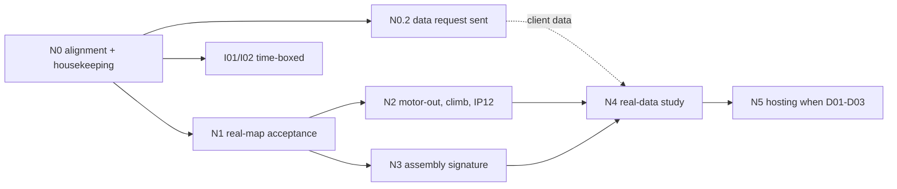

# PhysiCore Drone: state review and next development plan

**Historical specification / reviewed snapshot.** Current slice status and execution order live only in [plan.md](../../plan.md#active-slice-status). The acceptance details below remain applicable; their snapshot status is not a current work queue.

**Date:** 5 October 2026. **Reviewed snapshot:** `main` @ `ec51c2b` (PR #6 merged). Working tree clean apart from `.DS_Store`.
**Reviewer:** Claude Opus 5.5. **Status:** proposal for the user's decision. It reorders and adds to the open work in [plan.md](../../plan.md) and the [4 October work order](2026-10-04-implementation-plan.md). It does not replace their release gates, check any boxes or claim any validation.

---

## 1. Where the project stands (checked, not quoted)

### 1.1 What I re-ran or re-derived today

| Check | Result |
|---|---|
| Unit suite | **490 passed**, 3 backend tests deselected |
| Reference suite | **118 passed** |
| Ruff / JS syntax (`web/js/*.js`) | pass / pass |
| Labelled hover example through the real API (fresh data root): create → freeze → study | Headline **3.662841031 kg**, limiting case `hover_long`, active constraint `case_energy`. My independent hand calculation: E_usable = 2 kg × 100 Wh/kg × 3600 × 0.8 × 0.8 = 460 800 J; P ≤ 460 800/300 = 1536 W; payload = 1536/(10 × 9.80665) − 12 = **3.662841031 kg**. Exact match. The short case is correctly pack-power limited (18.59 kg). |
| Same example with payload moved to x = 0.8 m | Short case limited by front rotors r0/r3 at the map's 100 N ceiling. Candidate CG x = 0.45707 m ⇒ payload 15.994 kg, against my hand value (400/g − 12)/1.8 = **15.9937 kg**. Long-case front thrust is 45.584 N, as predicted. |
| Stale draft save | Correctly refused with HTTP 409 |
| **Realistic rotor map** (ideal CT/CQ scaling, 11 RPM points) with ±0.1 % and ±1 % multiplicative noise, 20 seeds each | **Refused in 20/20 cases at both noise levels** ("affine absorbed torque" or "convex electrical power"). Noise-free scaling data passes. See finding R1. |

Not re-run by me: native OpenFOAM backend tests, GitHub CI, browser interaction, PDF rendering. I rely on the project records for those.

### 1.2 What exists on `main`

- **Verified foundation:** the sphere CFD verification pipeline, native load integration and reconciliation, evidence packages with content-bound publication identity, the frozen P00.1 baseline, and the I03 evidence/historical-source verifier.
- **Contracts:** P01.1 versioned project/study contracts (`AircraftStudyV1/V2`), plus a local `local_mission_capacity_v3` with exact historical-producer dispatch.
- **Local saved-design workbench** (scoped subsets of IP01–IP11):
  - SQLite projects with expected-version conflicts and immutable frozen revisions;
  - mass/CG/fixed-pack authoring;
  - required cases and readiness;
  - rotor-map import with coverage;
  - electrical limits;
  - six-component wrench ledger;
  - linear-programming static-hover trim with certificates and the four outcome classes;
  - required-case minimum headline;
  - chronological constant-power energy;
  - comparisons and source-bound PDF/JSON reports.
- **Documented model scope** ([ADR-0003](../decisions/ADR-0003-static-hover-profile.md)): static hover, zero inflow, fixed attitude, exact convex piecewise-linear power and affine torque, fixed pack, constant-power segments.

### 1.3 What is not done

- **Real inputs:** no client geometry, rotor maps, mass ledger or mission tolerances. The [data request](../client/aircraft-data-request.md) is written but marked "sending not authorized". No named human engineering owner.
- **Model breadth:** only static hover. No climb inflow, forward flight, motor-out cases, uncertainty scenarios (IP12) or external allowable limits.
- **Authoring:** there is no geometry-to-rotor link. The workbench viewer shows declared rotor disks and CG but no airframe. Assembly authoring and repair remain open.
- **Operations:** recoverable jobs, hosted deployment and identity are deferred by the user (4 Oct decision).
- **Presentation:** standard-browser download, 200 % zoom and full conflict-dialog acceptance are pending. Two timed rehearsals and a backup recording are pending.
- **Side investigations:** I01 (regular-grid sampling) and I02 (domain/surface study for the +2.65 % sphere gap) are not started.

---

## 2. Assessment

### 2.1 What is working well

1. **The physics engine is correct within its declared scope.** Two independent hand calculations matched to 9–10 significant figures, including a CG-shift case where the binding constraint changes.
2. **Honest outcome semantics.** It distinguishes feasible, infeasible (only with a checked certificate), unsupported and unresolved. Coverage-dependent contradictions are never reported as physical infeasibility. Zero payload is never assumed feasible.
3. **Reproducibility discipline.** Frozen revisions, source-byte binding, immutable results, historical readers that don't silently re-qualify old records, and stale-write conflicts.
4. **The right strategic call on 4 October:** answer the payload question locally before building hosting.
5. **Review loops find real defects,** and each fix lands with a regression test.

### 2.2 Findings that should shape the next phase

| ID | Severity | Finding | Why it matters |
|---|---|---|---|
| **R1** | **High (product)** | `RotorMapV1.convex_static_profile()` (`drone/performance.py:95-125`) requires torque to be affine in thrust within 1e-10, and electrical power exactly convex. Shaft-basis maps are only accepted with *constant* torque, which is not physically realistic for a propeller. My test: 0.1 % measurement noise on otherwise ideal data is refused 40/40 times. | **The first real measured map will be refused.** The milestone the whole project is waiting for (real client data) cannot run through the engine as built. This is a correct refusal by design, not a bug, but it blocks Gate E. |
| R2 | Medium (process) | Four overlapping plan documents (root `plan.md`, archived master, 3-day plan, 4 Oct work order) plus about 30 QA/review receipts. The task status lives in prose inside several files. | Agents and people lose time reconciling status, and documents drift. |
| R3 | Medium (client) | The product has moved from the manifest's CFD-centred scope to a map-based capacity tool. That is the right move, but there is no record that the client agreed. | It needs an explicit client decision before the first real demo. |
| R4 | Medium (model) | Static hover only. For heavy-lift multirotors, the governing cases are often climb and **one-motor-out**. Motor-out fits the existing LP directly (zero the failed rotor's thrust and check the six-component balance). | High client value for low cost; currently scheduled late (P08.4). |
| R5 | Low | The model fingerprint hashes every Python file under `src/physimesh`, so an unrelated UI or doc-code change withholds numeric comparison. | Comparison becomes unusable across routine releases. |
| R6 | Low | The data request has not been sent. | The real-data critical path hasn't started its clock. |

---

## 3. Recommended direction

Prioritize, in this order:

1. **Unblock real data:** client alignment, data request, and an engine that accepts measured maps.
2. **Model breadth the client will ask for:** motor-out, climb, uncertainty and allowable limits.
3. **The client-facing signature:** the real assembly linked to rotors, CG and the limiting case.
4. **Validation with the named engineer.**
5. **Hosting, once D01–D03 exist.**

Keep CFD to two small, time-boxed investigations until a client case needs installed-rotor effects.

---

## 4. Milestones and slices

Sizes follow the project buckets: **S** = 1–3 engineering days, **M** = 4–8, **L** = must be split before committing. These are effort buckets, not calendar dates. Physics-critical slices (⚠) keep the independent review rule. Other slices use automated tests plus a standard code review.

### Milestone N0: alignment and housekeeping (this week)

| Slice | Size | Work | Acceptance |
|---|---|---|---|
| N0.1 Client scope decision | S (user) | Confirm with the client: pilot = map-based payload capacity for declared cases. CFD is a later, optional capability. Name the client engineer who owns tolerances. | Recorded as ADR-0004 with date and client contact role |
| N0.2 Send the data request | S (user) | Send [aircraft-data-request.md](../client/aircraft-data-request.md), plus a request for raw rotor test data with test conditions and uncertainty | Sent date recorded; D04–D06 move from "not requested" to "requested" |
| N0.3 One living roadmap | S | Make `plan.md` the single active plan. Fold IP01–IP18 and this document's slices into one status table (ID, state, evidence link, blocker). Mark the other plans "historical". | One table answers "what is next and what blocks it". No duplicated status prose. |
| N0.4 Close browser acceptance | S | Standard-browser download, 200 % zoom and the conflict-dialog journey | Recorded in the existing design audit with screenshots |
| N0.5 Semantic model identity (R5) | S ⚠ | Fingerprint only the modules that define the model (performance, trim, capacity, mission_capacity, authoring, contracts) plus a declared model version. Keep the old full-tree fingerprints readable. | A UI-only change no longer withholds comparison; a physics-module change still does; historical records still read |

### Milestone N1: accept real measured rotor maps (critical path)

| Slice | Size | Work | Acceptance |
|---|---|---|---|
| N1.1 Map conditioning policy | M ⚠ | A versioned, reviewed step from raw measured points to the model the engine uses: • **Power:** the lower convex hull of the measured points sits below some of them, so it is optimistic. Use that hull shifted up by the maximum point deviation instead. It is still convex and lies on or above every measured point, so it is conservative for power and energy. Retain the shift. • **Torque:** an affine fit with bounded relative residual. Check the yaw balance at both edges of the residual band. • Refuse when the residual exceeds the declared tolerance. Original bytes stay untouched; the conditioned model is a separate, hashed artifact. | Noisy fixtures (0.1 %, 1 %, 5 %) are conditioned or refused exactly as the policy states. The conditioned power is ≥ every measured point. Capacity with conditioned maps is ≤ capacity with the exact ideal map (conservatism test). Independent review of the conservatism argument. |
| N1.2 General PWL maps option | M ⚠ | **If** the client's maps violate the convex/affine assumptions beyond tolerance, add an exact piecewise-linear-in-RPM formulation. Each rotor's thrust, torque and power are interpolated between adjacent measured points using SOS2/λ variables, solved as a mixed-integer LP with SciPy's HiGHS (`scipy.optimize.milp`). This removes the convexity requirement entirely. | Same fixtures as N1.1 plus a nonconvex one. The MILP and LP agree on convex fixtures. Solver gap and status are retained. "Infeasible" still requires a separate certificate rule, otherwise it is reported as unresolved. Decide N1.1 vs N1.2 after seeing the first real map. |
| N1.3 Realistic labelled fixture | S | A labelled "realistic" dataset built from public propulsion test tables (license checked and recorded) or from the analytic CT/CQ model with noise. Use it to exercise import → conditioning → capacity → report end to end. | The full journey runs, or refuses with exact reasons. Clearly labelled not-client data. |
| N1.4 Shaft-power basis | S ⚠ | Support shaft-power maps with varying torque, via conditioning or N1.2 rather than the constant-torque restriction. Apply efficiency once. | Shaft and electrical versions of the same rotor give matching results under a declared efficiency |

**Gate N1:** a realistic noisy map produces a capacity result (or a precise refusal) without any manual data editing.

### Milestone N2: model breadth the client will ask for

| Slice | Size | Work | Acceptance |
|---|---|---|---|
| N2.1 Motor-out cases | M ⚠ | A case can declare failed rotors (thrust and torque fixed at zero). The LP re-solves the six-component balance with the remaining rotors. The report names the failed rotor and the governing limit. | Quad motor-out is refused as an infeasible yaw/roll balance with a certificate, or unsupported (known physical result). A hexa/octo motor-out gives a reduced but feasible capacity on fixtures. Independent review. |
| N2.2 Axial climb case | M ⚠ | Accept maps measured at a declared axial inflow V_c, and a climb case with that inflow (no extrapolation across inflow). | A climb case refuses without a matching-inflow map. With one, the capacity is lower than hover on physically consistent fixtures. |
| N2.3 IP12 scenarios and allowable limits | M ⚠ | Already the next item in the work order: correlated deterministic scenarios (mass, map uncertainty band, density) and sourced external caps (structure, operational). | As specified in IP12. Model capacity and approved allowable limit shown separately. |
| N2.4 Variable-power segments | S–M ⚠ | Only if the client's mission needs it: piecewise-constant segments generated from case transitions, with an energy ledger | Analytic agreement and refinement evidence |

Forward flight (attitude tilt, edgewise maps) stays out until the client's mission data shows it governs. It needs maps the client may not have.

### Milestone N3: the client-facing signature

| Slice | Size | Work | Acceptance |
|---|---|---|---|
| N3.1 Assembly to rotor link | M | Import the client's STL assembly (existing intake). Place rotors by picking on geometry or by numeric entry against the model. Show the airframe, rotor disks, CG and the limiting rotor/case in one view. | Real geometry shown with declared units. Rotor positions round-trip. The limiting rotor is highlighted from the result. |
| N3.2 "What changed and why" comparison | S | Extend the existing comparison: changed inputs → changed active constraints → capacity delta, with the "not causation" qualifier kept | Two revisions with moved payload show the constraint switch (as in my x = 0.8 m test) |
| N3.3 Rehearsals and backup recording | S | Two timed rehearsals of the full journey on a realistic fixture; a backup screen recording | Logged in the presenter guide |

### Milestone N4: first real-data study and validation

| Slice | Size | Work | Acceptance |
|---|---|---|---|
| N4.1 Data intake review | S | With the named client engineer: units, coordinate frames, map test conditions, mass ledger completeness | Gaps listed as structured blockers, not defaults |
| N4.2 Preregistered comparison | M ⚠ | Before running, fix the quantities, conditions and tolerances (owned by the client engineer). Hold back test points for validation, separate from those used for calibration. | Registration committed before results. Discrepancies retained, including failures. |
| N4.3 Reviewed real-design report | S | Run, review (independent physics review plus the client engineer), publish a frozen report | Report states scope, model, coverage and approval status exactly |

### Milestone N5: hosting (starts only after D01–D03)

Keep IP13–IP17 as specified. Recommended order once unblocked: IP13 persistence adapters → IP14 identity/authorization → IP15 recoverable jobs → IP17 staging and drills. Split each into reviewed PRs. Until then the local workbench is the delivery vehicle.

### Side track: bounded CFD investigations (time-boxed)

| Item | Size | Rule |
|---|---|---|
| I02 sphere domain/surface study | S | Preregister. Larger domain at fixed near-wall resolution, and finer surface at fixed domain. Report what changes Cd. Assign no cause beyond the evidence. Closes the open +2.65 % question a technical client will ask. |
| I01 regular-grid sampling | S | Probe the exact image capability first. Keep the four refused slices refused under the old policy. |

Aircraft CFD (P07/P08) waits for a client case where installed-rotor interference plausibly governs capacity.

---

## 5. Sequencing

Recommended immediate order: **N0.1 + N0.2 (user, today)** → N0.3 → N1.1 → N1.3 → N2.1 → N0.4/N0.5 in gaps → N3.1 → N2.2/N2.3.

Rationale:
- N1 is the only engineering work that blocks the real-data milestone.
- N2.1 is the highest-value model extension per unit of effort, because it reuses the existing LP.
- N3.1 is what the client will actually look at.

---

## 6. Ways of working (adjustments)

1. **Review depth by risk.** Keep independent cross-family review for ⚠ slices (map conditioning, trim, motor-out, energy, contracts). UI/doc/plumbing slices need tests plus one code review, not a full receipt chain.
2. **One receipt per milestone** instead of a QA file per sub-step. The evidence stays the same; it's just less scattered.
3. **Status lives in one table** (N0.3). A slice's checkbox flips only when its acceptance row is met.
4. **Fixture labelling stays mandatory** on every screen, report and export until N4.3 is accepted.
5. **No calendar commitment to the client** until N1 has run on a realistic map and N4.1 has reviewed the real data. Then re-estimate bottom-up.

---

## 7. Decisions needed from the user

| ID | Decision | Recommendation |
|---|---|---|
| U1 | Approve the client scope (map-based pilot, CFD later) and name the client engineering owner | Yes. Do it before the next client meeting. |
| U2 | Authorize sending the data request | Yes, today. It is the longest lead time. |
| U3 | Approve N1.1 (conservative conditioning) as the default, with N1.2 (MILP) held in reserve | Yes |
| U4 | Prioritize N2.1 motor-out ahead of IP12 | Yes, unless the client says redundancy isn't a requirement |
| U5 | Consolidate plans into one living roadmap (N0.3) | Yes |
