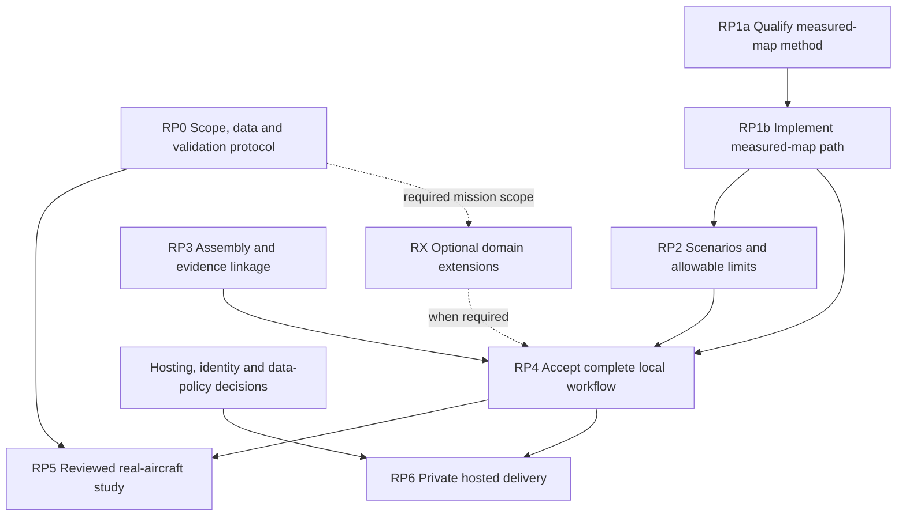

# Next milestone: a credible real-aircraft engineering pilot

Date: 14 October 2026. Reviewed source: `main` at `264056d7f1520fc368f1b9e050382ace5c4d6c78`. The working tree was clean before this planning task. The user selected a credible real-aircraft engineering pilot as the next priority.

This is a proposed work order, not implementation acceptance or aircraft approval. It updates the sequence proposed on [5 October](2026-10-05-next-development-plan.md). The requirements and release gates in [plan.md](../../plan.md) still apply. The [4 October work order](2026-10-04-implementation-plan.md) remains the detailed historical decomposition; its local subsets must not be mistaken for completed production tasks.

## Outcome and recommendation

Deliver one traceable real-design study: original aircraft inputs, qualified rotor data, an immutable design revision, supported mission cases, a checked common payload, the governing constraint, and a report reviewed by the named client engineer. Report unsupported conditions and validation discrepancies explicitly. The pilot can be delivered locally under the existing deployment decision; a private hosted release remains a separate gate.

Prioritize **measured-map qualification → scenarios and allowable limits → assembly-linked evidence → local acceptance → real-data validation**. Start client input collection and validation planning alongside the software work. Add climb or fault cases only when the agreed pilot mission requires them. Develop hosting after its decisions are recorded, without making cloud deployment a prerequisite for local physics work.

### Approaches considered

| Approach | Benefit | Trade-off | Recommendation |
|---|---|---|---|
| Engineering pilot first | Addresses the measured-data and validation gaps in the central payload question | Depends on client inputs and a physics-method decision | Selected direction |
| Local presentation first | Improves usability and presentation quickly | Leaves measured-map eligibility and aircraft evidence unresolved | Include focused workflow fixes alongside engineering slices |
| Hosted platform first | Enables invited client access | Adds identity, storage and operations before the real-data method is qualified | Separate delivery track once D01-D03 are resolved |

## What was checked

The audit covered the Python API, project storage/contracts, map/trim/capacity/energy path, geometry intake, solver and evidence boundaries, browser modules, tests, CI, previous plans and retained QA/review records. It was not a line-by-line independent physics certification.

| Check run on this checkout | Result |
|---|---|
| `.venv/bin/python -m pytest -q -m 'not backend'` | 490 passed; 3 backend tests deselected |
| Reference suite from `reference_impl/` | 118 passed |
| `.venv/bin/ruff check .` | Passed |
| Node module syntax check of all six `web/js/*.js` files | Passed |
| Fresh temporary API data root: create labelled example, freeze, evaluate | HTTP 201/200/200; feasible within the declared model; exact bound `3.6628410313409776 kg`; limiting case `hover_long` |
| Retained JSON and PDF API downloads for that study | HTTP 200; 9,540 JSON bytes and 27,166 PDF bytes; PDF layout not newly rendered/reviewed |
| T3 browser with a separate temporary workspace | Pointer clicks completed connect, create labelled example, freeze and evaluate; DOM showed `3.66 kg`, `hover_long`, fixture qualification and a real rotor canvas |
| Measured-data eligibility probe, described below | Noise-free analytic curves accepted 20/20; noisy curves refused 40/40 |

Runtime used: Python 3.11.16, NumPy 2.4.6, SciPy 1.17.1, FastAPI 0.142.2 and Pydantic 2.13.5. Both test suites emitted a Starlette/httpx deprecation warning. Dependency modernization should be verified separately rather than performed as part of this plan.

Not re-run: native Docker/OpenFOAM tests, a sphere campaign, remote GitHub Actions, exact historical numerical reproduction, full visual/browser acceptance or human aircraft validation. T3 navigation and interactions worked after retries, but screenshot capture failed twice. This audit therefore provides no new screenshot or pixel-level acceptance evidence. DOM inspection at the initial 1280 px viewport found no document-width overflow; it does not establish mobile or zoom acceptance.

## Current implementation and gaps

| Area | Working foundation | Next gap | Main code |
|---|---|---|---|
| Saved designs | SQLite drafts, version conflicts, immutable revisions, retained studies | Complete assembly authoring and future authenticated review | `projects/sqlite.py`, `projects/service.py`, `api/projects.py` |
| Inputs | Mass/CG, fixed pack, cases, map import and readiness | Real source records, correlated scenarios and sourced allowable limits | `drone/authoring.py`, `drone/performance.py`, `web/js/input-editors.js` |
| Calculation | Restricted six-component static-hover LP; independent candidate recomputation; common-payload checks; chronological constant-condition energy | Qualify measured curves; extend only the mission domains actually required | `drone/trim.py`, `drone/capacity.py`, `drone/mission_capacity.py` |
| Reports | Retained JSON, source-bound PDF and revision comparison | Scenario/cap reporting, assembly linkage and completed browser export acceptance | `projects/studies.py`, `projects/reports.py`, `web/js/study-view.js` |
| Geometry | Original STL retention, declared units, transforms and topology diagnostics; separate STL preview | Persist component instances and bind geometry/rotor placement to the study revision | `drone/api.py`, `drone/geometry.py`, `web/js/viewer3d.js` |
| CFD/evidence | Pinned sphere verification, native integration, publication and historical byte verification | Aircraft-specific capability/validation; I01/I02; historical solver execution | `solver/`, `postpro/`, `scripts/verify_evidence.py` |
| Operations | Local bearer token; synchronous study request; basic job ledger and bounded runner | Individual identity, private hosted storage, recoverable/fenced attempts and operating drills | `api/app.py`, `core/jobs.py`, `core/container.py` |
| Delivery | Unit/reference/lint CI; manually dispatched backend job | Browser automation, deployable asset packaging and staging/recovery checks | `.github/workflows/ci.yml`, `pyproject.toml` |

The current workbench shows declared rotor disks and axes, not a persisted airframe assembly. A frozen revision is not authenticated engineering approval. The health endpoint deliberately declares no demonstrated backend capabilities. Preserve those distinctions.

## Findings that change the previous proposal

1. **Measured-map support is the first method gap.** `RotorMapV1.convex_static_profile()` requires strictly increasing thrust, one full covered interval, nondecreasing convex power and torque affine in thrust at approximately `1e-10` tolerance. Shaft maps with varying torque can be imported/queried but cannot enter the current LP. This is an intentional scope restriction, not evidence of an incorrect LP.
2. **Reproduced noise refusal.** The temporary probe used 11 RPM samples from 0 to 6,000, with `x = RPM/6000`, `T = 100x² N`, `Q = 2x² Nm`, and electrical `P = 1800x³ W`. Each T/Q/P sample was multiplied independently by `1 + normal(0, sigma)`, using NumPy `default_rng(seed)` for seeds 0-19, then parsed through `RotorMapV1.model_validate_json`. At sigma 0, all 20 passed. At 0.001, all 20 failed affine torque. At 0.01, 14 failed affine torque and 6 failed convex power. These are analytic software probes, not measured rotor evidence or an uncertainty policy.
3. **Do not adopt the earlier conditioning recipe as already conservative.** A convex curve shifted above measured power samples bounds those samples only. It does not establish a bound between samples, on thrust/torque error, on installation discrepancy, or relative to an unknown ideal aircraft. Checking two torque-band edges without a defined multi-rotor uncertainty/command policy does not prove robust yaw balance. A capacity inequality against an ideal fixture needs an explicit nested-feasible-set argument.
4. **General PWL electrical maps and shaft maps need different treatment.** Adjacent-segment mixed-integer interpolation could represent T/Q/electrical-P consistently without convexity. For shaft maps, interpolated torque multiplied by angular speed is generally quadratic within a segment. Calling all three quantities linear in RPM would silently change the present shaft-power semantics. Resolve and version this before selecting the optimizer.
5. **Motor-out is conditional scope, not an automatic cheap safety feature.** Zeroing thrust/torque represents a declared stopped-rotor idealization. Windmilling, locked-rotor loads, controller authority and recovery dynamics require additional evidence. Neither an infeasible quad nor a feasible hexa/octo is universal: fixtures need specified geometry, rotation signs, bounds and equations.
6. **Model identity needs separation from build identity.** `projects/studies.py:model_identity()` hashes every Python file under `src/physimesh`; report/API edits can therefore withhold numeric comparisons. A new semantic identity must include all physics dependencies and policy resources, not just an informal shortlist of modules. Preserve complete build provenance and historical producer dispatch.
7. **Planning status has drifted.** Root-plan baseline rows and Pilot-1 prose predate implemented local subsets; the 5 October proposal reorders IP12 without recording adoption. Use the work-order table below for this next milestone; retain old IDs as requirement references, not competing live status lists.

## Proposed work order

Sizes are effort buckets: S = approximately 1-3 engineering days, M = 4-8, L = split and estimate after discovery. They exclude client waiting time, independent review scheduling and hardware campaigns. They are not calendar commitments. No implementation item below is completed by this audit.

| ID | Slice | Size | Dependency | State at planning | Earlier work |
|---|---|---|---|---|---|
| RP0 | Scope, data intake and validation protocol | S + external lead time | Client engineer/input owners | Can prepare now; client decisions pending | D04-D06, P10.1, N0.1/N0.2 |
| RP1a | Measured-map method decision and qualification fixtures | S-M | Existing local baseline; representative non-client data can start now | First software task | IP04/IP07 extension, N1 |
| RP1b | Implement qualified map path end to end | L | RP1a accepted method and error policy | Await method decision | P03.1/P04.1/P04.2 |
| RP2 | Correlated scenarios and allowable limits | M | RP1b for the new measured-map path; existing-fixture design can start earlier | Planned | IP12/P04.4 |
| RP3 | Persist assembly and link result evidence | M-L | Existing saved projects; geometry contract agreed | Can begin fixture design independently | IP16/P02.1, N3 |
| RP4 | Harden and accept local pilot workflow | M | RP1b-RP3 and any required domain extensions | Planned | Browser acceptance, P09 |
| RP5 | Execute and review the real-data pilot | M + external test/review time | RP0, RP4; sufficient real inputs and measurements | Externally blocked | IP18/P10, N4 |
| RP6 | Deliver private hosted pilot | L | D01-D03; accepted local scope and operational prerequisites below | Deferred decisions | IP13-IP17/P01/P05/P06 |
| RX | Required climb/fault/trajectory extensions | Estimate individually | RP0 says required; suitable data and separate method review | Conditional | N2/P08.4 |



### RP0: fix the claim before running the campaign

Prepare an intake checklist using the [existing data request](../client/aircraft-data-request.md). The user/client owns sending it and identifying the responsible engineer, independent approver, permitted transfer channel and recipients. This planning task does not send messages or upload confidential inputs.

Record: intended claim and deployment mode; required cases versus ordered mission segments; installation treatment; real mass/CG and electrical limits; measurement rights and coverage; tolerances; uncertainties; and calibration versus held-out validation datasets. Preregister the comparison procedure before examining validation outcomes. Separate data-quality screening from calibration and physical validation.

Acceptance: every field has a source or a structured blocker; the named engineer accepts the intended claim and acceptance policy; held-out data remains separate; any required climb/fault capability is explicitly added to RX. The old 750 kg target stays retired. Software fixture work continues while external inputs are missing.

### RP1: qualify and implement the measured-map path

**RP1a, first reviewable deliverable:** a method decision with representative datasets, executable qualification probes, physical equations, bounded resource measurements and an independent physics review. Use openly licensed rotor data when available, retaining exact source/license/test conditions; otherwise retain labelled analytic/noisy fixtures. Do not relabel noisy analytic data as measurements.

Compare these approaches before implementation:

- A conditioned convex/affine surrogate preserves the existing LP, but requires a defensible error envelope and documented limits on any conservatism claim.
- Adjacent-segment mixed-integer interpolation can preserve a general electrical PWL map. It needs segment adjacency, explicit gap/timeout handling and independent recomputation; verify the selected SciPy/HiGHS formulation against the installed API before use.
- Shaft maps with varying torque require a separately specified product-consistent model or a reviewed approximation with retained error bounds. A generic nonlinear solver adds nonconvergence and search-bound work and should not be selected merely to accept more files.

Recommend investigating the electrical-map formulation first while comparing its complexity with a justified surrogate. Select based on actual map quality, the required claim and review evidence. Do not silently smooth or extrapolate inputs to make them eligible.

**RP1b implementation boundary:** raw source bytes → parsed dataset → separately hashed derived model/policy → eligibility → allocation/capacity/sequence → retained result → visible report. Likely owners are `drone/performance.py`, a separate new performance-method module if needed, `trim.py`, `capacity.py`, `mission_capacity.py`, versioned result readers, project source services and the existing editors/report view.

Acceptance:

- Raw data never changes; the derived artifact binds algorithm/version, source hashes, conditions, valid intervals, residuals, tolerances and reviewer status.
- Noise, nonconvexity, holes, invalid units, sign conventions, insufficient duty coverage and out-of-domain RPM/density/inflow/pitch have deterministic acceptance or precise refusal reasons.
- Thrust, torque and electrical demand are recomputed from the same accepted model/commands. Efficiency and reserve are applied once; shared power/energy and all six wrench residuals still pass.
- The old LP and new method agree within a preregistered numeric tolerance on compatible fixtures. Tiny independently enumerable cases check segment selection and optimum bounds.
- A feasible incumbent on timeout is distinguished from a proved optimum. Solver failure stays unresolved; coverage failure stays unsupported. Any infeasibility claim has an independently reviewed qualification rule appropriate to the new method.
- Existing historical V1/V2/V3 records remain readable under their original producer policies; changed semantics introduce a new declared method/result version.
- Browser import, readiness, evaluate and report show the same qualification and outcome. Independent physics review accepts the supported scope before the milestone closes.

### RP2: distinguish modeled capacity from allowable payload

Implement IP12 with immutable, named deterministic scenarios. Preserve correlated changes as joint scenarios rather than inventing independent perturbations. Re-evaluate trim and chronological energy under each supported scenario; density changes require source coverage or an explicitly qualified new model, not automatic density scaling.

Add external limits with quantity, units, source, revision, applicability, approval status and expiry where relevant. A structural load envelope is not automatically a scalar payload cap: check whether the limit applies to the candidate/case before combining it.

Acceptance: each required scenario is evaluated at the common reported payload; taking the minimum of separately optimized maxima alone is insufficient. Unsupported/unresolved required scenarios withhold the combined headline. Report nominal model bound, checked scenario bound and approved allowable limit separately; name the governing scenario/case/limit. Missing uncertainty or approval stays visible. Deterministic scenarios do not become confidence intervals. Include correlated, coverage-changing and governing-cap fixtures and independent review. Retain `docs/validation/capacity-uncertainty.md` as specified by IP12.

### RP3: make the real assembly the product signature

Extend the existing plain HTML/JS workbench and vendored Three.js viewer. Preserve original geometry hashes, per-instance transforms, declared units, roles and rotor references in the frozen design. Distinguish a reusable geometry asset from each assembly instance. Numeric placement is the first reliable path; geometry picking can follow with exact coordinate feedback. Reuse existing geometry diagnostics and preserve originals when proposing repairs.

Acceptance: import → assign/transform → save → restart/reopen → freeze reproduces the same assembly and rotor placement in metres. Show actual geometry, axes, payload location and candidate CG together. Selecting a retained case/result highlights its actual limiting component when one exists; aggregate energy does not invent a limiting rotor. Draft edits mark retained evidence stale. Selecting a historical study must update both evidence and its matching geometry, rather than showing current draft CAD. A textual equivalent gives coordinates, quantities and limits for people unable to use the canvas.

Extend comparison to changed inputs and changed active constraints without asserting causation. Introduce a versioned semantic model identity with an explicit dependency manifest while retaining full build/source identity. Tests must show that an unrelated report/API edit leaves semantic comparability intact, a physics dependency/policy change does not, and old producer identities still dispatch correctly.

### RX: add only mission-required domains

For each extension, write its eligibility and validation requirements before implementation. If RP0 requires it, it becomes a dependency of RP4/RP5 rather than silently dropping that mission condition.

- **Motor-out:** specify stopped/locked/windmilling state, rotor mask, residual loads, duration, remaining limits and allowed steady attitude. Retain zero-thrust/torque only as an explicitly reviewed idealization. Check geometry-specific six-component static feasibility; dynamic recovery/control safety remains outside that claim unless separately modeled and validated.
- **Axial climb:** define steady climb versus acceleration, map inflow and local rotor-relative flow conventions, body loads and energy. Matching nominal climb velocity to a map label alone is insufficient without that model definition. No unqualified inflow interpolation or extrapolation.
- **Variable conditions/pack state:** add variable-power integration, voltage sag, thermal state or battery resizing only when needed, with independent analytic/refinement and mass-energy consistency checks.

There is no universal acceptance requirement that climb capacity must always be lower than hover, or that any rotor-count family must survive a fault. Use physically specified fixtures with independently derived expected behavior.

### RP4: harden and accept the complete local workflow

Complete the existing standard-browser JSON/PDF file-save checks, real 200% browser zoom, conflict-dialog recovery, keyboard navigation, narrow layouts, reduced motion, invalid inputs, long names, failed requests, stale results and application restart. Verify local backup/restore of both SQLite metadata and content-addressed sources. A PDF response alone is not a completed download or a rendered-layout pass.

Add a small automated browser journey in CI: create/open → edit → save → freeze → evaluate → select retained study → compare → download and inspect retained exports. Include two-session stale-save recovery and a required unsupported case. Keep native backend tests separate from these local workflows. Close the deprecation warning through a deliberate compatible dependency update with both suites, not suppression alone.

Render representative PDFs, check every page for clipping/contrast/units, and compare UI/API/JSON/PDF quantities and identifiers. Repeat two timed presentations and retain a backup recording. Acceptance includes screenshots, downloaded files, conflict recovery evidence and the entire design-law re-check. A fixture demonstration is still labelled as such.

### RP5: execute the real-aircraft study

Use the RP0 frozen protocol and RP4 software build. Review intake with the client engineer, qualify the available method, retain source artifacts, evaluate all required cases/scenarios and compare held-out measurements at matched conditions. Quantify discrepancy and measurement uncertainty and preserve failed comparisons. Do not tune on held-out data and then call the same comparison validation.

Acceptance: one frozen real-design study and reproducible report reviewed by the independent physics reviewer and named client engineer. It states exactly what was modeled and validated, installation treatment, applicable envelope, governing constraint, uncertainty and remaining approval limits. Isolated-rotor measurements alone do not establish installed-aircraft capacity. If required installation/aircraft measurements are missing or acceptance fails, deliver a traceable unvalidated study and an explicit remaining experiment; RP5 remains incomplete for the agreed credible-pilot claim.

### RP6: deliver private hosted access

Keep provider/region/budget (D01), identity/session/invite policy (D02), and confidentiality/residency/retention/backup policy (D03) as explicit decisions. The existing shared bearer token is local access, not a hosted identity design.

Split this L item into reviewed vertical slices: deployable packaging and storage adapters; individual identity/project authorization/audit; recoverable compute; staging and operating drills. `api/app.py` currently locates `web/` relative to the source checkout, and solver code reads bundled templates. An installed package/container must demonstrably contain both before deployment.

Local worker recovery can be developed before provider selection: extend `core/jobs.py` with attempt identity, lease expiry, heartbeat and fencing; separate logical study identity from attempt identity; make cancellation and final publication race-safe; retain bounded events with reconnect behavior. A worker restart must not publish from a stale attempt. Preserve idempotent results and complete evidence.

Acceptance before external client access: cross-project/tenant denials including artifacts/reports, invite/revoke behavior, private storage, restart/timeout/cancellation/duplicate-attempt tests, migration and restore drills, deployment rollback, representative resource quotas and measured concurrency. RP5 and RP6 are separate gates; staging can proceed with labelled fixtures once D01-D03 are settled, while aircraft acceptance remains pending.

## Keep CFD bounded and demand-driven

I01 regular-grid sampling and I02 controlled sphere domain/surface experiments remain separate, preregistered investigations. Preserve the old refused slices, source/native evidence, pinned runtime and discrepancy interpretation. The approximately +2.65% sphere correlation gap still has no established cause. I03 has evidence/source-byte verification; exact historical numerical execution is still outstanding.

Aircraft actuator-source, blade-resolved and transient CFD remain later method-specific capabilities. Bring one forward only when the selected pilot's installation question requires it, with its own budget, capability probe and matched validation evidence. Never use a sphere test or attractive contours to qualify aircraft performance.

## Verification and release discipline

For each software slice, run the applicable focused tests, then these baseline checks once the implementation is ready:

```sh
.venv/bin/python -m pytest -q -m 'not backend'
.venv/bin/ruff check .
(cd reference_impl && ../.venv/bin/python -m pytest -q)
for source_file in web/js/*.js; do
  node --input-type=module --check < "$source_file" || exit 1
done
```

For solver/template/container changes, additionally run the native backend suite with the README's verified tutorials and immutable image configuration. For UI/report changes, retain actual pointer/keyboard, screenshot, completed-download and rendered-document evidence as applicable. Mocked API or syntax checks cannot stand in for those checks.

Keep the existing one-task-at-a-time, reviewable-PR workflow. Independent derivation and physics review apply to new models, scenario aggregation, bounds/certificates, energy and physics-related contracts. Human engineering acceptance remains separate from AI review and software tests. Record one completion receipt per milestone with links to its detailed evidence; leave tasks open when criteria are unmet.

## Design-law review for this plan

The entire supplied law was re-read against the recommendations before completing this plan. No interface was redesigned in this task, and existing UI has not received a new visual pass. The [existing point-by-point audit](../qa/local-workbench-design-audit.md) is retained as historical evidence; RP4 must repeat it on the implemented pilot and fix every applicable failure before acceptance.

The plan applies every rule through these concrete constraints:

- **Composition and signature:** actual assembly, rotor placement and result-linked evidence are the focal artifact. Compose the working application around the engineering task; do not add a marketing hero, faux app window, decorative chart, reusable landing-page stack or a fake aircraft scene.
- **Palette, material and typography:** maintain one deliberate tonal system, readable contrast and crisp content; no default gradients, glows, icon tiles, decorative rules, shadow boxes, grain over content or trendy font cycling. Final hosted typography needs licensed/self-hosted or verified cross-platform assets and a rendered candidate review. Do not copy another project's house pairing.
- **Geometry and layout correctness:** verify every clipped edge, overlay, glyph/mark center, gutter, control baseline, comparison row and narrow/zoom view. Scope display-only clipping to the geometry canvas; never crop live text/controls or hide columns without accessible scrolling.
- **Motion and state:** content remains visible by default; no entrance-dependent controls, hover jumps or growing underlines. Authored response should communicate selection, changed geometry or a changed result. Respect reduced motion and keep all real controls functional.
- **Honesty and specificity:** use only actual geometry/data and warranted real brand marks. No invented customers, sources, capacities or approval. Keep fixture status and claim limits legible while placing detailed evidence in accessible disclosures.
- **Foundations and whole-page craft:** preserve functioning native controls and existing Three.js; use tested accessible primitives where new controls need them. Do not migrate the framework merely for a component library. Re-check the whole workflow, nav, footer, form states and real result view together, rather than treating individual clean components as sufficient design.

These constraints cover both prohibited defaults and the positive guidance on cohesion, atmosphere, depth, typography, bespoke geometry, purposeful motion and real specificity. Optional glass, grain, grids, logo walls, giant wordmarks and decorative effects are contextual tools, not requirements to add to an engineering application. Actual pixel-level proof and any UI fixes belong to the implementation acceptance work in RP3/RP4.

## First actions and completion boundary

1. User/client: identify the engineering owner and agree the pilot claim, required cases and private data-transfer route using RP0. Sending the prepared request needs a recipient and explicit instruction; do not infer it from this plan.
2. Engineering: execute RP1a on representative rotor datasets and review the method decision before implementing conditioning, mixed-integer interpolation or a new shaft model.
3. Engineering: split RP1b into source/derived contracts, solver path, compatibility and complete browser/report slices after the method is selected. Close each with its own evidence.
4. Proceed to RP2, while RP3 assembly work can advance independently on labelled geometry. Promote RX into the critical path only for agreed required conditions.
5. Close RP4, then RP5 against real data. Scope RP6 once D01-D03 are answered. Re-estimate calendar delivery after map qualification and real-data intake.

The next software task is **RP1a**, not a frontend rewrite, a broad optimizer replacement or a cloud deployment. This plan is ready for review; no application behavior, published evidence, model approval, external message, deployment or release gate changed during its creation.
