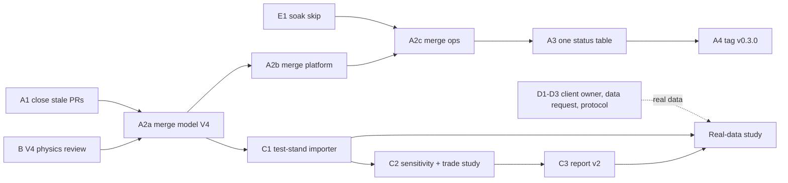

# PhysiCore Drone v0.3 update plan: integrate, qualify, make client-ready

**Date:** 21 October 2026. **Author:** Claude Opus 5.5 (review + planning). **Status:** proposal for the user's decision. It changes no code, gate or evidence status.

**Reviewed sources:**
- `origin/main` @ `802c63a`;
- the open draft stack tip `codex/local-reliability-followup` @ `edf5beb` (PR #19);
- local `main` @ `264056d` with uncommitted `README.md`/`plan.md` edits and an untracked `docs/plans/2026-10-14-next-development-plan.md`, which were left untouched.

---

## 1. Where the project really is (checked today)

### 1.1 Repository state

```
origin/main 802c63a  (last merged work: 5 Oct)
   └─ 9008991..5e8cf06  model V4: conditioning, climb, motor-out, scenarios, geometry links   (no open PR; PR #7 merged before these commits)
       └─ PR #8   10efe4d..60c0ab2  hosted platform: PostgreSQL/S3, OIDC sessions, roles, fenced jobs, packaging
           └─ PR #12  701ec77  baseline reconciliation, submission diagnostics
               └─ PR #16 → #17 → #18 → #19  disk-pressure drill, intake report, bounded soak, storage/CI fixes
PR #9  roadmap proposal (doc)            PR #1, #2, #3  stale (content already on main)
```

- **About 17,300 added lines across 182 files are unmerged**, in a six-deep stack of **10 open draft PRs**.
- Nothing has reached `main` since 5 October.
- The uncommitted 14 Oct plan reviewed the *old* `main`. It proposes "RP1a: qualify measured maps" as the next task, but that work already exists on the stack. The plans and the code have drifted apart.

### 1.2 Checks I ran at the stack tip `edf5beb`

I used an isolated environment built from the branch's own `requirements-test.lock`.

| Check | Result |
|---|---|
| Unit suite (`-m "not backend and not integration"`) | **605 passed, 1 failed**, 5 deselected. The failure is `tests/test_bounded_soak_qa.py::test_namespace_mismatch_fails_before_process_creation`: the code raises "Linux proc monitoring is required" on macOS. It's a portability/skip issue, not a logic error; the branch record says Linux CI passed. |
| Reference suite | **118 passed** |
| Ruff; Node module syntax for all 7 `web/js/*.js` | pass; pass |
| Measured-map probe (ideal CT/CQ scaling, 11 RPM points, 30 seeds) through `drone/conditioning.condition_map` with a stated policy (5 % torque tolerance, 2 % power/torque uncertainty, 10 % max shift) | **0.1 % and 1 % noise: 30/30 accepted** (median conservative power shift 0.27 % at 1 %). **5 % noise: 30/30 refused**, each with an exact reason ("torque relative residual 0.10 exceeds declared tolerance"). The 5 October blocker is resolved on the branch. |

Not run by me: native OpenFOAM, PostgreSQL/S3 integration, browser journeys, release image, GitHub CI. Those rely on the branch's recorded receipts.

### 1.3 What the stack adds (from its receipts and code inventory)

- **Model V4:**
  - retained raw maps plus separately hashed conditioned profiles ([ADR-0005](../decisions/ADR-0005-conditioned-axial-profile.md));
  - varying-torque shaft maps with efficiency applied once;
  - steady axial climb with exactly matching inflow maps;
  - failed-rotor cases;
  - sourced correlated deterministic scenarios and external allowable caps;
  - semantic model identity (UI edits no longer block comparisons);
  - a new local V4 result contract that leaves old records readable.
- **Workbench:** explicit-unit STL preview, numeric rotor/component links, CG and governing-rotor display, constraint comparison, and completed JSON/PDF downloads. Two timed automated journeys and a backup recording exist; human rehearsals don't.
- **Platform:**
  - PostgreSQL and S3-compatible private storage with migrations;
  - OIDC token verification and revocable sessions;
  - organizations and roles, invitations, authenticated review records;
  - durable jobs with leases, fencing, cancellation and retries;
  - backup/restore, packaged resources, locked wheels and provider-neutral deployment inputs.
- **Operations:** baseline reconciliation, submission profiling, disk-pressure (injected ENOSPC) recovery, an aircraft intake report, a bounded soak harness, and artifact-integrity/CI fixes.

### 1.4 Still missing

- **Independent (cross-family) physics review of V4.** The branch records say explicitly that this is pending.
- **Human engineering owner.**
- **Real client data.** The client said it will arrive later.
- **Hosting decisions D01–D03.** The user has said these are their later decision.
- **Rotor-data import from the files clients actually send** (test-stand CSV/Excel logs): today only `rotor_map_v1` JSON is accepted.
- **Input sensitivity** ("what drives the payload?"). The existing "sensitivity" code is slice-visualization only.

---

## 2. Diagnosis

| # | Problem | Consequence | Response in v0.3 |
|---|---|---|---|
| D1 | Integration debt: 17k unmerged lines, 6-deep stacked drafts | Each later fix touches the whole stack; nobody can review a cumulative diff; `main` doesn't show the real product | **Track A**: land the stack in three reviewable groups |
| D2 | Review debt: V4 physics has only same-family review | The plan's own rule (cross-family review before merging physics-critical work) blocks merging | **Track B**: independent V4 review, as the gate for group 1 |
| D3 | Planning divergence: the uncommitted 14 Oct plan, `plan.md` on the stack, and PR #9 each claim to be current | Agents work from stale instructions (the 14 Oct audit repeated already-finished work) | **A3**: one status table on the merged line; fold in the 14 Oct plan's valid cautions |
| D4 | Operations hardening ahead of any customer data or hosting decision | Effort goes to drills nobody needs yet | **Freeze**: no new ops/platform features until D01–D03 or a client dataset arrives |
| D5 | Intake only accepts `rotor_map_v1` JSON | The first real dataset needs hand conversion: slow, error-prone and untraceable | **C1**: test-stand importer with traceable conversion |
| D6 | The client can't see *why* the payload is what it is | A single number invites distrust | **C2/C3**: sensitivity and trade-study views; executive summary |

---

## 3. What v0.3 adds and how

### Track A: integrate the stack (first; mostly mechanical)

| ID | Work | How | Acceptance | Size |
|---|---|---|---|---|
| A1 | Clean up PRs | Close #1, #2, #3 with a comment linking the `main` commits that contain their content. Close #9 as superseded by this plan, or merge its still-valid text in A3. | No stale open drafts | S |
| A2a | **Group 1: model V4** → `main` | New PR from `codex/next-development-plan` (`5e8cf06`) to `main`. Diff `802c63a..5e8cf06`: model, workbench and evidence only. **Merge only after Track B passes.** | Green CI (unit/lint/reference); B1 review PASS; receipts linked | S (merge) |
| A2b | **Group 2: platform** → `main` | Retarget PR #8 base to `main` after A2a, so the diff is the platform only. Standard code review (non-physics). Keep hosted mode off by default. | CI green incl. the integration job; local mode unchanged; the numerical-module closure check shows zero model changes | S |
| A2c | **Group 3: operations** → `main` | Retarget #12 to `main` after A2b, then fold #16–#19 into one PR (they are small, sequential and same-scope). Fix E1 first. | CI green; the soak test skips cleanly off Linux | S |
| A3 | One status table | On the merged line, make `plan.md` §"Active slice status" the only live tracker. Mark the 4 Oct, 5 Oct, 14 Oct (uncommitted) and PR #9 plans as historical, with pointers. Copy into `plan.md` the 14 Oct plan's still-valid cautions: the RP0 protocol, limits on the motor-out idealization and conservatism claims, and shaft-map semantics. | One table answers "what's next / what blocks it" | S |
| A4 | Release `v0.3.0` | `CHANGELOG.md` (Keep-a-Changelog style), git tag on the merge commit, plus short client-facing release notes listing new capabilities and their claim limits | Tag exists; notes reviewed against §13 claim limits | S |

**Merge rule:** use merge commits, not squash, to keep the receipts' commit hashes valid. No force-pushes to `main`. Each group is reviewed on its own diff, never the cumulative one.

### Track B: independent V4 physics review (the gate for A2a)

I'd do this as the cross-family reviewer, read-only, with independent re-derivations that don't import `physimesh`, as in earlier reviews. Scope and method:

| Area | Independent check |
|---|---|
| Map conditioning (ADR-0005) | Re-derive the conservatism argument. The upper sample envelope plus the torque band × RPM convexity is valid *for the model's piecewise-linear interpolation* (it's the product of two increasing affine functions on each interval). Confirm the qualification text says nothing about between-sample physics. Probe policies at the boundaries (tolerance, shift), and check torque-band corners in the yaw balance. |
| Shaft maps | Check efficiency is applied once, and that varying torque is handled consistently with `Q·Ω`. |
| Axial climb | Sign and frame of body-relative inflow; no extrapolation across inflow, density or pitch; energy over the climb duration. |
| Motor-out | Hand-derive a quad certificate and an octo reduced-capacity fixture with a 6-component balance. Check the stopped-rotor idealization is labelled and that windmilling/locked loads are refused or declared. |
| Scenarios and caps | Common-payload rule across scenarios (not the minimum of separate maxima); joint correlated changes; caps applied only where they are in scope; the nominal, scenario and allowable values reported separately. |
| Semantic model identity | The dependency closure includes every physics module and policy resource; historical producer dispatch is intact. |
| Contracts | V4 readers; V1–V3 still readable; no status upgrade path. |

Deliverable: `docs/reviews/2026-10-xx-v4-model-claude.md` with a verdict per area, Critical/High/Medium/Low findings, and fixes applied before A2a. **A human engineering sign-off is still separate and still needed.**

### Track C: client-readiness features (new)

#### C1. Test-stand rotor-data importer (highest value, critical for real data)

**Why:** clients deliver propulsion test-stand logs (CSV/Excel time series), not `rotor_map_v1` JSON. Without an importer, the first real dataset is converted by hand and loses traceability.

**How:**
- **New module `drone/map_import.py`.** Pure functions: `parse_table(bytes, format)` → raw rows; `apply_mapping(rows, mapping)` → typed samples; `steady_steps(samples, policy)` → per-step means and standard deviations; `to_rotor_map(steps, metadata)` → `rotor_map_v1`. CSV first, using the standard-library `csv`. Excel (`.xlsx`) needs `openpyxl`, which is a **new dependency and the user's decision**; until then, ask for a CSV export.
- **Explicit column mapping**, never guessed: the user maps each column to RPM, thrust, torque, voltage, current or electrical power, and declares its unit.
  - Exact factors: kgf → N × 9.80665; gf → N × 0.00980665; lbf → N × 4.4482216152605; ozf → N × 0.27801385095378125; N·m, kgf·cm → N·m × 0.0980665.
  - Electrical power = V·I only when the user explicitly declares that rule; this is recorded in the conversion record.
  - Presets for specific vendor export formats are added only after checking them against a real export file.
- **Steady-step averaging policy** (versioned, reviewed): detect throttle plateaus, discard a declared settling time, and average over the remainder. The per-step standard deviation becomes the measured uncertainty fed to `ConditioningPolicyV1` (rather than a typed-in guess). Steps that are too short or too noisy are refused with reasons.
- **Provenance chain:** raw file bytes (hash) → mapping record (hash) → step table (hash) → `rotor_map_v1` (hash) → conditioned profile (hash). Every link is retained and shown in the report appendix.
- **API:** `POST /api/drone/projects/performance-imports`, with a preview response (no retention until confirmed) and then a confirm. **UI:** a mapping dialog in `web/js/input-editors.js` with column preview, units and the detected-plateau chart.

**Tests:**
- Every unit factor checked against an independent constant.
- Missing or duplicate columns, mixed units, nonmonotonic RPM, negative thrust and NaN rows are refused.
- Synthetic logs (from the existing CT/CQ fixture plus noise and settling transients) reproduce the source curve within the stated uncertainty.
- The round trip import → condition → capacity gives the same result as importing the equivalent JSON.

**Acceptance:** a labelled synthetic test-stand CSV completes the full journey to a capacity report with the complete provenance chain. **Size: M.** Physics-critical parts (averaging and uncertainty policy) get a Track-B-style review.

#### C2. Capacity sensitivity and trade studies ("what drives the payload?")

**How:** reuse the existing deterministic scenario engine (`drone/scenarios.py`).
- **Sensitivity:** the user chooses inputs and declared ± steps: empty mass, pack Wh/kg, usable fraction, a map power scale through conditioning uncertainty, payload CG offset, and a density scenario only where map coverage exists. The new `projects/sensitivity.py` creates one full re-evaluation per step (bounded count) and reports Δpayload and any change of governing constraint for each. Display as a tornado chart in `study-view.js`, labelled "deterministic one-at-a-time sensitivity, not a probability". Inputs that change the active constraint are flagged.
- **Trade study:** select 2–8 frozen revisions (for example propeller or pack options) → one table with payload, governing case and constraint, energy margin and power margin, sorted. It reuses `compare`; it never extrapolates between designs.

**Acceptance:**
- An analytic fixture where d(payload)/d(empty mass) = −1 exactly (energy-limited hover with pack energy fixed) is reproduced.
- The pack-Wh/kg sensitivity matches a hand derivation.
- Constraint switching is shown, for example on the shifted-CG fixture from the 5 Oct review.
- Bounded runtime; unsupported or unresolved steps are shown, never dropped.

**Size: M.**

#### C3. Report v2: executive summary plus engineering appendix

**How:** extend `projects/reports.py`:
- **Page 1** for the client: design and revision; headline payload with exact scope wording; governing case and constraint; top-3 sensitivities from C2; what's validated vs not; and approval status.
- **Following pages:** the existing engineering detail plus the C1 provenance chain.
- Same source-bound identity; fixture labels on every page.

**Acceptance:** every rendered page is checked visually (clipping, units, contrast), and UI/API/JSON/PDF numbers agree in an automated test.

**Size: S–M.**

### Track D: real-data readiness (external, start now)

| ID | Work | Owner | Acceptance |
|---|---|---|---|
| D1 | Name the client engineering owner and agree the pilot claim (map-based payload capacity for declared cases) | User + client | Recorded as ADR-0006 |
| D2 | Send the [data request](../client/aircraft-data-request.md) plus "raw test-stand logs in CSV, with stand model, prop/motor/ESC, voltage, ambient conditions" | User | Sent date recorded |
| D3 | Validation protocol template (`docs/client/validation-protocol.md`): quantities, conditions, calibration vs held-out points, tolerances owned by the client engineer, and preregistration before results | Engineering drafts; client engineer approves | Approved before any real comparison |

### Track E: housekeeping (small, do alongside)

| ID | Work | Acceptance |
|---|---|---|
| E1 | Skip or mark the Linux-only soak test off Linux (`pytest.mark.skipif(sys.platform != "linux")` or a `linux_only` marker) | 606/606 on macOS; still runs in Linux CI |
| E2 | Resolve the Starlette/httpx `TestClient` deprecation with a deliberate locked dependency update; run all suites | Warning gone; no assertion weakened |
| E3 | `README.md` quickstart refresh: a single command for the local workbench and the realistic fixture; a link to the release notes | A fresh clone reaches a capacity result by following the README |
| E4 | Remove the merged-but-reused branch pattern: after A2a, delete `codex/next-development-plan` and open new branches per change | No commits land on branches of already-merged PRs |

### Track F: hosting (frozen until decided)

The platform code is ready but not activated. **No new platform features in v0.3.** When D01–D03 are decided:
1. provision staging from the existing provider-neutral inputs;
2. connect the selected OIDC provider (browser PKCE is still a follow-on);
3. run the existing restore and worker-failure drills on staging;
4. run an invited-client dry run with fixture data only.

Estimate after the provider is chosen.

---

## 4. Explicitly not in v0.3

- **Forward flight / edgewise maps, BEM, aircraft CFD:** only when the client's required cases show they govern, and with suitable data.
- **Frontend framework migration:** the plain JS workbench works; no observed limitation justifies it.
- **New operations drills or soak extensions:** frozen until hosting or a real workload exists.
- **Probability or confidence intervals:** deterministic scenarios only until reviewed distributions exist.

---

## 5. Sequence and sizes



| Order | Items | Size | Gate |
|---|---|---|---|
| 1 | A1, E1, D1/D2 (user) | S | none |
| 2 | **B** (V4 review) | M | report with verdict |
| 3 | A2a → A2b → A2c, A3, A4 | S each | CI green per group; B PASS for A2a |
| 4 | **C1** importer | M | labelled CSV completes the journey with full provenance |
| 5 | C2, C3, E2, E3 | M, S–M, S, S | analytic sensitivity fixtures; rendered PDF check |
| 6 | D3 protocol, then real-data study when data arrives | S + external | client engineer approves the protocol |

Size buckets (from `plan.md`): S ≈ 1–3 engineering days, M ≈ 4–8. They exclude review waiting time and client lead time. Re-estimate after B (review findings may add fixes) and after the first real data file arrives.

---

## 6. Ways of working for v0.3

1. **No new stacked branches deeper than two.** Merge each group before starting dependent work.
2. **One live status table** (`plan.md`). A plan document is either "active" or "historical", stated at its top.
3. **Cross-family review** for physics-critical changes (B, C1 averaging policy, C2 aggregation); standard code review for the rest.
4. **Claim discipline unchanged:** fixture labels everywhere; no aircraft capacity claim before the real-data study and human sign-off.

---

## 7. Decisions needed from the user

| ID | Decision | Recommendation |
|---|---|---|
| U1 | Approve the three-group merge plan (A2a/b/c) with B as the gate for model V4 | Yes |
| U2 | Authorize me to run the B review now | Yes, it unblocks the merge |
| U3 | Approve C1 (CSV first; `openpyxl` for Excel only if approved) | Yes, CSV first |
| U4 | Freeze new platform/ops work until hosting is decided | Yes |
| U5 | Name the client engineer and send the data request (D1/D2) | Yes, longest lead time |
| U6 | What happens to the uncommitted 14 Oct plan and `README`/`plan.md` edits on local `main`: fold the valid content in (A3) or discard | Fold in; the author should confirm |
