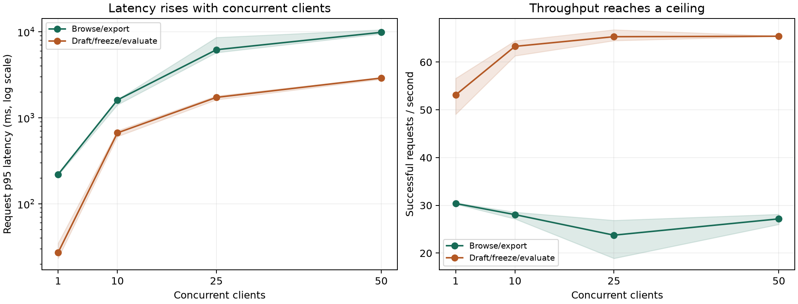

# Performance baseline — 5 October 2026

Application source measured: `ec51c2baa253dc6bdf9fc9b2d1cf645eb190ac53` on GitHub `main`. The checkout was clean and matched the remote branch before this audit. Saved projects, hover/mission studies, retained comparisons and PDF reports were already committed. This audit changes only benchmark tooling and documentation; no application optimization was applied.

During the audit, main advanced to `264056d7f1520fc368f1b9e050382ace5c4d6c78` with a planning document only. That update was fast-forwarded locally and preserved; application source, web assets, tests, dependency files and existing scripts remained identical to the measured commit.

## Baseline and measurement conditions

Cloud Linux VM: Intel(R) Xeon(R) Platinum 8370C CPU @ 2.80GHz; 5 visible CPUs, CPU quota `400000 100000` (four cores), 32 GiB memory limit. Python 3.11.16, locked dependencies, one Uvicorn process with default access logging, thread pool and numerical-library settings. HTTP uses loopback and measures the full response body. The load generator averaged 8.9% of one CPU core, leaving it well below saturation.

Five process-cold startup runs used separate new SQLite directories; OS caches were not flushed. For each workload/concurrency pair, three 15-second measured windows used a new API process and the same 50 seeded synthetic hover projects. Concurrency order rotated between repeats. Requests already in flight were allowed to finish; throughput includes that drain time. Closed-loop clients have zero think time. Reported request percentiles are pooled raw samples from all three runs, including failed requests; throughput counts successful requests only. CPU 100% means one core. API RAM is the maximum sampled RSS or Linux process high-water mark. Process CPU/RSS were sampled every 100 ms.

Browsing cycles through workbench HTML, JavaScript, project inventory, project detail, input inspection, retained study reads, JSON export and PDF export. Authoring cycles through a unique draft edit, freeze and fresh two-case hover study; each completed workflow consists of three successful API requests. Draft description edits preserve the same physical fixture while forcing a distinct frozen revision and study. The application currently declares single-operator access; these clients stress its existing shared-bearer interface rather than implementing invited users.

### Startup

| Metric | Result |
|---|---:|
| Median startup to first successful health response | 0.849 s |
| Startup range, five runs | 0.816–1.052 s |
| Mean process CPU time during startup | 1.586 CPU-s |
| Peak startup RAM | 85.9 MiB |

### Web/API baseline

| Workload | Clients | Requests | p50 ms | p95 ms | p99 ms | Successful req/s, mean (range) | Mean CPU % | Peak RAM MiB | Failures |
|---|---:|---:|---:|---:|---:|---:|---:|---:|---:|
| browse | 1 | 1376 | 3.5 | 219.9 | 248.1 | 30.39 (30.26–30.55) | 95.6 | 106.0 | 0 |
| browse | 10 | 1294 | 114.2 | 1614.4 | 2434.4 | 28.06 (27.17–28.58) | 106.3 | 135.9 | 0 |
| browse | 25 | 1118 | 232.8 | 6197.3 | 8707.4 | 23.76 (18.90–26.87) | 108.5 | 185.0 | 0 |
| browse | 50 | 1247 | 639.3 | 9867.6 | 11333.5 | 27.17 (26.02–28.14) | 111.4 | 204.8 | 0 |
| author | 1 | 2397 | 19.4 | 27.1 | 39.9 | 53.12 (49.07–56.60) | 78.7 | 94.8 | 0 |
| author | 10 | 2910 | 71.8 | 669.2 | 1608.0 | 63.30 (61.32–64.47) | 107.2 | 103.6 | 0 |
| author | 25 | 3081 | 96.2 | 1729.4 | 3571.5 | 65.32 (64.50–66.78) | 108.9 | 114.2 | 0 |
| author | 50 | 3223 | 270.6 | 2903.8 | 5445.9 | 65.42 (65.39–65.47) | 110.3 | 126.9 | 6 |

Total: **16,646 requests**, **3,868 completed authoring workflows**, **six failed requests**. At 50 authoring clients, each of the three trials recorded one `sqlite3.OperationalError: database is locked` HTTP 500 at `BEGIN IMMEDIATE`, followed by one HTTP transport `ReadError`. No failure retries, timeout increases or configuration changes were used to hide them. The database-lock exception escaped the route error handler. All browsing trials and authoring trials at 1, 10 and 25 clients had zero failed requests.

Selected endpoint medians make the cost visible independently of the mixed workload:

| Endpoint | Median at 1 client, ms | Median at 50 clients, ms |
|---|---:|---:|
| `pdf_export` | 217.05 | 9401.11 |
| `inventory` | 7.66 | 999.17 |
| `draft_save` | 10.58 | 254.95 |
| `freeze` | 19.36 | 274.70 |
| `study_evaluate` | 23.32 | 275.81 |



Bands show the range across three runs. The low-throughput 25-client browsing repeat is retained rather than discarded. These are brief baseline load windows, not an endurance or production capacity certification. Same-host loopback excludes Internet delay, TLS/CDN behavior and browser rendering/WebGL frame time.

### OpenFOAM baseline

Pinned image: `opencfd/openfoam-run@sha256:4229997e74defb81548222d511b8e3b95b98305e5df41b8e88b031813fe47eeb`. The existing stage runner, fixed sphere Re=100 geometry, laminar model, original dictionaries and drag-average stopping policy were used. Iteration cap: 3000. Surface refinement stayed fixed; background divisions were 64×32×32 (coarse) and 96×48×48 (medium). Each level executed three times in a fresh case directory, with no retained-result reuse. Container limits remained two CPU cores, 4 GiB RAM, 512 PIDs, read-only root, no network and matched host UID/GID. Runs were serial across cases and isolated from API load/profiling. Python cProfile was disabled for the primary simulation runs.

Each stage reported cgroup v2 `cpu.stat` and `memory.peak` at completion. CPU seconds include the entire stage container; peak memory includes charged file cache and container overhead, and is not process RSS. Host wall time includes container startup, teardown and the runner’s polling/hashing. All six runs passed `checkMesh`; input hashes matched across repeats and the final drag coefficients matched within 1e-10 across repeats at each mesh level.

| Mesh | Cells | Iterations per run | Pipeline wall s, mean (range) | Container CPU-s, mean | Peak container MiB |
|---|---:|---|---:|---:|---:|
| coarse | 80,473 | 812, 812, 812 | 108.12 (104.64–111.57) | 89.99 | 203.8 |
| medium | 251,192 | 812, 812, 812 | 318.79 (316.20–320.43) | 297.69 | 523.9 |

| Mesh | Stage | Mean wall s | Mean container CPU-s | Mean CPU % | Peak container MiB |
|---|---|---:|---:|---:|---:|
| coarse | `blockMesh` | 5.83 | 0.81 | 15.5 | 61.6 |
| coarse | `snappyHexMesh -overwrite` | 13.23 | 9.56 | 72.3 | 122.4 |
| coarse | `checkMesh` | 5.71 | 0.92 | 16.1 | 62.9 |
| coarse | `simpleFoam` | 83.23 | 78.70 | 94.6 | 203.8 |
| medium | `blockMesh` | 7.24 | 1.48 | 21.0 | 198.0 |
| medium | `snappyHexMesh -overwrite` | 34.30 | 29.21 | 85.2 | 337.6 |
| medium | `checkMesh` | 6.52 | 1.84 | 28.6 | 174.4 |
| medium | `simpleFoam` | 270.52 | 265.16 | 98.0 | 523.9 |

These are verification sphere simulations, not aircraft performance predictions. The fine mesh, transient/actuator cases, parallel scaling and three-grid evidence publication were not part of this baseline. The vendor tutorial archive still returns HTTP 403, but these cases use the repository’s retained templates and do not need that download.

## Slowest functions and scaling diagnostics

Function profiles below are separate diagnostic runs: 20 calls for each operation, after initialization. Their times include cProfile overhead and should not replace the HTTP baseline. Cumulative timings are nested and must not be added together. Native CFD internals were not stack-profiled; their measured slowest processes are the solver and meshing stages above.

| Operation | Profiled median ms | Dominant application/native functions, cumulative seconds over 20 calls |
|---|---:|---|
| `pdf_export` | 620.90 | `studies.py:pdf` 12.766s; `reports.py:render_pdf` 12.600s; `doctemplate.py:build` 9.278s; `doctemplate.py:build` 9.276s; `doctemplate.py:handle_flowable` 8.781s |
| `study_evaluate` | 24.31 | `studies.py:run` 0.486s; `capacity.py:capacity_from_snapshot` 0.318s; `capacity.py:allocation` 0.266s; `trim.py:solve_hover` 0.265s; `_linprog.py:linprog` 0.163s |
| `project_freeze` | 39.80 | `service.py:freeze` 0.822s; `models.py:readiness` 0.540s; `__init__.py:safe_load` 0.523s; `__init__.py:load` 0.523s; `constructor.py:get_single_data` 0.521s |
| `study_export` | 0.63 | `studies.py:export` 0.013s; `sqlite.py:study_digest` 0.004s; `main.py:model_validate_json` 0.004s; `studies.py:_bytes` 0.003s; `sqlite.py:_connection` 0.002s |
| `study_compare` | 8.71 | `studies.py:compare` 0.175s; `studies.py:report_inputs` 0.155s; `sqlite.py:revision` 0.124s; `main.py:model_validate_json` 0.117s; `serialization.py:load_contract` 0.113s |

Inventory scaling used the actual repository listing function and JSON serialization, with three calls at each size. These extra projects have synthetic snapshots and no studies; growing revision/study histories can add more payload. This diagnostic excludes HTTP serialization overhead and cProfile makes it conservative relative to the uninstrumented function.

| Projects | Median list + JSON ms | Response bytes | SQL execute calls, three lists |
|---:|---:|---:|---:|
| 1 | 0.28 | 8,054 | 12 |
| 100 | 4.63 | 718,370 | 606 |
| 500 | 40.13 | 3,588,770 | 3,006 |
| 1,000 | 48.89 | 7,176,770 | 6,006 |

The changed-mass study comparison and JSON/PDF SHA-256 bindings also passed during diagnostics. The earlier onboarding checks passed 490 application tests, 118 reference tests and Ruff against this same application commit. No application source was changed for this audit.

## Top five bottlenecks and proposed fixes

The following are proposals only. Priority combines measured user impact and failure severity.

1. **SQLite writer contention causes failures and multi-second tails.** All three 50-client authoring trials hit the 10-second write-lock deadline. `SQLiteProjects._connection` starts `BEGIN IMMEDIATE` for every write, and save/freeze/study operations contend on one SQLite file. Propose a bounded fair write queue for the local mode, shorter transaction work, and an explicit retryable busy response rather than an uncaught 500. For the planned hosted multi-user workflow, evaluate PostgreSQL with a bounded connection pool. WAL may improve read/write overlap but does not permit concurrent SQLite writers. Preserve optimistic version checks and durability.

2. **PDF export renders the whole evidence document on every request.** `LocalStudies.pdf` always calls `render_pdf`, even when identical deterministic bytes are already retained. ReportLab paragraph/layout work occupies Python CPU, while browsing throughput stays near one-process capacity and p95 grows into seconds. Propose verified reuse keyed by study JSON hash, frozen-input hash, renderer version/source hash and ReportLab version, plus a bounded process queue for first rendering. Preserve receipt association, hash validation and identical exported bytes.

3. **Authoring repeats schema parsing and numerical work synchronously.** In the freeze profile, `readiness` consumed 0.540 of 0.822 cumulative seconds, including 0.523 seconds repeatedly parsing the same YAML manifest. Twenty study evaluations invoked 80 `solve_hover`/`linprog` calls; `LocalStudies.run` recomputes a result even for an already retained identical revision. Propose caching the immutable parsed manifest against its source hash with development reload invalidation, avoiding duplicate parsing within an operation, and verified reuse of an identical revision/source-map/model/schema result. For new expensive solves, evaluate bounded process workers and recoverable jobs after storage contention is fixed. Preserve independent candidate checks, corruption refusals and all unknown-input semantics.

4. **Project inventory is unbounded and performs two extra queries per project.** `list_projects` calls `_view` for every row, fetching revisions and studies separately and returning each complete snapshot. The scaling table measures the resulting query/payload growth. Propose a paginated lightweight inventory, batched summary queries and separate detail endpoints for snapshots/history. Rebenchmark both many-project and long-history datasets.

5. **CFD wall time is dominated by serial solving, with repeated container overhead.** `simpleFoam` uses roughly one core; a two-core quota alone does not enable domain decomposition. Four fresh containers also introduce overhead, visible in wall-versus-CPU stage timings. Propose separately benchmarking supported `decomposePar`/MPI/reconstruction at representative mesh sizes, and a single hardened pipeline container with stage-specific logging/cancellation and resource accounting. Reuse a mesh only when geometry and all meshing inputs are hash-identical. Accept changes only after comparing numerical outputs and retained provenance; do not relax mesh or convergence checks to improve timings.

## Evidence and reproduction

- [Machine-readable runs, aggregates, profiles and evidence hashes](performance-baseline-2026-10-05.json)
- [Reproducible benchmark harness](../../scripts/benchmark_baseline.py)
- Raw timings, resource samples, exception logs, profiler files and native case outputs remain in `.backend/performance-2026-10-05/` in this cloud environment. They are excluded from Git; the committed JSON includes SHA-256 receipts for key raw files.

Run phases sequentially against the unchanged application; use a new output directory for each audit to avoid mixing earlier state:

```bash
cd /workspace/Drone-Project
export MPLCONFIGDIR=/workspace/.cache/matplotlib XDG_CACHE_HOME=/workspace/.cache
.venv/bin/python scripts/benchmark_baseline.py api --output .backend/performance-new --seconds 15 --repeats 3
.venv/bin/python scripts/benchmark_baseline.py simulations --output .backend/performance-new --levels coarse,medium --iterations 3000 --repeats 3
.venv/bin/python scripts/benchmark_baseline.py profiles --output .backend/performance-new
```

The harness generates runtime session tokens without printing or recording them, uses isolated synthetic data, and stops only API processes it starts. A newly running workbench session uses the normal saved cloud startup instructions; benchmark processes do not survive publication.
