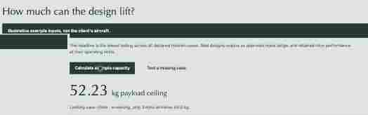

# Results-page QA, 2026-10-02

Tested at http://127.0.0.1:8766/web/results.html against the local retained
three-mesh sphere package acd1b8716144aeaa. No aircraft data supplied.

## Browser checks

- Connect loads authenticated retained results, plots, native surface and examples.
- Native face-constant pressure and shear views switch with explicit ranges and
  true extrema. Pointer drag changes orbit; reset restores the camera.
- Coarse/medium/fine gallery selector changes the retained contour group.
- Generated sphere STL imports: 20,480 triangles, one shell, no topology issue
  groups, SI area 3.14065 m²; preview renders. Missing roles/rotors remain explicit.
- Missing-input readiness lists absent ledger categories, atmosphere and rotors.
- Calculate returns 52.23 kg for the synthetic example, limited by climb. Removing
  climb inputs blocks the headline. No 750 kg target remains.
- ZIP preparation succeeds and produces a visible Save evidence ZIP link. API
  tests verify archive bytes, hashes and retained status. In-app browser download
  capture times out for blob links, including explicit link activation. Brave
  activation saved `sphere-acd1b8716144aeaa.zip` in Downloads: 2,576,790 bytes,
  all 33 manifest-listed members match SHA-256, evidence unverified/review pending.
  The UI reports ready rather than claiming file saving.
- Desktop 1280 and phone 390 CSS-pixel layouts have no horizontal document overflow.
  Tables have their own scroll regions; phone columns stack. Screenshot captures
  were visually inspected in browser tooling; a compact actual payload screenshot
  is retained at `docs/qa/images/payload-example.jpg`.
- Browser console has no captured errors or warnings during tested flows.

## Design-law recheck

The full supplied law was checked point by point. The interface is a working
engineering evidence desk, with the native CFD surface as its focal artifact.
No marketing hero, fictitious customers, code-window props, decorative pricing,
quotation cards, logo walls or countdowns are present. No Google font, icon pack,
gradient, glow, glass, shadow, graph-paper backdrop, ornamental rules, pills,
hover lift or opacity-gated entrance is used. Scientific colormaps retain their
field semantics and are separate from the quiet green interface palette.

Headers, controls, tables and captions retain gutters and legible contrast.
Metadata wraps; table values stay aligned; numerical monospace is limited to
hashes and actual structured data. No content intersects a decorative notch.
Canvas overflow contains the geometry only; captions remain outside. Native
controls use labels and visible focus. Tested controls respond; asynchronous
work displays status. Authored interaction is the actual 3D orbit and data-field
switch, rather than decorative movement. Reduced-motion removes smooth scroll
and transitions. The existing brand/type voice is retained for continuity.

## Software checks and release limits

284 unit tests and three pinned backend tests passed before adding the reuse
regression; that additional regression passes. Ruff and JS syntax checks pass.
Backend fixture tests write temporary audit reports rather than overwriting
curated repository evidence. Numeric snapshot hashes survive 1.0 to 1 browser
serialization without changing native-file digest semantics.

Fresh-clone solver reproduction and byte-identical re-publishing after reuse
passed; details are in `docs/qa/fresh_clone_reproduction.md`. Independent physics
review, independent product gate sign-off, two full timed rehearsals and a backup
screen video remain pending. No release tag or main-branch merge is
approved by these implementation checks. Evidence stays unverified.

Final software review identified three spec issues: plot/run binding, hard-coded
iteration captions, and a reuse command that did not rebuild plots. All were
corrected. Plot operators now retain version, source-code hash, library versions,
interpolation method/grid/tolerance and rendering parameters. Diagnostic velocity
eligibility has a named assumption and retained tolerance/version. Native reader
and electrical-power public signatures have explicit types and units. Final unit
suite: 285 passed. GitHub unit, lint and manual pinned-backend checks for 73ee812 passed. Updated plots were regenerated
from the original native records into a new immutable local package root;
previous published packages were preserved.

