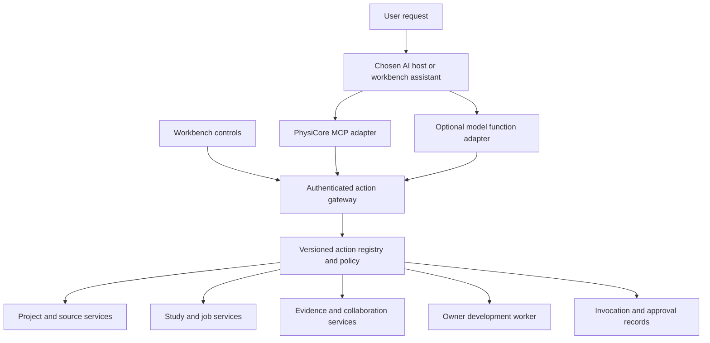

# PhysiCore AI-native foundation and MCP server

Status: FIRST STAGE APPROVED by the owner on 26 October 2026 with “Approve
foundation and MCP first”. This supersedes the earlier two-mode assistant
proposal. Provider activation, later stages, publication and release remain
separate scopes. Application baseline:
`5de743c9fd682fd799b4d7abbdfd13b8e858aa11`.

## Owner requirement

AI must be a foundation of PhysiCore. The owner explicitly wants future LLMs
to control the system from natural-language requests, including project designs
and application development. The owner identified an owned MCP server as a way
to support future AI clients. The earlier assistant-panel proposal was not
approved; this document changes the architecture and delivery order accordingly.

The central product interface is a versioned catalog of domain actions and
project context. The browser, our MCP server and any embedded model adapter use
that same interface. Domain validation, permission and audit rules live beneath
all clients. A chat interface is one consumer of this foundation.

The compatibility target is any MCP-capable AI host, or a model connected through
an explicit function-tool adapter. MCP does not make a raw language model a tool
client, supply the model or ensure that every model plans correctly. Changing
providers must not require rewriting PhysiCore's domain operations.

## Proposed architecture

Keep the domain registry independent of MCP, any LLM SDK, browser state and
prompt wording. The gateway adapts authenticated requests into an explicit
ActionContext. Existing domain services retain the calculations and source
integrity checks. The development worker is a separately enabled adapter.

The first foundation and MCP server need no application-side model API key.
An external AI host supplies its own model. An embedded workbench conversation
can later use a configured provider adapter and usage budget.

## Observed application and design implications

- FastAPI/Python and native JavaScript already expose projects, geometry,
  source import/library, inspection, revisions, studies, comparisons, reports,
  hosted jobs and collaboration. The route/service inventory is recorded in
  [the capability map](../../architecture/ai-capability-map.md).
- There is no existing AI action registry, MCP server or model integration in
  the inspected source. Existing HTTP endpoints are not evidence that an MCP
  operation is implemented or qualified.
- Some authoring, source-binding and geometry-attachment steps currently live
  in browser helpers. Extract authoritative operations into typed domain
  handlers and test existing behavior before migrating those controls. Merely
  wrapping an endpoint cannot supply missing domain commands.
- Saves already use canonical snapshots, source integrity and optimistic draft
  versions. Preserve these contracts and extend them narrowly for transactional
  action receipts, instead of replacing them with model-generated persistence.
- Hosted authorization currently derives project write access partly from HTTP
  methods. MCP carries both reads and writes as calls, so the gateway needs
  explicit action-level authorization. A POST must not imply either permission
  or denial for every action. Unknown/unclassified actions fail closed.
- Some apparent reads have effects: job detail may materialize an accepted
  publication; PDF/review-pack retrieval may prepare or queue artifacts. Record
  those effects explicitly in the action descriptor. Do not infer purity from
  GET or from a tool annotation.
- The shared local access token is one workspace permission, not owner identity.
  Development capabilities require separate operator authorization.
- Docker availability was observed; sandbox isolation has not been qualified.
  No model credentials were read or transmitted for this design.

## Alternatives and decision

| Approach | Result | Tradeoff |
| --- | --- | --- |
| Shared action foundation with MCP and optional model adapters, recommended | One product contract serves AI clients and the workbench | Requires a deliberate registry, policy and compatibility migration |
| Put control logic in one model-specific assistant | Early chat demonstration | Each future client would inherit model-specific orchestration and duplicated rules |
| Automatically expose every HTTP endpoint as a tool | Broad initial tool list | Misses domain semantics, ownership, effects and operations requiring human authority |

Use the shared foundation. Add domain tools intentionally and track coverage of
the whole shipped product. Do not label planned adapters as available tools.

## Action contract

Each action has a stable domain ID, independent contract version and a typed
input/output schema. Its descriptor also declares:

- User-facing purpose, required parameters, units and supported model regime.
- Target resource extraction, required project/organization/operator capability,
  applicable server modes and prerequisite actions or retained source records.
- Effects: pure read, read with materialization, proposal, draft change, artifact
  retention, job submission/recovery, collaboration, code branch or release.
- Expected draft/revision/base commit, conflict behavior, idempotency support,
  quotas/timeouts and whether a human approval receipt is required.
- Result/evidence type, immutable resource references, undo or compensation
  behavior, availability and a precise unavailable reason.

Schemas are derived from server-owned types and exported to REST/MCP/model
adapters. Validate semantics on the server even when a provider enforces schema
shape. Avoid a generic arbitrary JSON/shell executor. A future feature is complete
only when its domain action/resource, policy, agent discovery and relevant
contract tests accompany its browser interface, or its exclusion is explicit.

ActionContext contains verified actor/grant identity, target scopes, request ID,
approved intent/receipt, finite execution limits and correlation IDs. A model
cannot supply its own role, owner identity or approval by adding arguments.
Every invocation resolves authorization again; a previous tool-list response is
not a capability grant.

Preserve existing HTTP contracts as compatibility adapters during migration.
Human-only actions, including advanced manual snapshot saving, can share core
validation while remaining unavailable to an AI grant. Client-declared transport
or role labels cannot unlock these actions.

## Product coverage and build order

The target catalog covers the complete product: workspace discovery, design
authoring, geometry, rotor-source workflows, mission/battery configuration,
inspection, revisions, analysis, jobs, comparisons, exports, collaboration,
owner development and operational metadata. Existing scientific/human-review
boundaries remain part of the contract. See the capability map for adapters,
existing source references and excluded legacy routes.

Deliver in bounded stages with visible coverage:

1. **Foundation and real MCP server:** action schemas/registry, policy gateway,
   scoped client grants, invocation/approval records and a stdio MCP adapter.
   Complete an actual saved-project flow: discover/read/inspect, propose/edit/
   apply/undo, freeze, run the existing eligible study, inspect recorded results,
   compare studies and export exact evidence. Hosted jobs retain existing rules.
   Migrate the corresponding workbench operations to the same action handlers.
2. **Remaining domain adapters:** geometry upload/binding, tabular preview/import,
   source reuse/binding/conditioning, all supported authoring groups and report/
   collaboration preparation. Expose every completed adapter through MCP and the
   same policy. Authentication and final human scientific acceptance stay in
   explicit trusted interaction flows.
3. **Embedded conversation:** a natural-language workbench client of the registry,
   with a replaceable model adapter. Context is selected/scoped; provider settings
   stay server-side. This stage adds conversation, not a second domain engine.
4. **Owner development:** isolated code actions, named checks, patch evidence and
   review branches. Broader source areas require approved scopes. Promotion to
   main, publication, deployment and restart remain explicit release actions.
5. **Hosted MCP endpoint:** Streamable HTTP with standards-conforming resource
   authorization, discovery, issuer/audience checks and operational qualification.
   A separate transport adapter must reuse the same action policy.

Approval of the first stage authorizes implementation of the foundation and its
listed complete flow. Later stages remain architectural direction until scoped
for implementation. None of them is a promise of unrestricted model authority.

## MCP adapter

Use the official Python MCP SDK as an optional, locked dependency. Current
official documentation describes the stable 2.x line and protocol 2026-07-28;
resolve and pin the actual release at implementation. Use SDK protocol handling,
including supported legacy-client compatibility, instead of hand-written framing
or assumptions from older initialization/session examples.

The first server is launched by an MCP host over stdio. It connects to the
PhysiCore action API using an explicitly configured HTTPS endpoint or loopback
HTTP endpoint and a scoped grant credential. This lets a client on another
machine operate the application API while its MCP subprocess remains local to
that client. Credentials come from protected configuration/environment, never
tool arguments or model-visible messages. Protocol output is stdout; bounded
diagnostics go to stderr with secrets removed. Redirects cannot forward a grant
to a different origin, and arbitrary URLs are not model tools.

Expose:

- **Tools:** typed domain actions such as `physicore_projects_list`,
  `physicore_design_propose`, `physicore_proposal_apply` and
  `physicore_study_run`. Return only implemented, currently authorized tools.
- **Resources:** scoped JSON schemas, project snapshots, immutable revisions,
  study evidence and action receipts under explicit `physicore://` URIs.
  Resolve ownership on every read, including direct resource URI requests.
- **Prompts:** optional versioned workflow templates such as reviewing a design
  or comparing retained studies. Templates cannot grant permissions or approval.

Use structured results with schema version, exact resource/version binding,
status, reasons, recorded data and action/job references. Supply bounded text
fallbacks for clients that need them. Pagination and discovery are deterministic
for the requesting authorization; the last selected project or last tool call
cannot silently change another client's tool set. Advertise only implemented SDK
capabilities. Treat MCP annotations as descriptive hints, not enforcement.

Use ordinary job IDs and explicit status tools for asynchronous domain work.
Do not depend on an experimental MCP tasks extension. Local and hosted study
results remain accurately distinguished. Closing an MCP request does not prove
an admitted solver job was cancelled; cancellation uses the authorized job action.

The first release is a real stdio MCP server, not a claimed deployed HTTP MCP
endpoint. The later HTTP endpoint follows the protocol's authorization profile.
Do not implement an incomplete home-grown OAuth flow or forward a client token
unvalidated to other services.

## Authorization and useful autonomy

Users create revocable AI-client grants from a trusted application flow. Grants
can only reduce their current authority: select projects, action groups, expiry
and finite execution/compute limits. Default grants permit reads and proposals.
They contain no provider key, cannot grant development from a shared workspace
token and are stored as hashes. Default lifetime is one hour, with a 24-hour
server maximum and no automatic renewal in the first release.

Agent grants and the gateway are disabled in unauthenticated public-access mode
until an authenticated profile is configured. Existing manual demo behavior is
not evidence of authority to issue a privileged AI credential.

Distinguish the application's browser session, an AI-client grant, a provider
credential and an owner/operator capability. A grant is audience-bound to the
agent gateway and cannot act as a general workspace credential. Local token
rotation invalidates grants derived from that workspace binding. Hosted grants
also recheck the underlying identity and project membership. Operator grants
expire no later than the operator session and are independently revocable.

AI may read and prepare a plan within its grant. An explicitly approved bounded
plan can authorize a sequence without repeatedly asking for every read or tool
step. In the first stage, mutating approval binds the exact prepared action(s),
arguments, affected resources, base versions, expiry and limits. New facts or
effects outside that binding require a fresh review; the agent cannot approve a
broader plan itself. Open-ended numerical-range delegation is a later feature.

The approval confirmation endpoint is excluded from model tools and requires a
trusted human interaction with normal user/operator authentication and CSRF
protection. Model-provided `approved: true`, an MCP host's unverified user claim
or prose consent stored in a project file is not a confirmation receipt.
Consume approvals atomically with mutations or their durable admission record.

Owner permissions, release decisions, spending and safety-critical changes
retain their existing boundaries. Models may prepare scientific reviews but
cannot impersonate a qualified human reviewer or grant aircraft acceptance.

## Design editing and evidence

Use server-owned field and entity schemas for supported authoring groups, with
explicit units and stable entity IDs. Named mass items, mission cases/segments,
battery declarations and rotor/layout configuration become discoverable commands.
Source binding and geometry attachment use retained, project-authorized records;
they are separate operations, not arbitrary hash/path replacement.

The first-stage edit set is payload mass, mission duration and existing mass/CG
entries, proving the complete protocol and approval flow. The coverage resource
must clearly report the remaining authoring actions as pending. Extend it by
domain adapter rather than adding model-specific edit logic.

Pin proposals to the saved draft version and canonical hash. Preserve explicit
unknowns, reject ambiguous entities and never invent measurements or provenance.
Schema validity, deterministic input readiness, numerical solver outcome and
independent physical qualification remain distinct result fields.

Apply the exact reviewed proposal using existing canonical/source checks plus a
narrow transactional save-and-receipt operation in SQLite and PostgreSQL. Persist
approval consumption, result version and receipt together. Retries return the
same outcome. Undo creates a new draft only when current version/hash still
match the applied result. Frozen revisions and retained results stay immutable.

Browser edits are preserved: ask users to save/discard explicitly before using a
saved-draft proposal. Project/logout/permission/editor changes invalidate stale
actions. Late responses cannot overwrite a new context or unsaved input.

## Owner development adapter

Keep development behind separate operator identity, with an explicitly
configured repository/base commit and an approved task scope. The shared
workbench token and ordinary project grants cannot access source/code tools.
This operator mechanism is required before the development stage is enabled.

Export permitted tracked source to a disposable workspace, excluding credentials,
home directories, original `.git`, `.backend`, `.venv` and live data. Validate
paths, symlinks and bytes independently. Start with authored frontend assets and
associated tests/docs; scientific source, security, dependencies and deployment
require additional scopes. Use named check actions in a pinned non-root container
with no network/host socket, read-only root and finite CPU/memory/process/disk/
time limits. A missing qualified runner disables checks rather than using host
execution.

The agent can prepare changes and recorded checks within its authorized task.
Create a fresh `codex/` review branch through a trusted Git object/ref operation
without host hooks, filters or checkout of untrusted generated code. Never
overwrite/delete an existing branch. Show the exact patch, check outcomes and
limitations for release review. Any future live preview needs a separate
credential-free origin. A code patch cannot silently replace the running app.

## History, recovery and boundaries

Every state-changing invocation has a request ID bound to actor/action/arguments,
an admission/approval record and a terminal receipt or explicit uncertain state.
Record user-visible action inputs/results, version references and failures with
appropriate project/operator access. Do not collect hidden chain of thought,
provider credentials or model-provider history that the application cannot see.
Externally supplied model/client names are labels, not trusted actor identities.

Prevent duplicate admission with transactional uniqueness, including job submits.
Object retention is content-addressed and permission-bound; incomplete metadata
commit cannot falsely claim success. Reconcile known receipts after restart;
never automatically replay an uncertain mutation. Preserve existing jobs rather
than introducing a second solver queue. Read/materialization effects stay honest.

Enforce per-grant quotas, request byte limits, finite timeouts and bounded results.
First-stage bulk operations are limited to 25 entities and source/schema/resource
responses to 256 KiB; exports use authorized artifact handles instead of inlining
unlimited data. Existing stricter source/upload/compute limits still apply. No
paid model call or expensive new solver run is part of foundation qualification.

## Acceptance for the foundation stage

- Real SDK client discovers implemented tools/resources/prompts from our stdio
  server and exercises the full saved-project flow through the action API.
- Demonstrate server schema/units discovery, a reviewable edit, refusal of fake
  approval, one approved application, duplicate-safe retry and safe undo.
- The same action handler produces equivalent UI/API and MCP outcomes with
  identical permission, validation, provenance and conflict behavior.
- Verify grant expiry/revocation/token rotation, no authority escalation,
  cross-project denial, viewer reads, unauthorized writes, direct resource URI
  denial and no operator-code access with a project credential.
- Exercise two independent client contexts and supported current/legacy protocol
  paths. A model-provider fixture tests only an optional adapter, not model quality.
- Validate local/hosted result differences, existing accepted-publication
  materialization, queued report effects, failure/restart/cancellation and no
  duplicate study admission after retry.
- Package/lock/schema migrations and existing workflow regressions pass. New
  connection, approval and action-history controls receive real browser and full
  owner interface-law review. Record what was actually tested and its limits.

The acceptance evidence establishes functioning agent interfaces. It does not
establish that every LLM is reliable, all product actions are already migrated,
HTTP MCP is deployed, physical science is qualified or unattended operation is
production-ready.

## Official sources

Accessed 26 October 2026:

- [MCP architecture](https://modelcontextprotocol.io/docs/learn/architecture):
  protocol scope, host/client/server roles and tools/resources/prompts.
- [MCP transports](https://modelcontextprotocol.io/specification/2026-07-28/basic/transports):
  standard stdio and Streamable HTTP bindings.
- [MCP tools](https://modelcontextprotocol.io/specification/2026-07-28/server/tools)
  and [resources](https://modelcontextprotocol.io/specification/2026-07-28/server/resources):
  discovery, structured contracts, pagination and authorization-dependent results.
- [MCP authorization](https://modelcontextprotocol.io/specification/2026-07-28/basic/authorization):
  transport authorization and token audience/security requirements.
- [Official Python SDK](https://py.sdk.modelcontextprotocol.io/) and
  [releases](https://github.com/modelcontextprotocol/python-sdk/releases):
  stable 2.x line, current/legacy protocol support and Python compatibility.

These establish integration patterns. The product action/grant/approval design
above is our proposal and still needs implementation and verification.
