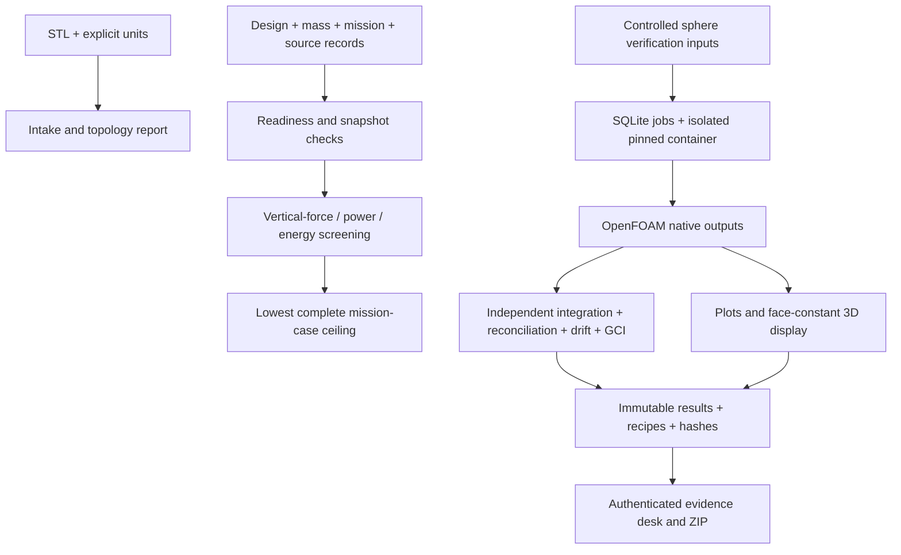

# PhysiCore Drone MVP: code, backend and physics guide

Version: 2026-10-02. Implementation branch: `mvp/3day`.
Repository: https://github.com/PhysiCoreEngine12/Drone-Project/tree/mvp/3day

## 1. What the software does today

The MVP connects STL intake, a controlled OpenFOAM verification study, native
load integration, numerical checks, plots, evidence packaging and a browser
results desk. A separate payload screening endpoint calculates a vertical-force
ceiling from a declared aircraft mass ledger and retained rotor/body performance
at supplied operating limits. The headline is the lowest ceiling across every
declared mission case. There is no fixed 750 kg target.

Two examples are deliberately separate:

- A stationary sphere at Reynolds number 100 checks the CFD/post-processing chain.
- A synthetic four-rotor aircraft demonstrates mission-case payload screening.
  Its inputs are illustrative; its output is not a result for a client aircraft.

The current solver automation is a stationary, incompressible, laminar sphere
profile. Importing another STL does not automatically configure an aircraft CFD
study. No real aircraft geometry or rotor performance has been supplied. The
sphere evidence remains `unverified` pending independent physics review.

The payload endpoint needs force and power records. It does not infer maximum
thrust, aircraft mass or motor limits from the appearance of a CAD model. A
snapshot hash binds a caller's approval assertion to exact inputs; it does not
prove that an engineer approved them or that their physics is valid.

## 2. Architecture and ownership

The browser is a presentation and interaction layer. Python validates inputs,
performs screening and post-processing, and controls execution. OpenFOAM solves
the flow equations. Files and SQLite retain evidence.

| Layer | Main files | Responsibility |
|---|---|---|
| Browser | `web/results.html`, `web/js/results.js`, `web/css/results.css` | Authenticated record selection, tables, galleries, import and screening controls |
| 3D display | `web/js/viewer3d.js`, pinned `web/vendor/` | Orbit native display triangles, field colours and STL preview |
| Application | `api/app.py`, `api/settings.py` | FastAPI factory, environment settings and namespace authentication |
| Geometry/domain | `drone/models.py`, schema, units, frames, STL/geometry modules | Explicit units, component metadata, input readiness and geometry checks |
| Payload screening | `drone/screening.py`, `api/screening.py` | Source-bound mission inputs, power/energy gates and minimum payload ceiling |
| Mass/atmosphere/energy | `drone/mass.py`, `atmosphere.py`, `mission.py` | SI calculations and analytical diagnostics |
| Execution | `core/jobs.py`, `core/container.py`, `solver/runner.py` | Durable lifecycle, container isolation and budgets |
| Case generation | `solver/openfoam_cases.py`, vendor-derived templates | Deterministic sphere dictionaries and mesh levels |
| Native reading | `solver/foam_ascii.py` | Native ASCII meshes, fields and function-object tables |
| Results | `postpro/loads3d.py`, `results.py`, `statistics.py` | Unsmoothed face loads, reconciliation, drift and mesh sensitivity |
| Visualisation | field registry, contour rules, recipes, plots | Capability decisions, ranges, masks and reproducible operators |
| Publishing | result contract, `scripts/demo_assemble.py`, `api/results.py` | Immutable package, schema/status checks and authenticated export |

Paths in this table are relative to `src/physimesh/`, except `web/` and `scripts/`.
The retained `reference_impl/` is a separate comparison suite, not the runtime
application. It preserves reference fixtures and equations; passing those tests
does not establish aircraft capability.

## 3. End-to-end execution

1. Upload original STL files with declared units. Preserve their original bytes.
2. Parse ASCII/binary STL, convert lengths to metres and apply declared transforms.
3. Report topology and unresolved component roles; do not infer rotor identity.
4. Validate a project snapshot for the requested purpose. Missing inputs block it.
5. For the verification demo, generate three controlled sphere cases from the
   inspected OpenCFD v2606 templates.
6. Submit jobs with explicit CPU, memory, disk, wall-time and process limits.
7. Run `blockMesh`, `snappyHexMesh -overwrite`, `checkMesh`, then
   `simpleFoam`; retain stage logs and their hashes.
8. Read native geometry, pressure, wall shear, loads, coefficients and sample data.
9. Integrate loads independently, compare with native OpenFOAM output, check
   iteration drift and estimate qualified mesh sensitivity.
10. Generate scientific plots and a native face-constant display surface.
11. Assemble `results.json`, recipes, plots, surface data and a hash manifest.
12. Serve the package through authenticated endpoints. Keep the evidence level
    and qualifications visible in the page and ZIP.

The UI does not calculate aircraft physics. It formats backend results and
computes visual colour interpolation. Visualization interpolation never feeds
surface-load integration or payload screening.

## 4. Inputs, units and coordinate conventions

The project schema is `drone/schema/drone_manifest_v1.yaml`. A project includes
assembly components, transforms, rotor frames/performance declarations, atmosphere,
mass items, mission cases and numerical/model settings. `null` means unknown.
Readiness checks depend on purpose: `screening`, `cfd_run` or `feasibility`.

Length intake accepts metres, millimetres, centimetres, inches and feet. Units are
explicit; bounding-box size is not used to guess them. Internally use metres,
kilograms, seconds, newtons, pascals, watts, joules and kelvin. RPM is declared and
converted to angular speed where needed.

World coordinates use ENU with z upward. Body axes are x forward, y left, z up.
Yaw-pitch-roll follows ZYX:

`R = Rz(yaw) Ry(pitch) Rx(roll)`

For row-wise point arrays, `x_world = x_body Rᵀ + translation`. Polar vectors,
including velocity and force, rotate without translation. Axial vectors,
including moment and angular velocity, use `det(R) R v`; this preserves the sign
convention if a reflection is explicitly involved. Tensors use `R I Rᵀ`.
Rotor angular velocity is `Ω = signed_RPM × 2π/60 × unit_axis`, following the
right-hand rule. Blade-resolved transient comparisons also need phase and
azimuth-zero metadata; the sphere does not have blades.

Geometry intake retains separate original-file, transform and revision hashes.
Welding uses a scale-relative numerical tolerance after SI conversion. It reports
boundary edges, nonmanifold edges, inconsistent winding, duplicates, degenerate
faces, shell count and area. Issue locations are bounded for response size. A
closed mesh is useful evidence about topology; it does not establish a physical
mass, watertight manufacturing assembly, valid meshing domain or valid CFD model.

## 5. Mass ledger and centre of gravity

`drone/mass.py` requires all categories: payload, structure, propulsion, energy,
avionics and other. If a category truly has no mass, declare an explicit zero
item. An omitted category stays unknown. STL volume multiplied by a material
density is not used to invent the mass of a hollow aircraft.

For item masses `m_i` in kg and body-frame positions `x_i` in m:

- Total mass: `m = Σ m_i`.
- Centre of gravity: `x_cg = Σ(m_i x_i)/m`.
- Empty airframe mass for capacity: `m_empty = m_total − m_installed_payload`.
- Inertia about combined CG: `I = Σ[I_i + m_i((d_i·d_i) Identity − d_i d_iᵀ)]`,
  where `d_i = x_i − x_cg`, in kg m².

Masses must be finite and nonnegative, with positive total mass. Positions must
be finite 3-vectors. Declared inertia must be symmetric, positive semidefinite,
and satisfy the principal-moment triangle inequality. Inertia is required only
for purposes that explicitly need it; the vertical screening ceiling does not
solve attitude dynamics or use inertia to establish controllability.

## 6. Atmosphere and rotor diagnostics

`drone/atmosphere.py` implements:

| Quantity | Implemented expression | Units |
|---|---|---|
| Density | `ρ = p_absolute/(R_air T)` | kg/m³ |
| Sound speed | `a = sqrt(γ R_air T)` | m/s |
| Kinematic viscosity | `ν = μ/ρ` | m²/s |
| Chord Reynolds number | `Re_c = ρ V_relative c/μ` | dimensionless |
| Local Mach | `M = V_relative/a` | dimensionless |
| Axial-flight tip screen | `M_tip = sqrt((Ω R)² + V_axial²)/a` | dimensionless |

`R_air = 287.05 J/(kg K)` is the manifest air model. Standard gravity is
`g0 = 9.80665 m/s²`. The ideal-air approximation defaults to γ=1.4. Absolute
pressure and positive Kelvin temperature must be supplied. Viscosity must be
supplied either as positive Pa·s or through the explicitly approved Sutherland law:

`μ(T) = μ_ref (T/T_ref)^(3/2) (T_ref + S)/(T + S)`

The implemented air constants are μ_ref=1.716e−5 Pa·s, T_ref=273.15 K, S=110.4 K.
The optional ISA troposphere helper is limited to 0–11,000 m, with
`T = 288.15 − 0.0065 h` and
`p = 101325 (T/288.15)^[g0/(R_air × 0.0065)]`.
These model choices must not replace a declared measured/nonstandard atmosphere.

`screening_diagnostics.py` only computes the tip estimate when velocity is
explicitly air-relative and lateral flow relative to the rotor axis is numerically
zero. Its named eligibility tolerance is 1e−9 m/s, a numerical assumption recorded
with diagnostic version 1, not a physical operating margin.

The isolated ideal-hover lower-bound diagnostic is:

`A = πR²`, `v_induced = sqrt(T/(2ρA))`, `P_ideal = T v_induced = T^(3/2)/sqrt(2ρA)`.

It is available only for a hover case with zero air-relative velocity and
nonnegative axial thrust. It is not a climb-power model, installed rotor map,
interference correction or actual electrical power prediction. Its idealization
is consistent with rotor momentum theory described in NASA's rotorcraft theory
report: https://ntrs.nasa.gov/api/citations/20160012474/downloads/20160012474.pdf

## 7. Payload capacity: exact implemented logic

`api/screening.py` first validates the project, compares its versioned snapshot
hash with `approved_design_sha256`, and checks that every declared rotor has a
performance point for every mission case. It resolves performance, body-force
and limit hashes in the content-addressed store. Stored JSON must match the
project/case binding and the exact declared quantities. A string that looks like
a SHA-256 is not enough: retained bytes must exist and match that hash.

The case inputs include world force on the aircraft in N, electrical power in W,
per-motor sustained limits, available fleet power, case duration in s, upward
acceleration in m/s², body force and available energy in J. Environment, attitude,
reserve policy and derating must already be represented by the supplied
performance records. The engine does not optimize a rotor map to find a new
operating point.

For each case c:

$$
F_{z,c} = \sum_i F_{\mathrm{rotor},i,z} + F_{\mathrm{body},z}
$$

$$
m_{\mathrm{supported},c} = \frac{F_{z,c}}{g_0 + a_{z,c}}
$$

$$
\Delta m_c = m_{\mathrm{supported},c} - m_{\mathrm{empty}}
$$

$$
m_{\mathrm{payload},c} = \max(0,\Delta m_c)
$$

World z is positive up; a negative body force reduces supported mass. The
acceleration denominator must be positive. Power must satisfy each motor's
sustained limit and `Σ P_electric,i ≤ P_available`. Required case energy is
`E_required,c = (Σ P_electric,i) × duration_c`, and must be no greater than
approved usable energy.

Only after every case is complete and all gates pass is the headline:

$$
m_{\mathrm{headline}} = \min_c m_{\mathrm{payload},c}
$$

The limiting case is selected using the raw margin, preserving evidence that the
empty aircraft cannot be supported. A negative margin yields
`requirement_not_met` and a zero ceiling. Missing, inconsistent, nonfinite,
unsupported or over-limit inputs yield `inputs_incomplete` and a null headline,
with explicit blocking reasons. Passing screening yields `screening_only`.

Mission cases currently represent alternative operating conditions. Their
energies are checked independently, not added as a sequence of segments. A
sequential mission and a trim/control/structural feasibility solve need further
implementation. The reported ceiling assumes the supplied body/rotor loads remain
applicable at that mass; it does not model mass-dependent installed-flow changes.

### Synthetic example arithmetic

The example has four rotors and an empty mass of 65 kg, including its battery.
All force/performance/limit sources are explicitly synthetic.

| Case | Rotor vertical force | Body vertical force | Acceleration | Net force | Payload ceiling |
|---|---:|---:|---:|---:|---:|
| Hover | 4 × 350 N | −40 N | 0 m/s² | 1360 N | `1360/9.80665 − 65 = 73.68 kg` |
| Climb | 4 × 320 N | −60 N | 0.6 m/s² | 1220 N | `1220/10.40665 − 65 = 52.23 kg` |

Hover power is 24 kW for 300 s, requiring 7.20 MJ. Climb power is 22.4 kW for
180 s, requiring 4.032 MJ. The example usable energy is 11.52 MJ, computed from
20 kg × 250 Wh/kg × 3600 J/Wh × 0.8 usable fraction × 0.8 reserve allowance.
Here reserve is a fraction of usable pack energy. The separate battery exercise
below instead multiplies mission energy by `(1 + reserve_fraction)`; these
conventions are distinct. The API accepts the approved usable-energy declaration
and does not derive it from pack mass. Electrical power is also supplied data;
limit and energy checks do not establish its physical validity. Isolated ideal
hover power is a diagnostic, not a general installed-rotor power gate. The
example's acceleration is an instantaneous force margin. The 180 s duration
checks constant-point energy; it does not integrate an accelerating trajectory.
Both cases satisfy the illustrative limits. The headline is **52.23 kg**, limited
by climb. Removing climb data blocks the headline rather than showing hover alone.

## 8. Separate battery-mass fixed-point exercise

`drone/mission.py` provides a separate analytical sizing loop. It does not resize
the four-rotor capacity example in the UI.

Electrical power from shaft powers is:

`P_electric = Σ[P_shaft,i/(η_motor,i η_inverter,i η_drive,i)] + P_aux`.

All efficiencies must be dimensionless and between zero and one, with matched
array lengths; powers must be finite and nonnegative. For a constant-power
segment of duration t:

`E_mission = P_electric(m) t`

`m_battery = E_mission(1 + reserve_fraction)/(e_pack × 3600 × usable_fraction)`

`m_next = m_without_battery + m_battery`.

The code iterates because battery mass changes required power. It starts from
mass without battery and records each proposed mass. Convergence requires
`|m_next − m| ≤ relative_tolerance × m_next`. Explicit iteration and divergence
limits terminate the calculation with `converged`, `max_iterations` or `diverged`.
A converged numerical fixed point is not a validated battery pack: current,
thermal limits, voltage sag, ageing, structure and installed rotor performance
remain separate requirements.

The labelled A/B/C fixtures use an eight-rotor ideal-hover proxy and a different
base aircraft. A and B converge to total masses approximately 1442.15 kg and
3066.91 kg. C crosses its divergence limit; its large final iterate is a numerical
failure diagnostic, not a proposed aircraft mass.

## 9. OpenFOAM model, case and stopping logic

The execution pin is:

`opencfd/openfoam-run@sha256:4229997e74defb81548222d511b8e3b95b98305e5df41b8e88b031813fe47eeb`.

This is OpenCFD v2606. The inspected vendor archive and each copied template have
retained hashes in the backend audit and template `SOURCES.json`. The archive's
observed SHA-256 is
`2a1310e3ed192cc4c521e1d22dcc176f57bec61160c878dc4348f21d6672294d`.
That observed digest provides reproducibility, not independent authentication of
the vendor distribution. The runtime image lacks tutorials, so backend smoke
tests use the verified source archive.

The sphere profile sets diameter D=1 m, inlet U=(1,0,0) m/s, kinematic viscosity
ν=0.01 m²/s and reference density ρ=1 kg/m³. Thus `Re = U D/ν = 100`. Reference
area is `A_ref = πD²/4`. These are verification-case values, not air defaults for
an aircraft. The world domain spans (−10,−10,−10) to (30,10,10) m. The STL is a
fixed, deterministic icosphere. Background resolution changes across three meshes,
while surface refinement levels remain fixed at (4,4).

The configured physical model is steady laminar incompressible flow:

`∇·U = 0`

`(U·∇)U = −∇p_kinematic + ν∇²U`.

OpenFOAM performs finite-volume discretization and SIMPLE pressure/velocity
coupling; Python does not implement a substitute CFD solver. The exact schemes,
linear solvers, relaxation, boundaries and function-object definitions are the
retained generated dictionaries, not hidden frontend settings. The boundary
profile uses fixed inlet velocity, zero-gradient inlet pressure, outlet pressure
reference zero, no-slip sphere and slip outer sides. It has no rotating region,
blade motion, compressibility or turbulence closure.

The runner stops on stage failure, failed `checkMesh`, cancellation, disk budget
or total wall deadline. Its fixed stage strings prevent uploaded filenames from
becoming arbitrary shell commands. The vendor entrypoint changes working
directory, so every stage explicitly re-enters `/case`.

The sphere's vendor-derived drag controller starts at iteration 400. Its exact
running-average window is configured to 400, but v2606 does not require that
window to fill before testing convergence. After the default `nIterStartUp=10`,
it checks `|running mean Cd − current Cd| < 1e−3`, rather than a 400-step range.
The retained logs show the trigger at iteration 412, followed by 400 further
iterations, ending at 812. The default hard cap is 3000. Residual-only
stopping is disabled in this profile. Separate post-processing checks inspect
the last two complete 200-iteration windows. Steady iteration indices are not
physical seconds or accepted time averages.

The original retained study stopped at iteration 812 for each mesh:

| Level | Cells | Wall seconds | Peak container memory | Cd |
|---|---:|---:|---:|---:|
| Coarse | 80,473 | 40.93 | 205,983,744 bytes | 1.1468925753 |
| Medium | 251,192 | 227.63 | 613,011,456 bytes | 1.1249130055 |
| Fine | 804,280 | 653.09 | 2,198,327,296 bytes | 1.1206201832 |

These measurements belong to the original local run group
`acd1b8716144aeaa045019515bdf377018ae4a74ce3a0403cf50c52da007ff6a`.
The clean-clone reproduction at commit `58a9596` completed all three meshes at
iteration 812 with the same cells and Cd values. Its wall times were 58.98 s,
335.89 s and 829.90 s. Its distinct run-group SHA-256 is
`ffb5d252c9b9155fbc0040b13f4aa94f2694fe2973645a8f689651fcac0a8bfc`.
Matching Cd values do not make the execution records identical.

## 10. Native data and load integration

`foam_ascii.py` reads native mesh points, polygon faces, boundary patch ranges,
owner indices, field dimensions and values, raw samples and function-object
tables. It supports retained ASCII/gzip evidence, not every OpenFOAM storage
format. Counts, dimensions, numeric structure and associations are checked.
Unsupported boundary reconstruction is refused. For the sphere pressure's
`zeroGradient` boundary, the reader obtains values from owner cells. A field
name alone never determines its physical units.

The physical conversion rule is:

- Native dimensions `[1 −1 −2 0 0 0 0]`: pressure/stress already in Pa.
- Native dimensions `[0 2 −2 0 0 0 0]`: multiply once by declared density.
- Unsupported dimensions: refuse.
- `p_rgh`: refuse here because hydrostatic reconstruction is required.

OpenCFD documents the distinction between physical and kinematic pressure:
https://doc.openfoam.com/2312/tools/processing/solvers/algorithm-kinematic-pressure/
The exact v2606 conventions were also checked against captured backend output;
the general documentation is not a substitute for that experiment.

Native boundary area vectors point outward from the fluid domain. For solid
loads the code uses `S_solid = −S_fluid`, directed from solid into fluid. The
native wall-shear vector is converted by dimensions and negated once to become
traction acting on the solid. These conventions are documented and independently
reconciled; signs are not changed to make a plot look plausible.

For native face f, area magnitude `A_f = |S_solid,f|`, centre x_f and solid
viscous traction t_v,f:

`F_pressure = Σ[−(p_f − p_ref) S_solid,f]`

`F_viscous = Σ[t_v,f A_f]`

`F_total = F_pressure + F_viscous`

`M_origin = Σ[(x_f − x_origin) × F_f]`.

The sphere uses p_ref=0 Pa and moment origin (0,0,0) m. Integration uses native
polygons and unsmoothed field values. Display triangulation and interpolated
contours never enter the sum. The v2606 forces implementation is inspectable at
https://api.openfoam.com/2606/classFoam_1_1functionObjects_1_1forces.html

Other implemented mathematical helpers in `loads3d.py` are:

- Moment transfer: `M_O = M_A + (x_A − x_O) × F`.
- Rotor thrust: `T = F·axis`.
- Aerodynamic axis torque: `Q_aero = M_rotor_centre·axis`.
- Shaft power into a rotor: `P_shaft = −M_aero·Ω`.
- Reaction to a fluid volume source: `F_aircraft = −Σ(f_volume V_cell)` and
  `M_rotor = −Σ[(x_cell − x_rotor) × (f_volume V_cell)]`.

These helpers are tested building blocks. A configured rotating-blade or
actuator-source aircraft solver is not delivered by having those helpers.
The force ledger forbids counting both rotor source reaction and rotor-wall
traction for the same rotor, and rejects duplicate patch counting. Gravity is
not part of its aerodynamic total.

## 11. Reconciliation, convergence and mesh sensitivity

For pressure force, viscous force, total force, origin moment and Cd, each
component must satisfy:

`|independent − native| ≤ relative_tolerance × |native| + absolute_tolerance`.

The sphere values are relative tolerance 1e−3 and absolute tolerance 1e−6 in
that quantity's units. Every original mesh passes. Exact repeated adjacent final
rows caused by the backend end callback are collapsed; conflicting duplicate
history rows are refused.

The independently integrated drag coefficient is:

`Cd = Fx/(0.5 ρ U_inf² A_ref)`.

The frozen comparison value is Cd_ref=1.09173 from the plan's Schiller–Naumann
sphere correlation at Re=100. The fine result differs by approximately +2.6463%.
The case has not been tuned to erase that discrepancy.

Window statistics use trapezoidal integration, so a mean is time/index weighted:
`mean = integral(f dξ)/Δξ`, and
`RMS_fluctuation = sqrt[integral((f−mean)² dξ)/Δξ]`.
For this steady solve ξ is iteration, not physical time. Last-window drift is
`|mean_last − mean_previous|/max(|mean_last|, absolute_scale)`.
The sphere uses absolute scale 1e−6 and a 0.005 (0.5%) drift threshold. Each
200-iteration interval must have the expected endpoints and 201 samples; a
truncated history cannot pass as complete.

For global integral mesh comparison, effective length is `h = (V/N)^(1/3)`.
Fine is index 1, medium 2, coarse 3. Measured ratios are `r21=h2/h1` and
`r32=h3/h2`, approximately 1.47390 and 1.46145 respectively in the original
study. The result record stores both, rather than assuming the nominal
background refinement factor.

The positive-order model is `f(h)=f0+C h^p`. With `e21=f2−f1` and `e32=f3−f2`,
solve the unequal-ratio relation:

`e32/e21 = r21^p (r32^p − 1)/(r21^p − 1)`.

Then `f_extrapolated = f1 + (f1−f2)/(r21^p−1)` and
`GCI_fine = 1.25 × |(f1−f2)/f1|/(r21^p−1)`.
Oscillation, zero differences or absence of a positive-order fit do not produce
a forced GCI. The method follows the generalized Richardson/GCI procedure in
ASME's numerical-accuracy guidance:
https://www.asme.org/wwwasmeorg/media/resourcefiles/shop/journals/jfenumaccuracy.pdf

The original observed order is 4.32694 and observed-order fine GCI is 0.109894%.
Independent review F1 requires a second estimate using
`p_used = min(p_observed, nominal_order_cap)`, with cap 2 from the retained
sphere schemes and safety factor 1.25. It gives approximately 0.40844% and is
shown first, including in the mesh-chart error bar. Both estimates remain
qualified mesh sensitivity; neither is a proven error bound. The estimator code
hash, selected order, cap, source and safety factor are retained. Fixed surface levels, unusually high observed order and
unproven asymptotic behavior prevent a total-accuracy claim. GCI does not include
geometry, domain extent, boundary, model or experimental uncertainty. A small
GCI does not validate a drone.

## 12. Plots, field semantics and 3D rendering

The immutable field registry declares dimensions, association, frame, derivation,
units and signedness. Supported demo fields include gauge pressure, velocity
magnitude, in-plane velocity, y-vorticity, wall shear, Cd history, solver residuals,
wake-axis Ux and per-mesh Cd.

The fifteen retained plots comprise three speed/pressure/vorticity contours per
mesh, fine vectors, fine in-plane streamlines, wake profile, Cd history, fine
residual history and mesh Cd. Signed pressure and vorticity use shared symmetric
zero-centred diverging ranges. Magnitudes use shared nonnegative ranges. Legends
retain display limits, true extrema, clipped fraction and invalid/masked counts.

The nominal y=0 samples have small native coordinate deviations, up to roughly
9.28e−6 m in the original medium case. The cause is unresolved. The visual
projection explicitly permits 1e−5 D and records the observed deviation. It is
not used for integration. Slice interpolation uses linear SciPy `griddata` on a
180×360 grid; sphere interior and unsupported samples are masked. Vectors show
Ux/Uz, and background colour is |U|. In-plane streamlines are not 3D particle
trajectories or a transient flow prediction.

A recipe retains source and array hashes, field/run identity, plane, units,
colormap, range policy, overrides, caption and renderer version. Operator records
include source-code hash, library versions, grid/tolerance/bounds, figure size,
DPI, shading, vector stride and streamline density. Captions derive actual final
iterations from each retained run, including all mesh times for comparisons.
PNG bytes can vary across rendering environments; operator and array provenance
is distinct from the hash of a particular exported PNG.

`demo_surface.py` triangulates each native fine-sphere polygon around its native
centre for display, repeating one native face value across every triangle vertex.
The viewer therefore does not smooth pressure/shear across neighbouring faces.
It shows gauge pressure or wall-shear magnitude, explicit display ranges and true
extrema. Basic vertex-colour material avoids lighting changing scientific colours.
OrbitControls provides actual drag/zoom/reset interaction with world z up.

Three.js 0.180.0 and required loaders are vendored with the MIT license and file
hashes in `web/vendor/SOURCES.md`; no live CDN is needed. The intake viewer displays
actual imported STL with declared scale. The current browser upload flow uses
identity transforms; assembly authoring controls are not yet implemented.

Capability refusals are generated by the backend rules. The sphere refuses y+
for laminar-wall semantics, a physical mean without an accepted averaging window,
blade pressure without blades, and comparisons with independent colour ranges.
Each refusal includes a practical next action. These are actual capability
results, not decorative warnings.

## 13. Evidence, hashes and status

`ArtifactStore` keeps raw bytes at content-addressed paths. Job events and
metadata connect those bytes to execution. Native-file hashes are ordinary
SHA-256 over exact bytes. Serialized records use deterministic key ordering.
Approved design/case snapshots use the separate versioned scheme
`si_numeric_snapshot_v1`, normalizing JSON numeric 1 and 1.0 while preserving
booleans, strings and null. Nonfinite values and integers outside the browser's
exact range are refused. This avoids an unchanged browser round trip accidentally
changing an approval hash. It does not change native-file hashing.

`results_v1` separates:

- Job execution state, such as completed or failed.
- Numerical status: `numerical_checks_passed` or `diagnostic_only`.
- Independent evidence: currently always `unverified`, with review `pending`.
- Aircraft screening status, returned separately by the screening API.

Pydantic checks the envelope, required ordered meshes, numerical gates and finite
nested values. A failed reconciliation/drift gate cannot be promoted to numerical
success. Results and plots are not promoted to validated evidence on export.
Interpretation uses deterministic templates bound to metric paths, values and
thresholds. It is not an unconstrained language-model summary.

Before publication, assembly checks the run-group hash, each plot's group/run
identity, native source hashes and aggregate recipe source hash, PNG bytes and
surface job/time/source binding. A surface or gallery from another run is refused.
Published package files are created exclusively; a subsequent publish may reuse
exact bytes but cannot silently replace different bytes. An evolved result can
be published into a new explicitly selected data root while preserving the old
package. The group ID is the first 16 characters of the full run-group SHA-256;
the full digest remains in provenance.

Hashes detect accidental mutation and bind stored records. They are not digital
signatures, proof of human approval or protection against an administrator who
changes the entire package and manifest together. Local evidence storage remains
a trusted component.

## 14. API, authentication and frontend behavior

All `/api/drone` endpoints require `Authorization: Bearer <session token>`.
The token is supplied through environment configuration; startup refuses missing
credentials. The local server binds 127.0.0.1. `/api/health` describes the process
and configured pin, not verified CFD capability. A configured pin alone does not
set `workflow_ready` to true.

| Method and path | Behavior |
|---|---|
| `POST /api/drone/import` | Multipart STL files, declared source units and optional transform; retained intake report |
| `POST /api/drone/validate` | Project/purpose readiness; explicit missing or invalid inputs |
| `GET /api/drone/project-template` | Incomplete project template for readiness demonstration |
| `POST /api/drone/screening` | Snapshot/source-bound payload ceiling across mission cases |
| `GET /api/drone/examples/screening` | Explicitly synthetic screening request and separate battery fixtures |
| `GET /api/drone/results` | Published result inventory |
| `GET /api/drone/results/{group_id}` | Checked results contract |
| `GET /api/drone/runs/{id}` | Published group metadata or SQLite job/events |
| `GET /api/drone/plots/{group_id}/{plot_id}.png` | Hash-checked retained PNG |
| `GET /api/drone/surfaces/{group_id}/{surface_id}.json` | Hash-checked native display surface |
| `GET /api/drone/runs/{group_id}/export` | Deterministic-order ZIP with fixed timestamps and retained status |

Result routes restrict identifiers and filenames and check resolved paths stay
inside configured roots. Changed/missing artifacts yield conflict errors rather
than displaying stale evidence. Upload limits default to 50,000,000 total bytes
and 1,000,000 triangles and can be explicitly configured. Uploaded names are
metadata; originals are stored by digest rather than user-specified filesystem
paths.

The browser token stays in memory and a password field, without localStorage or
URL query parameters. Requests use bearer headers; plots become local object
URLs after authenticated fetch. Untrusted strings are inserted with `textContent`
rather than interpreted as HTML. The page displays loading/errors and refuses a
missing-case headline. Phone layouts stack figures and keep wide tables in their
own scroll regions. Controls have labels and visible focus. Content is visible
without an entrance animation.

ZIP preparation and API archive integrity are tested. The Save link was activated
in Brave, and the actual 2,576,790-byte archive was found in Downloads. All 33
manifest-listed members match their SHA-256 values; the exported status remains
`unverified` with review `pending`. Browser-tool download capture timed out, so
the filesystem archive was checked directly. The in-app browser download path
still has that capture limitation. The UI reports ready rather than claiming a
file was saved.

## 15. Jobs, isolation and recovery

SQLite uses WAL mode and short transactional claims. Legal lifecycle:

`queued → preparing → meshing → running → postprocessing → completed`.

Failure and cancellation transitions are allowed from appropriate active states.
A worker cannot claim a job already claimed. Events retain UTC timestamps. Active
jobs whose worker disappears are marked interrupted/failed rather than silently
resumed or treated as completed.

Docker arguments enforce no network, a read-only root filesystem, all Linux
capabilities dropped, PID limit, CPU limit and memory limit. The case directory
is an explicitly writable bind mount and `/tmp` is a writable tmpfs. On the
POSIX host, Docker runs with the caller's numeric UID/GID. The pinned vendor
entrypoint supports this through nss-wrapper. This keeps generated case files
writable on Linux when all capabilities are dropped. Without that mapping, the
manual GitHub backend check reached OpenFOAM but failed to write the runner-owned
case; that portability issue was caught after the local Colima runs. Python polls
wall deadline, case disk size and cancellation, and terminates the process/container
when a gate trips. The driver uses 2 CPU cores, 4 GiB memory, 5 decimal GB disk,
7200 seconds and 512 PIDs for each sphere run. These are demo execution choices,
not aircraft inputs.

`run_record.json` retains generated input hashes, native output hashes and byte
sizes, stage exit codes, log hashes, wall time and observed peak memory. Original
run groups also retain code commit, image digest, case settings, job IDs and
execution metrics. Budget limits and immutable pins are necessary safeguards;
the MVP is not a multi-tenant production service or an arbitrary-code sandbox.

## 16. Reproduction and development workflow

Use Python 3.11, the committed `requirements.lock`, Docker and the pinned image.
The complete literal setup and demo commands are in README.md. Under Colima the
clone and case files must live in a directory shared with the VM. A `/tmp` clone
can produce missing-file errors inside a bind mount even when host files exist.
The fresh-clone check encountered this condition and was rerun under the shared
project directory.

| Script | Input | Output |
|---|---|---|
| `demo_run.py` | Explicit output root, ordered three-mesh set, iteration cap | Three native runs/group/ledger; rebuilds derived loads, plots and surface |
| `demo_loads.py` | Retained run group | Reconciliation/drift/mesh study in `load_results.json` |
| `demo_plots.py` | Group plus load record and native sources | Fifteen PNGs, recipes, index and observations |
| `demo_surface.py` | Completed fine run in group | Face-constant native display `surface.json` |
| `demo_assemble.py` | Group and data root | Immutable checked package under `results/{group_id}` |
| `demo_seed.py` | Data root | Content-addressed synthetic records and screening example |

A repeat of `demo_run.py` verifies identical generated input hashes, backend pin,
iteration cap, selected completed mesh set and every retained output byte hash.
Only then does it reuse CFD runs and rebuild derived artifacts. Different settings,
incomplete groups or tampered evidence are refused. Choose a new output root for
a new study; preserve prior failed evidence rather than overwriting it.

Tests are separated:

- Unit/reference tests check equations, types, missing-input behavior, contracts,
  geometry, source binding, lifecycle, hashes and exported files.
- Backend tests execute the actual pinned container and vendor/tutorial/sphere
  cases; they require verified tutorial configuration and a working shared mount.
- Browser QA checks actual controls, native 3D interaction, import, missing inputs,
  galleries and desktop/phone behavior.
- Independent physics review assesses model suitability, assumptions and evidence.

A GitHub clone at `58a9596` reproduced all three native solves and checks, fifteen
plots and the 39,816-triangle display surface. Repeating the driver verified
generated inputs and every retained output hash, rebuilt derived artifacts and
re-published identical package bytes. Authenticated API checks returned the fresh
package and a 2,577,760-byte ZIP with all 33 listed members matching SHA-256. The
synthetic 52.23 kg result and missing-case refusal also passed in that clone.
See `docs/qa/fresh_clone_reproduction.md` for the record.

The corrected candidate f19cbeb passes 290 unit tests and 118 reference tests;
Ruff and JavaScript syntax pass. The documentation-only follow-up d065729 passes
12 affected tests and Ruff. GitHub unit/lint checks for both commits pass.
The unchanged runtime previously passed three pinned backend tests and the manual
Linux backend workflow on 73ee812. The revised export has 33 hash-verified members
(2,579,327 bytes, SHA-256 `c3fe646f64e44a80d2ecb176aef374fcf475e08ff7b7fda31f8043ed193bf6c7`).
A warning remains about FastAPI/Starlette TestClient's httpx dependency deprecation;
it does not fail the suite. Rendering and reference tests do not certify aircraft
feasibility. Backend fixture tests write temporary audit output so they do not
overwrite curated evidence documents.

## 17. Known limits and next work

The current payload number is a screening ceiling at supplied sustained limits.
To analyze an actual approved design, provide:

1. Original component geometry and explicit units/transforms/roles.
2. Complete mass ledger, CG and uncertainty; inertia for dynamics/feasibility.
3. Rotor axes, radii, operating RPM, performance maps/measurements, sustained
   motor/ESC limits and environmental/installed-flow applicability.
4. Named mission conditions, accelerations, durations and clear alternative-versus-
   sequential mission interpretation.
5. Battery usable energy, reserve policy, power/thermal/current limits and source
   records bound to that snapshot.
6. Body aerodynamic loads applicable to each condition and payload/mass state.

Further work includes assembly/rotor authoring, general aircraft case generation,
validated actuator or blade-resolved rotating models, trim/control feasibility,
structure, installed rotor interference, sequential missions and measured validation.
These are not hidden behind the successful sphere case.

Claude Opus 5.5 independently recomputed the native loads and reviewed the
corrections, issuing PASS for the bounded MVP at f19cbeb. Required F1–F3 and F9
are resolved; low findings remain as recorded in
`docs/qa/independent_physics_review.md`. Claude disclosed prior authorship of the
plans/reference code. This software review does not certify aircraft physics.

For this retained presentation, serve `.backend/demo-reviewed`. Earlier roots
are preserved and share the run-group ID, so cite the data root and ZIP digest
as well as the run-group ID. Fresh README commands generate the corrected
artifacts; do not point them at an already-published obsolete package. Machine
envelopes still say review pending/unverified: this external code-review record
does not upgrade an immutable package's status or its aircraft evidence level.

Release still requires product gate sign-off, two full timed presentation
rehearsals, a playable backup and human approval of final client wording. Native
QuickTime recording controls could not be exposed through available automation;
no backup video is claimed. See `docs/demo/presenter-guide.md` for the concrete
walkthrough and blank actual rehearsal record. No merge or release tag follows
from software tests. Current evidence is in `docs/qa/mvp_gates.md`.

## 18. Reading map and primary references

For a developer new to the project, read:

1. README.md for execution and environment.
2. `drone/models.py` and `drone_manifest_v1.yaml` for the domain/unknown-input model.
3. `api/screening.py` then `drone/screening.py` for source-bound payload logic.
4. `solver/openfoam_cases.py` and `solver/runner.py` for actual CFD execution.
5. `foam_ascii.py`, `postpro/results.py`, `loads3d.py` and `statistics.py` for evidence.
6. `demo_assemble.py`, `api/results.py` and result schema for publishing/export.
7. `web/js/results.js` and `viewer3d.js` for presentation.
8. Tests alongside each module, followed by the recorded audit/validation documents.

The implementation and formulas are documented from the code above and the
retained manifest/plan. Primary external references used to check conventions:

- OpenCFD v2606 release: https://www.openfoam.com/news/main-news/openfoam-v2606
- Exact vendor archive: https://dl.openfoam.com/source/v2606/OpenFOAM-v2606.tgz
- OpenCFD kinematic pressure: https://doc.openfoam.com/2312/tools/processing/solvers/algorithm-kinematic-pressure/
- v2606 force object source/API: https://api.openfoam.com/2606/classFoam_1_1functionObjects_1_1forces.html
- ASME numerical accuracy and GCI procedure: https://www.asme.org/wwwasmeorg/media/resourcefiles/shop/journals/jfenumaccuracy.pdf
- NASA NDARC rotorcraft theory: https://ntrs.nasa.gov/api/citations/20160012474/downloads/20160012474.pdf

The repository audits contain exact local source/file hashes and observed backend
sign conventions. External documentation does not expand the implemented scope.
