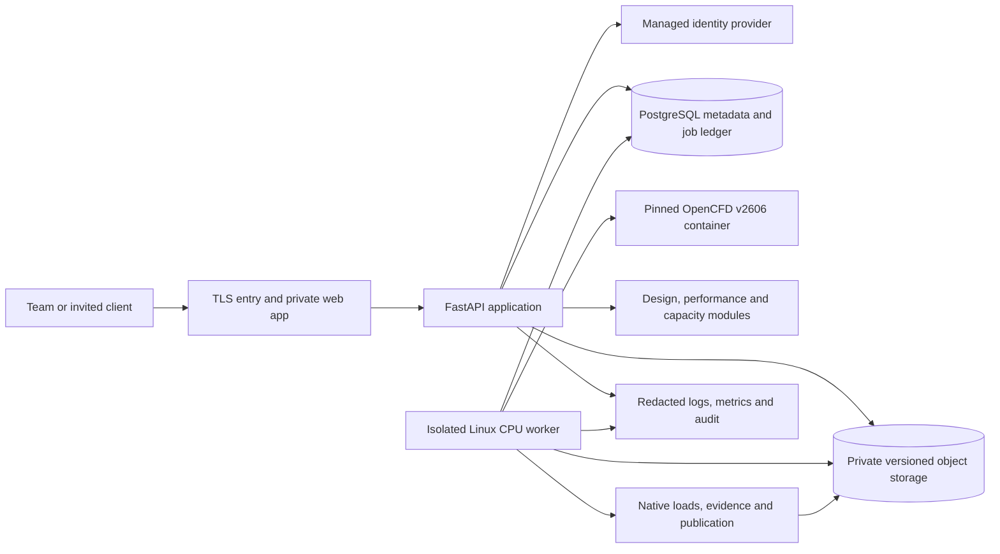
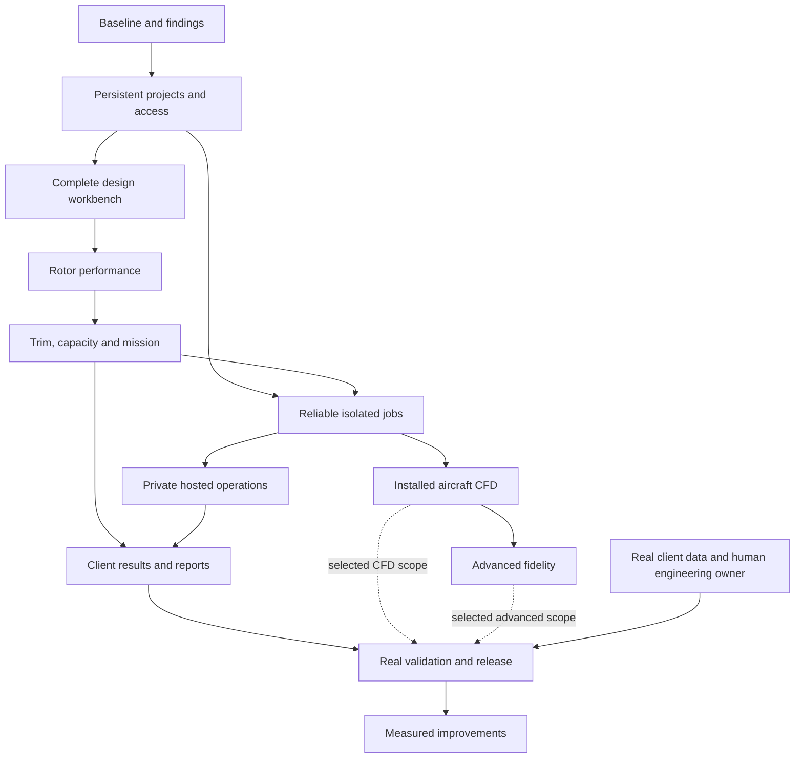

# PhysiCore Drone: production development plan

**Planning baseline:** 3 October 2026, commit `66611667aa0d9614f6e5c066db7410b7d7a30a03`, branch `mvp/3day`.
**Deployment decision:** private hosted web app for the team and invited clients.
**Document status:** development specification and work order. Future tasks are uncompleted; this document does not establish production readiness or aircraft validation.

**Active roadmap:** the table below is the single source of current slice status. Sections 1–16 retain the broader development specifications and release gates. The dated plans are historical specifications, not competing work queues. The user authorized execution of the 5 October direction; real client inputs and a named engineering owner are still unavailable (confirmed 5 October).

## Active slice status

States distinguish implementation from acceptance: **local subset** is historical scoped behavior; **review pending** is implemented/tested but not independently accepted; **blocked** requires an external input; **conditional** requires the stated trigger. No status here promotes aircraft evidence or completes a broader release gate.

| ID | State | Evidence/specification | Blocker or next action |
|---|---|---|---|
| Local storage and CI fixes | bounded plumbing review and implementation CI passed | [14 October followup](docs/qa/local-reliability-followup-2026-10-14.md) | CI verified implementation head `5f5ffe4`: 606 unit/118 reference, worker/PostgreSQL, installed wheel/images, browser and sphere smoke; full vendor backend skipped; model/real-data/hosting gates remain open |
| A07 | monitored local smoke and forced-stop recovery verified; draft integration pending | [Harness scope](docs/qa/bounded-soak.md), [21 October evidence](docs/qa/roadmap-followup-2026-10-21.md), [actual observations](docs/qa/soak-harness-2026-10-21.json) | Issue #15; real study/PDF journey, duration/storage/memory/SIGINT stops and active-job cancellation/stale-completion denial performed; 26 helper tests pass; 24-hour/provider qualification remains pending |
| A06 | declaration helper verified; draft integration pending | [Intake scope](docs/qa/intake-readiness.md), [14 October execution](docs/qa/a06-execution-2026-10-14.md), [21 October follow-up](docs/qa/roadmap-followup-2026-10-21.md) | Issue #14; malformed electrical metadata no longer falsely invalidates a bound mission; 32 intake tests independently rerun; source verification, human ownership and engineering acceptance remain unverified |
| A05 | helper verified; draft integration pending | [Drill scope](docs/qa/disk-pressure-drill.md), [14 October execution](docs/qa/a05-execution-2026-10-14.md), [actual observations](docs/qa/a05-observations-2026-10-14.json) | Issue #13; 19 targeted tests and injected storage/retry/fence CLI passed; actual exhaustion/worker/provider/pinned CI remain unverified |
| A01–A02 | implemented; draft integration pending | [Reconciliation](docs/qa/baseline-reconciliation.md), [model review checklist](docs/qa/model-review-checklist.md), [14 October evidence](docs/qa/roadmap-implementation-2026-10-14.md) | Issue #10; same-family documentation QA/review complete; independent model and human gates remain pending |
| A03 | helper tested; external profiling pending | [Submission diagnostics](docs/qa/submission-profiling.md), [actual receipt](docs/qa/submission-diagnostics-2026-10-14.json) | Issue #11; 11 targeted tests and six API admissions/cancellations passed in unpinned Python 3.12; pinned CI/PostgreSQL/concurrency unverified |
| U01 / N0.5 / IP07 / IP10 | software verified; model review pending | [Execution evidence](docs/qa/production-platform-execution-2026-10-06.md), [fresh V4 baseline](docs/qa/production-baseline-2026-10-06.md) | [Byte-identical wheel/image receipts](docs/qa/production-release-2026-10-06.json), packaged resources/locked runtime and expanded CI; independent current-model review and human acceptance still gate physics |
| U02 / N3.2 / IP16 | implemented; local audit retained | [Execution evidence](docs/qa/production-platform-execution-2026-10-06.md) | Bounded 1,000-project inventory/history and verified reuse; [repeat audit](docs/qa/production-performance-2026-10-06.md) retains all overloads; submission target, schema caching and 24-hour/provider tests remain open |
| U03 / IP13 | local integration verified | [Execution evidence](docs/qa/production-platform-execution-2026-10-06.md) | Real PostgreSQL 50-writer/version checks, S3-compatible HTTP fixtures and migrations; production provider/bucket/restore decisions pending |
| U04 / IP14–IP15 / IP17 | fixture journey and recovery verified | [Execution evidence](docs/qa/production-platform-execution-2026-10-06.md), [operations](docs/production/operations.md) | Sessions/roles/invitations/review exports; queued bounded studies/reports and fencing; hosted CFD/IdP flow, long soak and provider recovery remain pending |
| U05 / N2.4 / IP05 / IP11 | review gated | [Production upgrade](docs/production/upgrade.md) | User selected mission/powertrain; current-model review precedes physics extension; analytic fixtures then real-data qualification |
| N0.1 | blocked | [Scope proposal](docs/plans/2026-10-05-next-development-plan.md) | Client scope agreement and named engineer; no invented ADR-0004 decision |
| N0.2 | blocked | [Data request](docs/client/aircraft-data-request.md) | Recipient and explicit sending instruction; no message sent |
| N0.3 | implemented | This table | Review with roadmap changes |
| N0.4 | browser checked | [Execution receipt](docs/qa/next-development-execution-2026-10-05.md) | Native 200% zoom, real downloads, 409 preservation; broader/client UX pending |
| N0.5 | review pending | [Execution receipt](docs/qa/next-development-execution-2026-10-05.md) | Semantic module closure and historical compatibility tests pass; independent review |
| N1.1 | review pending | [Execution receipt](docs/qa/next-development-execution-2026-10-05.md) | Versioned retained conservative envelope/torque bands pass fixtures; independent review |
| N1.2 | authorized; review gated | [MILP option](docs/plans/2026-10-05-next-development-plan.md) | First real map exceeds declared conditioning tolerance; retain LP default |
| N1.3 | review pending | [Execution receipt](docs/qa/next-development-execution-2026-10-05.md) | 60 noise seeds plus API/browser/report/restart fixtures; real maps unavailable |
| N1.4 | review pending | [Execution receipt](docs/qa/next-development-execution-2026-10-05.md) | Varying-torque shaft/electrical equivalence; efficiency once; independent review |
| N2.1 | review pending | [Execution receipt](docs/qa/next-development-execution-2026-10-05.md) | Quad certificate and feasible octo/zero commands; independent review |
| N2.2 | review pending | [Execution receipt](docs/qa/next-development-execution-2026-10-05.md) | Exact matching-inflow climb and unsupported sign/coverage tests; independent review |
| N2.3 | review pending | [Execution receipt](docs/qa/next-development-execution-2026-10-05.md) | Joint scenarios, common-candidate energy and separately sourced caps; independent review |
| N2.4 | authorized; review gated | [Variable-power specification](docs/plans/2026-10-05-next-development-plan.md) | U05 leads next engineering work after current-model review; real data not required for labelled analytic fixtures |
| N3.1 | local subset | [Execution receipt](docs/qa/next-development-execution-2026-10-05.md) | Declared-mm airframe, numeric rotor/link round trip, governing-limit preview; real geometry pending |
| N3.2 | implemented | [Execution receipt](docs/qa/next-development-execution-2026-10-05.md) | Retained input/constraint comparison; JSON numeric round-trip fix; standard review pending |
| N3.3 | local subset | [Execution receipt](docs/qa/next-development-execution-2026-10-05.md) | Two timed automated journeys and retained recording; human presenter rehearsals pending |
| N4.1 | blocked | [Client intake request](docs/client/aircraft-data-request.md) | D04–D06 and named client engineer |
| N4.2 | blocked | [Validation specification](docs/plans/2026-10-05-next-development-plan.md) | Real held-out measurements and engineer-owned tolerances |
| N4.3 | blocked | [Report specification](docs/plans/2026-10-05-next-development-plan.md) | Real inputs, independent review and human scope acceptance |
| N5 / IP13–IP15 / IP17 | local subsets implemented | [Hosted specifications](docs/plans/2026-10-04-implementation-plan.md#ip13-hosted-metadata-and-private-artifact-adapters) | U03/U04 local adapters/access/study-report workers verified; D01–D03/D07 gate external deployment |
| IP01 | local subset | [Local checkpoint](docs/qa/local-workbench-merge.md) | Hosted authoring/permissions remain outside this subset |
| IP02 | local subset | [Hover/energy evidence](docs/validation/local-hover-and-energy.md) | Real approved mass ledger unavailable |
| IP03 | local subset | [Hover/energy evidence](docs/validation/local-hover-and-energy.md) | Broader case eligibility tracked in N2 |
| IP04 | local subset | [Model scope](docs/decisions/ADR-0003-static-hover-profile.md) | Measured-map acceptance tracked in N1 |
| IP05 | local subset | [Hover/energy evidence](docs/validation/local-hover-and-energy.md) | Sag/thermal/real sustained limits unavailable |
| IP06 | local subset | [Hover/energy evidence](docs/validation/local-hover-and-energy.md) | Only declared supported wrench inputs |
| IP07 | local subset | [Independent bounded review](docs/reviews/2026-10-05-local-hover-claude.md) | Extensions tracked in N1/N2 |
| IP08 | local subset | [Hover/energy evidence](docs/validation/local-hover-and-energy.md) | Restricted LP model; no general aircraft optimum |
| IP09 | local subset | [Browser audit](docs/qa/local-workbench-design-audit.md) | N0.4 and real-data gates |
| IP10 | local subset | [Historical compatibility review](docs/reviews/2026-10-05-historical-contract-claude.md) | New semantics require versioned successor |
| IP11 | local subset | [Hover/energy evidence](docs/validation/local-hover-and-energy.md) | Constant segments only; U05/N2.4 authorized after model review |
| IP12 | review pending | [Execution receipt](docs/qa/next-development-execution-2026-10-05.md) | N2.3 implementation shares evidence; independent acceptance pending |
| IP16 | local subset | [Report evidence](docs/qa/local-reports.md) | Assembly N3.1; hosted client review depends on N5 |
| IP18 | blocked | N4 above | D04–D06, real validation and hosted release gates |
| I01 | capability only | [Execution receipt](docs/qa/next-development-execution-2026-10-05.md) | Exact-image regular-point p/U/vorticity probe; independent accuracy/direction/refinement review pending |
| I02 | preregistered | [Execution receipt](docs/qa/next-development-execution-2026-10-05.md) | Controlled domain/surface protocol retained before probe; full campaign unrun |

Next acceptance sequence: independent cross-family model/contract review → human fixture presentation → real client intake and engineer-owned tolerances when available. Mission/powertrain work is now authorized by the 6 October upgrade; current-model review precedes its physics extension. MILP remains data/coverage driven. Hosting depends on D01–D03. On 14 October the user confirmed that hosting is undecided and remains their later decision; continue local development. No new physics merge or release tag precedes the required review and engineering acceptance.

The product must answer a practical question: **given this approved aircraft design, how much payload can it carry across the required mission?** It must show which condition limits that payload, what evidence supports the answer, and which assumptions could change it. The client should be able to inspect the design, compare revisions, and leave with an understandable, reproducible engineering report.

There is no fixed payload target. The previous 750 kg requirement has been removed by the user. Geometry alone does not establish thrust, aircraft mass, electrical capability, or flight feasibility. An incomplete design gets a precise request for missing information, with no invented capacity.

The existing MVP is a useful foundation: a reproducible sphere verification pipeline, native-field visualization, geometry intake, evidence packages, and an explicitly synthetic payload example. Production requires persistent design authoring, rotor performance models, coupled mission feasibility, authentication, worker recovery, deployment operations, and validation on real aircraft data.

## 1. Authority, references and development rules

The user's decisions take precedence over historical requirements. This plan governs development from the baseline above. The original master plan is preserved byte-for-byte in [the archived master plan](docs/plans/2026-10-02-master-plan.md). Its equation IDs E01-E56, task numbers, manifest references and historical assumptions remain available for interpretation of existing code and documents. Existing references to old `plan §...` refer to that archive. Links inside the untouched archive retain their original root-relative context; resolve those paths from the repository root. Its fixed-payload requirement is historical and must not be restored.

Use these references when implementing:

- [Original manifest](docs/source/manifest_v1.0_extracted.md): physical conventions, fidelity levels, evidence and export requirements, subject to the user's changes.
- [Payload-capacity decision](docs/decisions/ADR-0002-payload-capacity.md): update the decision if a versioned contract changes.
- [Three-day MVP plan](docs/plans/2026-10-02-3day-mvp.md): previous demo scope, not a production schedule.
- [Code, backend and physics guide](docs/technical/mvp-code-and-physics-guide.md): current implementation and formulas.
- [Independent physics review](docs/qa/independent_physics_review.md): bounded Claude review, follow-up PASS and remaining limitations.
- [Fresh-clone evidence](docs/qa/fresh_clone_reproduction.md), [MVP gates](docs/qa/mvp_gates.md), [results checklist](docs/qa/results_page_checklist.md), and [presenter guide](docs/demo/presenter-guide.md): actual checks and pending presentation work.

### Work one task at a time

1. Select the earliest unblocked task in the active work order in Section 10. Phase numbers group capabilities; they do not force hosted infrastructure ahead of the fixture-driven payload pilot. Read its dependencies and the relevant existing implementation before editing.
2. State the concrete change, limitations and expected evidence. Ask only when a missing decision materially changes implementation; continue independent work while awaiting external inputs.
3. Implement a complete vertical slice: persisted input, domain behavior, server interface, visible behavior, and relevant verification. Do not build disconnected screens or mark a shell as a working feature.
4. Test the public behavior with meaningful positive, negative and failure cases. Physics changes require an independent derivation or reference and review appropriate to their risk. Reuse established fixtures rather than testing a formula against a copy of itself.
5. Record changed files, data/model versions, test results, reviewer and remaining limits. Update this task's checkbox only after its acceptance criteria and evidence are met.
6. Commit a small, reviewable change on a `codex/` branch. Open a PR against the repository's confirmed default branch, now `main` as of the 4 October implementation baseline. When a task starts from an unmerged reviewed branch, stack its PR on that baseline and record the parent so the task diff stays reviewable. The historical planning baseline used `drone/wp03-geometry`; it is no longer the default.
7. Keep previously published snapshots and result packages readable. Changes to semantics require a versioned migration and compatibility tests. Promote through staging and the applicable gate before production.

Task completion, software release approval, design approval and physics validation are separate decisions. A passing software test cannot promote aircraft evidence. Do not merge or tag a physics release without its required independent review and human engineering acceptance. The current Claude PASS covers the stated MVP scope; it does not pre-approve future changes.

## 2. Baseline: what exists and what does not

| Area | Existing implementation | Production gap |
|---|---|---|
| Application | Python 3.11, FastAPI, NumPy/SciPy, safe YAML loading, local configuration | Hosted packaging, identity, organization/project permissions, durable authoring, monitoring |
| Geometry | Original STL bytes, explicit source units, SI transforms, welding/topology diagnostics, fixture generation | Persistent component instances, assembly edits, rotor assignment, reversible repairs, authoring UX |
| Design schema | Immutable `ProjectSnapshot`, explicit unknowns, readiness rules in `drone/models.py` | Revision lifecycle, concurrent editing, approved source binding, import migrations |
| Payload example | Supplied per-rotor force/power points, empty mass, all required cases, minimum vertical-force ceiling | Performance maps, trim, operating-point search, voltage/thermal/current constraints, sequential energy |
| Jobs/artifacts | Content-addressed local storage; SQLite atomic claims; bounded container execution | Multi-host leases, recovery/fencing, private object storage, quotas, durable event delivery |
| CFD | Pinned OpenCFD v2606; stationary laminar sphere; three mesh levels | Aircraft domains, rotor-source profiles, capability probes, real validation, transient campaigns |
| Loads/results | Native pressure/shear integration, backend reconciliation, drift and qualified GCI, hashed packages | General aircraft result schema, force ledger, versioned publication, authenticated review attestations |
| Frontend | Plain HTML/CSS/JS, vendored three.js, STL preview, evidence desk and native field display | Complete persistent workflow, safe concurrent saves, project comparison, client review and reports |
| Security | One environment bearer token; localhost defaults; container restrictions | Individual sessions, tenant isolation, project roles, revocation, audit trails, worker separation |
| Verification | Recorded 290 unit and 118 reference tests; retained backend and reproduction evidence | Production browser, authorization, migration, recovery, load and real-aircraft campaigns |

The retained image is `opencfd/openfoam-run@sha256:4229997e74defb81548222d511b8e3b95b98305e5df41b8e88b031813fe47eeb`. The vendor v2606 archive SHA-256 is `2a1310e3ed192cc4c521e1d22dcc176f57bec61160c878dc4348f21d6672294d`. Confirm execution/source records in [the backend pin audit](docs/audit/backend_pin.md). Version names alone do not identify a reproducible runtime. Updates require a new capability/reproduction review, dependency/security assessment and revalidation of affected methods.

Current intake limits are 50,000,000 bytes and 1,000,000 triangles. Retain those bounds during the initial migration; change them only with measured parser/viewer/worker behavior and agreed project quotas. A permitted file size does not guarantee an affordable CFD mesh.

Important limitations to preserve:

- The sphere is a verification case. Its mesh study does not validate rotor performance or an aircraft.
- The fine sphere result differs from the retained correlation by about 2.65%. That discrepancy needs interpretation; a small GCI is not total accuracy.
- The observed-order GCI is about 0.110%; the primary nominal-order-capped sensitivity is about 0.408%. Both have qualification limits. Do not turn either into an aircraft uncertainty claim.
- The illustrative aircraft example uses 65 kg empty mass. Its climb case gives about 52.23 kg, lower than its hover case. This is a supplied-force ceiling with constant operating-point energy, not a demonstrated optimized mission payload.
- Existing alternative mission cases independently check available energy. They do not yet form a chronological mission with shared state of charge.
- Existing approval digests bind caller-supplied inputs but do not authenticate the approver.
- `ResultsV1` intentionally describes the sphere verification study. Its validation/review fields must not be loosened to accommodate aircraft studies; introduce a new contract.
- Native face values drive integration. Display interpolation, decimation, smoothing and slices cannot become integration inputs.
- Real geometry, rotor data and an approved aircraft mass ledger are unavailable. Software development can proceed with labelled fixtures; real-design claims remain blocked.

## 3. Product outcomes and boundaries

### Local Pilot-1 before hosted rollout

Deliver the local single-user mass ledger → measured rotor-map fixture → required alternative cases → bounded payload/limiting-case workflow first. [Pilot-1](docs/pilots/pilot-1.md) records acceptance and the physics investigation queue. Keep the existing browser technology. This local milestone does not establish invited access or hosted production. Use explicit labelled fixtures while D04-D06 data remains unavailable.

### First credible private hosted pilot

An engineer can create a project, import an assembly, enter its mass ledger, bind rotor maps and electrical limits, define mission cases, approve an immutable revision, calculate payload feasibility, and share an approved report with an invited client. All persisted information survives a restart. A client can inspect the limiting case and compare two approved revisions without needing solver knowledge.

The first pilot may use measured rotor maps with a clearly identified installation model and validated scope. CFD is a separately eligible method. Do not delay every product workflow until transient CFD exists, and do not describe map-based screening as installed-aircraft validation.

### Production acceptance

A real client dataset completes the same workflow on the hosted system. The capacity result has sufficient model and measurement coverage for its stated scope, repeatable numerical evidence, a reviewed uncertainty treatment, traceable constraints, and a human engineering sign-off. Access isolation, backup restoration, worker loss, deployment rollback and report integrity have all been exercised.

### Advanced capabilities after the pilot

Installed actuator-disk interference, verified steady rotating-frame blades, transient sliding-interface blades, phase averages, physically eligible symmetry and fault-case allocation are released independently when their own validation gates pass. Capability selection must explain why a method is eligible and what it costs.

### Scope deliberately deferred

Public anonymous uploads, billing, marketplaces, autonomous flight control, manufacturing certification, structural FEA implementation, acoustic certification, GPU acceleration claims and writing a new flow solver. Structural allowable loads and other external engineering limits can be ingested as reviewed constraints; the application must distinguish modeled aerodynamic/electrical capability from approved operational limits.

The separate 2D PhysiMesh product remains separate. Integrate through a documented, versioned export contract when its actual consumer is available.

## 4. Architecture and implementation choices

### Approaches considered

| Approach | Benefit | Cost/limit | Decision |
|---|---|---|---|
| Extend the local demo with a public proxy | Fast presentation setup | Shared token, local state and synchronous execution cannot support private client work reliably | Keep for labelled demonstrations |
| Modular hosted application with separate CFD worker hosts | Reuses tested Python/domain logic; independent compute and web scaling; manageable operations | Requires identity, durable storage, reliable jobs and deployment discipline | Recommended production foundation |
| Many microservices and Kubernetes from the start | Fine-grained independent scaling | Adds network contracts and operating burden before demand is measured | Revisit only after measured pressure justifies it |

Keep the physics library independent of HTTP, storage and browser state. Build deep modules with small interfaces that hide implementation complexity. Existing local and new hosted storage/job adapters are real reasons for seams. Avoid factories and plugin systems for hypothetical future backends.

The diagram expresses target responsibilities. U03/U04 now implement local hosted metadata, private artifacts, access and study/report workers; external deployment and hosted CFD remain pending in the active status table.

### Recommended stack, subject to recorded hosting decisions

- Retain FastAPI and the tested Python domain library. Package templates and static resources as distribution resources so installed builds work outside a source checkout.
- Use managed PostgreSQL for projects, revisions, permissions, jobs, events and reviews. Choose a provider-supported stable version and pin it in an ADR; no untested major-version upgrade in production.
- Use private S3-compatible object storage for original geometry, map sources, native outputs, recipes and packages. Metadata points to exact versions and full SHA-256 hashes. Keep a local adapter for reproducible development.
- Start with a database-backed queue, transactional submission/outbox and worker leases. PostgreSQL documents `SKIP LOCKED` as suitable for queue-like contention handling; it does not itself provide delivery or recovery guarantees. Define those explicitly. [PostgreSQL SELECT](https://www.postgresql.org/docs/18/sql-select.html)
- Run CFD on dedicated Linux CPU hosts. The web application must not own a Docker socket or launch user-defined commands. A worker agent owns local execution and receives only authorized, bounded job specifications.
- Retain the working plain-JS evidence desk for Pilot-1. Use accessible native/tested primitives and scoped styling. React/TypeScript is an optional later migration: require a working local payload journey, demonstrated complexity/typing need and a separate ADR before changing framework. Persistent authoring does not itself require a framework rewrite.
- Keep three.js native-data semantics and source/license records. Pin an upgrade only after representative geometry and field fixtures verify equivalent behavior.
- Prefer managed identity supporting invited users and MFA. Choose the provider with the deployment region, data residency and client policy; do not invent a custom password system.
- Start with one application deployment, managed database/object storage, and a small bounded worker pool. Do not add Redis, a service mesh or orchestration layers without a demonstrated need.

### Module ownership and proposed interfaces

Paths below are relative to `src/physimesh/`. **New** means planned, not implemented.

| Module | Interface responsibility | Existing starting point |
|---|---|---|
| Project revisions, new `projects/` | Create/edit draft with version precondition; freeze/approve snapshot; resolve readable revision | `drone/models.py`, `drone/snapshot_hash.py`, `drone/provenance.py` |
| Access policy, new `auth/` | Authorize actor/action/project/resource on every operation | `api/app.py` global-token guard |
| Geometry authoring | Import, diagnose, instance, transform and propose repair; preserve originals | `drone/stl_import.py`, `drone/geometry.py`, `drone/api.py` |
| Rotor performance, new `drone/performance.py` | Evaluate rotor at command/inflow/environment; return force, torque, electrical demand, domain coverage and provenance | `drone/screening.py`, `drone/screening_diagnostics.py` |
| Trim/capacity, new `drone/trim.py`, `drone/capacity.py` | Evaluate candidate payload against a complete approved mission; bounded search with reasoned refusals | `drone/mass.py`, `drone/mission.py`, `drone/screening.py` |
| Job orchestration | Submit, claim with lease, renew, cancel, publish or fail; expose replayable events | `core/jobs.py`, `solver/runner.py` |
| Backend adapter | Probe exact capabilities; generate trusted case profile; execute fixed stage graph | `solver/openfoam_cases.py`, `core/container.py` |
| Study publication | Assemble/verify immutable package; attach separate authenticated review record | `postpro/result_contract.py`, `api/results.py` |
| Explanation/report | Render accepted results and cited limits into client and engineering views | `postpro/interpretation.py`, existing plots/recipes |

Each caller should receive typed values, reason codes and source bindings. It should not need to know SQL locking, OpenFOAM dictionary details or browser formatting to calculate a physical result.

## 5. Data lifecycle, status and provenance

### Persisted entities

Model organizations, identities, project memberships, projects, mutable drafts, immutable design revisions, geometry assets, component instances, rotor configurations, performance datasets, mass ledgers, mission definitions, study specifications, job attempts, artifact manifests, result revisions, reviews and client access grants.

An asset hash identifies bytes; a component instance identifies placement in an assembly. Two identical propellers must have different instance IDs while sharing a geometry asset. A study binds a design revision, mission revision, model versions, settings, backend digest and source datasets. A result revision binds every published byte and recipe, independently of the study ID.

Draft writes carry an expected revision/version. Conflicting writes produce a recoverable conflict, never silently overwrite another engineer. Approval freezes a canonical numeric snapshot. Changes to geometry, mass, rotor data, mission or analysis settings create a new revision and make previous evidence inapplicable to the changed revision while retaining the old evidence for audit.

### Separate status axes

| Axis | Required behavior |
|---|---|
| Input readiness | Structured missing/invalid/inconsistent inputs, linked to fields and methods |
| Execution | Preserve `queued`, `preparing`, `meshing`, `running`, `postprocessing`, `completed`, `cancelled`, `failed` semantics |
| Physical outcome | Distinguish feasible, infeasible, unresolved solver search and unsupported model domain |
| Aircraft study | Preserve existing `inputs_incomplete`, `screening_only`, `numerically_unverified`, `validation_pending`, `within_validated_envelope`, `requirement_not_met` through explicit compatibility mapping |
| Evidence | Preserve `unverified`, `iteration_converged`, `periodic_or_statistical_converged`, `mesh_assessed`, `time_assessed`, `validated_for_case_family` |
| Review | Authenticated pending/accepted/rejected/superseded record, with scope and reviewer |
| Software release | Build/deployment approval independent of aircraft conclusions |

Do not add an unversioned string to an old schema. Introduce structured physical-outcome reasons in the new result contract, and map old results honestly. A completed job can still yield infeasible or numerically unverified physics. A hash-valid package can still contain an unvalidated study.

### Provenance and publication

Retain original byte hashes, declared units, transformations, repair history, source licensing, performance domain, method/fidelity, code revision, dependencies, backend digest, exact dictionaries, mesh statistics, convergence windows, uncertainty policy, data conversions, plot recipe and data hashes, author/reviewer identity and timestamps.

Use a deterministic payload manifest whose hash excludes its own ID and detached signatures, avoiding circular hashing. Define byte encoding and member ordering. A package revision uses its full manifest hash; human labels are distinct. Publication stages outputs privately, verifies all expected members and hashes, then atomically marks a complete revision available. Failed/cancelled attempts retain diagnostics with restricted access and cannot become an approved report.

Reviews attest to the exact revision, methods, settings and scope. Store them as immutable, separately authenticated records so adding a review does not mutate an already-published package. Export can include detached review records and a manifest of those attachments. Any change invalidates the association with the earlier review.

## 6. Payload model: required physics and claim limits

### 6.1 Current supplied-point calculation

For the current vertical-only screening case:

`payload_ceiling = sum(rotor_force_world_z) / (g0 + vertical_acceleration) - empty_mass`

with `g0 = 9.80665 m/s²`. Its domain requires a positive denominator, declared mass and forces, complete rotor/case coverage, and explicit power/energy constraints. It does not solve lateral force, attitude, moments, aircraft interference or a search over operating commands. Keep this calculation available as a labelled diagnostic with those limitations.

### 6.2 Planned feasibility evaluation

For candidate payload `m_p`, compute total mass, CG and inertia from the empty-aircraft ledger and the payload placement. At every required flight state, solve compatible rotor commands and aircraft attitude subject to force and moment balance:

`sum(F_rotors) + F_airframe + m_total * g_vector = m_total * a_world`

`sum((r_i - r_CG) × F_i + Q_i) + M_airframe = I * angular_acceleration + omega_body × (I * omega_body)`

All terms must be in the same declared frame and about the same origin. The first trim release is explicitly steady/quasi-steady: rates and angular acceleration are zero unless their required inertial terms and valid aerodynamic model are provided. Rotor gyroscopic contributions require a supported model before nonzero body-rate cases are accepted.

Report normalized residuals using registered scales, for example `r_force = norm(F_balance) / F_reference` and `r_moment = norm(M_balance) / (F_reference * L_reference)`. Reference force and length must be positive and physically relevant; record absolute errors as well. A tolerance on an optimizer objective is not a substitute for independently checking each required balance and bound.

Constraints include rotor command and map domain, torque, RPM/pitch availability, motor/ESC current and duty/temperature limits, pack voltage/current/power, reserve, CG envelope and externally supplied structural limits. Treat aerodynamic loads, actuator reactions and blade forces with a ledger so the same force is never counted twice.

Per-case capacity is the best **verified feasible** payload found within the declared search domain. The headline is the minimum across every required case, further constrained by any declared complete mission sequence and external allowable limit. One missing required case prevents a mission headline. Optional/excluded cases must be named and excluded visibly.

A search failure is unresolved, not proof of physical infeasibility. A local optimizer's answer is not a proven global maximum. Report the feasible lower bound, explored upper bound, search tolerance, residuals and coverage. Use bisection only where monotonic feasibility is established for that model; otherwise use bracketed exploration and multiple starts with a clear unresolved interval.

### 6.3 Rotor and power models

Prefer measured rotor maps with traceable force/torque/power units, test conditions, installation context, uncertainty and valid ranges. Convert RPM to revolutions per second explicitly. Preserve shaft and electrical power as distinct quantities:

`n = RPM / 60`, `CT = T / (rho * n² * D⁴)`, `CQ = Q / (rho * n² * D⁵)`, `CP = P_shaft / (rho * n³ * D⁵)`

`P_shaft = Q * omega`, `P_electric = P_shaft / efficiency_chain + auxiliary_power`

The second expression only applies to the specified motoring regime and valid efficiency model. Regeneration and negative torque require explicit support. Test signed rotation and torque conventions independently. Do not extrapolate a map outside coverage or reuse a tip correction already embedded in measured data.

For eligible isolated, ideal hover, `A = pi * R²`, `v_i = sqrt(T / (2 * rho * A))`, `P_ideal = T * v_i`. This is a diagnostic reference in its supported conditions. It is not a universal power bound for installed rotors, lateral flow, climb, descent or a turbine regime.

BEM requires blade stations and validated polars spanning the used Reynolds/Mach/angle range, a converged inflow solution and explicit exclusion of unsupported regimes. A generated thrust estimate from blade geometry is still a model with evidence requirements.

### 6.4 Mission energy and battery coupling

Model independent design cases and ordered mission segments as different entities. Independent cases test each condition separately. Ordered segments propagate time, state of charge and, where supported, temperature and voltage:

`E_segment = integral(P_pack(t), dt)` and `E_mission = sum(E_segment)`.

At constant power only, `E_segment = P_pack * duration`. Acceleration, changing speed, altitude and cooling cannot be represented by an unrelated constant point while claiming a trajectory simulation. A quasi-steady segment approximation must state its discretization and applicability.

Usable battery energy comes from a versioned reserve convention and supported operating conditions. Record whether reserve is held energy, usable-capacity fraction or additional mission demand. Never apply it twice. Tie energy to pack mass, capacity, chemistry/source, voltage/current and discharge limits. A pack of impossible energy density is an inconsistent input, not a viable design.

If battery sizing changes aircraft mass, iterate mass, trim, electrical demand and energy to a converged, bounded solution. Detect divergence, oscillation and physically impossible sizing. Show whether the pack is fixed or being sized; capacity results from different pack assumptions cannot silently be compared.

### 6.5 Uncertainty and validation

Separate numerical discretization, model-form discrepancy, measured-map uncertainty, mass uncertainty, atmosphere variation, installation effects and operating constraints. Start with deterministic sensitivity scenarios and conservative engineering bounds whose inputs and correlations are reviewed. A percentile or 95% interval requires justified distributions, correlations and sampling convergence; do not invent probability from min/max ranges.

Validation is local to a case family, fidelity, geometry/installation, Reynolds/Mach/inflow and operating range. Publish interpolation coverage and distance from the tested envelope. Reusing sphere evidence or an isolated rotor map does not validate an installed multirotor aircraft.

A report can describe a modeled aerodynamic/electrical payload capability. Calling it an approved operational payload additionally requires the external engineering limits and human approval for that scope. No report constitutes flight certification.

## 7. Equation and numerical-method coverage

The archived [E01-E56 catalogue](docs/plans/2026-10-02-master-plan.md#7-equation-catalogue-e01e56) retains detailed source references. Every implementation task must maintain a formula register containing units, frames/signs, assumptions, method version, owning code and independent fixtures. The active E01 is `m_total = m_payload + sum(empty_mass_categories)`, replacing the historical constant-payload expression.

| Formula group | Production requirements | Owning tasks |
|---|---|---|
| E01-E02 mass, CG, inertia | Payload placement and pack coupling; parallel-axis theorem; external CG limits | P02.2, P04.2, P04.3 |
| E03-E04 atmosphere, Reynolds and Mach | Explicit atmospheric model; local relative velocity; axial tip-Mach approximation labelled; unsupported compressibility refused | P02.3, P03.2 |
| E05-E08 force/moment balance and residuals | Full supported trim; physically scaled tolerances; report force and moment residual separately | P04.1, P04.2 |
| E09-E16 momentum, BEM, rotor coefficients, advance ratio | Applicability gates, signed power, measured domain, no undefined hover propulsive efficiency claim | P03.1-P03.3 |
| E17-E30 flow, turbulence and moving frames | Exact vendor formulations, pressure/stress dimensions, case-profile eligibility; no home-built CFD | P07.1-P07.3, P08.1 |
| E31-E33 source reactions and reflection | Fluid-source reaction sign; polar/axial vector distinction; `det(H) * H` for axial reflection | P07.3, P08.3 |
| E34-E36 layers, finite volume, Courant/time/angular step | Measured mesh quality and wall treatment; supported time-step/angular resolution; blade-passing coverage | P07.2, P08.1 |
| E37-E40 statistics, flux and GCI | Valid windows/whole revolutions; gross-flow scale in hover; unequal refinement ratios; qualified order/Fs policy | P00.2, P07.4, P08.2 |
| E41-E45 native forces, moments and control-volume check | Outward-solid normal; pressure convention; moment-origin transfer; independent backend reconciliation | P00.2, P07.2, P07.4 |
| E46-E47 electric demand and battery energy | Valid efficiencies, auxiliaries, chronological integration and reserve/pack coupling | P03.2, P04.3 |
| E48-E55 fields and plots | Native load contributions; defined normalization; moving-frame relative velocity; supported wake planes | P07.4, P08.2, P09.1 |
| E56 bounded allocation | Physical commands only; failures and feasible intervals; no global-optimum claim from local solver | P04.1, P04.2, P08.4 |

Numerical thresholds belong in a versioned settings register with justification and campaign evidence. Do not silently copy a sphere absolute tolerance into aircraft trim or interpret historical 2%/5%/10% planning targets as demonstrated accuracy. Quantity-specific acceptance limits require an engineering owner before the applicable campaign runs.

## 8. Client experience and design direction

The signature is **the approved aircraft as an interactive evidence artifact**. The main workspace centers the real assembly, with its actual rotor axes, force directions, payload location and selected mission case. The limiting constraint is tied to the geometry and the report. A client can see what changed between designs and why the capacity changed.

This is an engineering workspace, not a SaaS landing page. Avoid a decorative split hero, fake application windows, generic feature-card grids, fabricated customer marks and empty dashboard metrics. Actual inputs and results carry the composition. Synthetic data is explicitly labelled throughout the screen, reports and exports.

### End-to-end journey

| Stage | Engineer action | Visible outcome and refusal behavior |
|---|---|---|
| Projects | Create/open project and invite authorized members | Recent approved revision, current draft, review state and last study; no fabricated statistics |
| Import/assembly | Upload components, declare units, place/tag instances, assign rotors | Real geometry, dimensions, axes and topology diagnostics; unresolved units/roles remain explicit |
| Aircraft inputs | Enter mass/CG/inertia, map sources, electrical and external limits | Source-linked ledger and coverage; unknown values block dependent methods |
| Mission | Define required independent cases and ordered segments where needed | Case completeness, atmosphere, velocity/acceleration, payload location and reserve convention |
| Review/run | Freeze design, review readiness, approve settings/budget and submit | Exact revision, eligible methods, measured resource estimate and clear queue/progress stages |
| Results | Inspect per-case feasible payload, trim, power/energy and evidence | Mission minimum, limiting case/constraint, uncertainty/scope, missing or infeasible reasons |
| Compare | Select two compatible approved studies | Shared units/scales, changed inputs, capacity delta and attribution; incompatible assumptions disclosed |
| Client handover | Publish reviewed revision to invited read-only client | Concise result with expandable assumptions, design viewer, case table, review history and report/export |

### Craft and accessibility requirements

- Compose one coherent system: a deliberate tonal palette, one signature type voice, a quiet readable body face, geometry-specific iconography and consistent spacing. Render type candidates before choosing; self-host only with a recorded license. Do not default to the rejected Google font rotation.
- Treat navigation as a working project/revision/case control. Use state changes tied to actual navigation, selection and calculation. Motion must respond to user action, preserve stable controls and honor reduced motion.
- Keep all content visible by default. Animation failure, disabled JavaScript, background tabs and throttling must not leave essential content hidden. Provide usable server/error fallback where interaction requires JavaScript.
- Maintain deliberate gutters, readable contrast, optical centering and aligned comparison rows. Test long names, missing values, large unit labels, zoom and translated copy. Any notch/clip needs enough safe padding and a close inspection of its edges.
- Use tested accessible dialog, menu and form primitives. They provide focus and keyboard patterns, while application labels, errors and interaction composition still need verification. [Radix accessibility](https://www.radix-ui.com/primitives/docs/overview/accessibility)
- Real field displays have units, frame, time/window, location, source and scale. Use shared scales for quantitative comparisons. Display LOD may simplify geometry, but never changes calculation data or invents contour accuracy.
- No decorative glows, pill metadata everywhere, hover movement on buttons, animated underline defaults, fake shadow boxes or icon tiles. Bare marks must carry meaning. Do not add brand/customer logos without an honest reason and real assets.
- Terse client copy can expand into technical details. Keep internal host paths, worker/container mechanics and solver dictionaries in the engineering detail view; keep implications and eligibility visible to the client.
- Every control must work and be tested with a real pointer and keyboard. Empty/loading/saving/conflict/error/cancelled/revoked states are part of the design.

Before each UI release, reread the user's full anti-slop law and perform a point-by-point audit with screenshots and interaction evidence. Specific safety, readability and default-visible rules prevail over optional examples that encourage clipping or entrance motion. Passing a checklist is the floor: the actual design-to-limiting-case interaction must deliver the authored signature.

## 9. Security and operating design

Private hosting still requires object-level authorization. Deny by default and check the actor's relationship to the project for each read, edit, review, job, plot, export and asset request, including guessed IDs. Treat client, engineer, reviewer and owner capabilities explicitly. Review independence rules can forbid self-approval where the release policy requires it. [OWASP authorization](https://cheatsheetseries.owasp.org/cheatsheets/Authorization_Cheat_Sheet.html)

Use secure HTTP-only session cookies, session expiration/revocation, CSRF protection for state changes, strict origin policy and an appropriate content-security policy. Store secrets outside version control. Redact credentials and confidential model data from logs. Invitation acceptance must bind the intended identity and project. A revoked user must lose access to dynamic pages and new downloads; document that already-downloaded bytes cannot be recalled.

Keep original uploads private and outside web-served paths. Validate parser structure and bounded sizes; distrust extensions and MIME declarations. Quarantine until parsing passes. Reject traversal, malformed numbers, decompression bombs if archives are introduced, and executable case content. Do not accept arbitrary OpenFOAM dictionaries, `coded` options, dynamic libraries or shell commands from clients. [OWASP file uploads](https://cheatsheetseries.owasp.org/cheatsheets/File_Upload_Cheat_Sheet.html)

Authorize a download before generating a short-lived, narrowly scoped signed URL. For reports requiring immediate revocation, proxy access through session checks; signed URLs otherwise remain usable until expiry. Define and test that expiry policy. Blob hashes are integrity identifiers, not access capabilities. Cross-project deduplication must not expose another project's existence or ownership.

Workers use a service identity, private networking and scoped access to job inputs/outputs. They execute a fixed stage graph in pinned containers with network disabled, read-only root, reduced capabilities, mapped non-root identity and enforced CPU, memory, disk, wall-time and process limits. Host-level controls and cleanup account for privileged container-runtime access. The web host has no runtime socket.

Resource admission occurs before execution. Each organization/project has bounded storage, active jobs and reserved compute. Cancellation kills the full process/container tree, releases reservations and retains restricted diagnostics. Worker loss uses expiring leases and fencing so a stale worker cannot publish after a replacement attempt. No exactly-once execution claim; make retries idempotent and publication single-winner.

Infrastructure is reproducible and separates development, staging and production data/secrets. Encrypt transport and stored data; configure database point-in-time recovery and object version/retention policies together. Restore tests include metadata, objects, permissions and review associations. Deletion/retention and customer export are documented; do not silently delete evidence needed by an active contract.

Proposed service targets below require confirmation and measurement, not marketing claims:

| Target | Initial proposal | How to verify |
|---|---|---|
| Interactive availability | 99.5% pilot; evaluate 99.9% production | External authenticated synthetic journey and documented maintenance/error-budget policy |
| API latency | p95 under 1 second for ordinary metadata at 10 active sessions, excluding uploads/CFD/exports | Fixed representative workload, data sizes and host configuration; report failures and p99 |
| Browser response | Input/selection feedback under 200 ms on an agreed reference laptop | Real interaction traces with representative assembly and display LOD |
| Recovery | RPO 15 minutes, RTO 4 hours, subject to hosting policy | Restore into isolated environment; reconcile object/DB consistency and elapsed time |
| Job progress | New stage events visible within 5 seconds under healthy networking | SSE replay/reconnect plus polling fallback; no unsupported percentage/ETA |
| Capacity/CFD cost | Budgeted per run with measured range | Record actual CPU hours, peak memory, scratch/storage and retries; reject over-budget work |

CFD turnaround targets are established after the real geometry benchmark. The MVP's local sphere timing cannot size a client aircraft or establish cloud cost.

## 10. Phased task backlog

**Boxes track verified progress from this baseline.** Existing behavior is described in Section 2, not retroactively checked here. A task is checked only after its acceptance checks and review are recorded. Dependencies use task IDs. `Existing:` paths identify current code; `New:` paths describe proposed additions. Task owners are roles to assign, not people already committed.

Owner roles: **APP** application engineer; **PHY** rotorcraft/physics engineer; **PLAT** platform engineer; **UX** product/frontend engineer; **QA** test/release engineer. A named human engineering owner is required for validation tolerances and operational aircraft claims.

### Active work order and client-review follow-up

1. P01.1 is accepted: contracts, full versioned slice metric and historical-version compatibility. Execute [IP01 onward in the implementation plan](docs/plans/2026-10-04-implementation-plan.md#9-immediate-implementation-order): local saved projects, then mass/mission authoring and the fixture-driven physics path. Local adapters complete only the accepted local subset of P01.2/P01.4.
2. Build the local Pilot-1 domain path with validated fixture inputs: the local portions of P02.2/P02.3, then P03.1/P03.2 and P04.1/P04.2. Hosted persistence/identity work can progress independently; it must not block pure fixture-driven physics. Full task checkboxes still require their authoring/UI acceptance, not only a domain helper.
3. I01: separately versioned regular-grid native sampling experiment. Retain raw native samples, compare supported coverage and vector/scalar sensitivity; preserve existing refusal policy and original artifacts.
4. I02: preregister the cheap sphere domain/surface-refinement matrix, retain exact job/source/resource/load evidence and investigate the +2.65% gap without assigning a cause in advance. Independent review determines what the experiment supports.
5. I03: add separate evidence-only baseline verification usable in a later checkout and exact-git-commit source reproduction mode. Preserve the frozen historical inventory/checker and test native/package tampering refusal. Do not weaken the old launcher in place.

I01-I03 are pending investigations, not completed capabilities or a reason to delay independent pilot contracts. Client data request [prepared here](docs/client/aircraft-data-request.md); no recipient/send action is authorized. The user confirmed **client** as human engineering owner. A named engineering contact, real data and approved tolerances remain external inputs.

### Phase P00: close the baseline and make evidence unambiguous

#### P00.1 [x] Freeze the current evidence and reconcile release status

**Completed 3 October 2026:** [baseline record](docs/qa/production-baseline.md), [machine inventory](docs/qa/production-baseline.json), [performed checks](docs/qa/production-baseline-checks.json) and [software review](docs/qa/production-baseline-review.md). Original physics/UI/evidence bytes remain unchanged. Human release approval, rehearsals, recording and real-aircraft validation remain pending.

**Dependencies:** none. **Owner:** APP + QA; PHY reviews scope.
**Existing:** QA docs, demo scripts, `api/results.py`, `postpro/result_contract.py`.

1. Record exact code/backend/source/package hashes and actual test/reproduction records in a machine-readable baseline inventory.
2. Identify the reviewed package revision and superseded demo roots; make the active demo configuration explicit.
3. Reconcile pending presentation work, Claude's scoped PASS and human release approval. Track the two timed rehearsals and playable, inspected backup recording under P09.3; their presentation-only dependency must not block independent software development.
4. Preserve old evidence and document reproducible regeneration without treating ignored local outputs as GitHub-delivered artifacts.

**Acceptance/evidence:** fresh clone instructions resolve; tampering is refused; presenter selects the reviewed package; `docs/qa/production-baseline.md` lists performed and pending checks separately. No aircraft validation is asserted.

#### P00.2 [x] Close Claude findings with meaningful regressions

**Dependencies:** P00.1. **Owner:** APP + PHY; independent reviewer.
**Existing:** `postpro/results.py`, `drone/screening.py`, result/plot contracts.

1. Address F4 with force-length-scaled moment reconciliation and a physically justified near-zero floor; prove detection of sign, origin and magnitude errors on a non-symmetric fixture.
2. Address F5/F10 with current-contract-compatible reason details and labels separating infeasible power/energy from missing data and numerical evidence from validation. Preserve existing literal statuses; register the structured successor contract in P01.1.
3. Address F6/F8/F11 with explicit constant-point scope, pack mass/energy consistency and trim eligibility. Remove any broader mission claim until supported by P04.
4. Address F7 with preregistered slice eligibility/geometry tolerance and sensitivity evidence; refuse a slice lacking supported coverage.
5. Address N1 with a versioned publication-identity envelope containing a content-bound package revision displayed/exported alongside the study ID. Keep the existing sphere `ResultsV1` and archived package IDs readable; P01.1 consolidates this envelope into the general study contract.

**Acceptance/evidence:** deliberate corrupt fixtures fail each gate; old packages remain readable; new manifests cannot collide for changed content; independent review in `docs/qa/baseline-findings-closure.md` links F4-F11/N1 to code and evidence.

**Gate G0:** reviewed, reproducible baseline and honest presentation scope. Remaining external real-aircraft inputs do not block independent software work.

### Phase P01: durable private project foundation

#### P01.1 [x] Define versioned project and result contracts

**Dependencies:** P00.2. **Owner:** APP; PHY reviews semantics.
**Existing:** `drone/models.py`, snapshot hash, `ResultsV1`. **New:** project revision and aircraft-study schemas.

1. Define entities and revision/result/review bindings from Section 5, including independent versus chronological mission cases.
2. Define `AircraftStudyV2` (proposed name), structured reason codes, field units, compatibility and publication states. Keep sphere `ResultsV1` unchanged.
3. Specify migrations, canonical serialization and unknown/null semantics; distinguish draft completeness from approved readiness.

**Acceptance/evidence:** schema fixtures for old sphere, incomplete draft, approved synthetic design, infeasible/unsupported/unresolved aircraft result and detached review all round-trip; `docs/contracts/production-data.md` records versions and migrations. Accepted at `831dd2e`: 415 unit, 118 retained reference and three actual pinned backend checks; final Claude PASS with C1/C2/R1 closed and no actionable standards/spec findings. See `docs/qa/production-contracts-review.md` and `docs/qa/production-contracts-checks.json`. This completes contracts only, not persistence/authentication or Pilot-1 physics.

#### P01.2 [ ] Add PostgreSQL metadata and private artifact adapters

**Dependencies:** P01.1. **Owner:** APP + PLAT.
**Existing:** `core/artifacts.py`, `core/jobs.py`. **New:** hosted persistence and migrations.

1. Persist projects, drafts, revisions, permissions, sources and audit records transactionally; add expected-version writes.
2. Add a private object-store adapter with checksum/version verification, bounded streaming and staged publication; preserve local development storage.
3. Migrate an existing example and package without overwriting source bytes; package static/templates independently of working directory.

**Acceptance/evidence:** restart retains state; concurrent writes yield a recoverable conflict; interrupted upload is unpublished; missing/corrupt objects are refused; clean installed build serves its resources. Migration/rollback evidence in `docs/qa/persistence.md`.

#### P01.3 [ ] Implement invited identity and project authorization

**Dependencies:** P01.2, D01-D03 provider/policy decisions. **Owner:** APP + PLAT; QA attacks isolation.
**Existing:** `api/app.py` bearer-token shell. **New:** hosted identity/session/access policy.

1. Integrate selected identity provider, invitations, MFA policy and secure sessions; keep the local demo mode isolated and explicitly configured.
2. Apply deny-by-default project relationships to every resource and action, including service identities, exports and direct assets.
3. Implement revocation, CSRF/origin controls and redacted audit events; define signed-link expiry and reviewer self-approval policy.

**Acceptance/evidence:** cross-project guessed IDs, forged grants, expired/revoked sessions, CSRF, stale download grants and unauthorized review/job requests fail. Engineer, invited viewer and reviewer journeys work. Permission matrix in `docs/qa/authorization.md`.

#### P01.4 [ ] Build persistent project navigation and draft editing

**Dependencies:** P01.2; hosted acceptance also requires P01.3. **Owner:** UX + APP.
**Existing:** `web/` workflow shell/evidence desk. **New:** persistent frontend workspace; framework migration is separately gated.

1. Deliver create/open/save/reopen project, draft status, source references and conflict recovery as a working plain-JS slice; adopt a different frontend framework only after Pilot-1 evidence and a separate ADR.
2. Establish the geometry-centered composition, licensed type/palette study, accessible primitives and reusable error/loading/save behavior.
3. Preserve old evidence-desk links; prevent stale browser responses from replacing a newly selected project/revision.

**Acceptance/evidence:** two browser sessions edit safely; restart/reload restores a draft; keyboard/pointer flows and long titles pass; no dead controls or credential browser storage. Initial design audit in `docs/qa/workspace-foundation.md`.

### Phase P02: complete the design-input workbench

#### P02.1 [ ] Implement assembly instances, tagging and repair revisions

**Dependencies:** P01.4. **Owner:** UX + APP; PHY reviews frames.
**Existing:** STL intake, geometry/frames, viewer.

1. Separate geometry assets from component instances; allow duplicate parts with independent placement, role and rotor assignment.
2. Provide explicit source units, dimension checks, local/world frames, rotor origin/axis/radius and signed rotation with undoable edits.
3. Propose repairs as new assets with before/after topology and dimension evidence. Require acceptance; preserve originals and repair provenance.
4. Bound parser/viewer resources, render representative LOD and preserve calculation geometry exactly.

**Acceptance/evidence:** multi-unit and duplicate-component assemblies reproduce exact transforms; invalid axes, nonfinite/oversized STL and broken topology produce actionable diagnoses; repair rejection preserves the old draft. Assembly fixtures and interaction audit in `docs/qa/assembly.md`.

#### P02.2 [ ] Add mass, payload placement and electrical-source editor

**Dependencies:** P02.1. **Owner:** UX + APP + PHY.
**Existing:** `drone/mass.py`, models. **New:** source-bound ledger editor.

1. Enter empty categories, positions, component masses/inertias and uncertainty/source; prevent battery or propulsion double counting.
2. Define payload placement/CG envelope and optional external structural allowable limits with review provenance.
3. Enter pack mass/capacity/voltage/energy/reserve, motor/ESC limits and efficiencies; distinguish unknown from a true zero.

**Acceptance/evidence:** independent analytic CG/inertia fixtures, missing-ledger refusal, pack-energy inconsistency, mixed units and out-of-envelope placement are verified; visible ledger explains totals. `docs/qa/mass-electrical.md`.

#### P02.3 [ ] Add mission cases and readiness explanations

**Dependencies:** P02.2, P01.1. **Owner:** UX + APP + PHY.
**Existing:** atmosphere, models/readiness, current screening bindings.

1. Author required independent cases and ordered segments with atmosphere, relative flow, attitude/rates where supported, acceleration, duration and case provenance.
2. Introduce method-specific readiness rules for map screening, supported trim and CFD. Unsupported lateral/transient/thermal regimes must be diagnosed.
3. Link each refusal to the exact input and eligible correction; show excluded cases and invalidate stale analysis bindings after edits.

**Acceptance/evidence:** omitted required case, undeclared air-relative flow, conflicting segment data and unsupported regimes cannot create a headline; complete labelled fixtures freeze/reopen byte-equivalent approved snapshots. `docs/qa/mission-readiness.md`.

**Gate G1:** persistent design workspace passes import-to-approved-snapshot journeys. Geometry/mass/performance readiness remains visibly separate from software completion.

### Phase P03: credible rotor performance and input consistency

#### P03.1 [ ] Import and evaluate measured rotor maps

**Dependencies:** P01.1, P02.3; real coverage needs D04. **Owner:** PHY + APP.
**New:** `drone/performance.py`, dataset contracts and map import screen.

1. Define measured thrust/torque/shaft/electrical data, rotor configuration, density/inflow/RPM/pitch coverage, measurement uncertainty and licensing/source.
2. Validate units, signed quantities, duplicate points, inconsistent coefficients, holes and unsupported extrapolation; preserve raw sources and transformations.
3. Select and justify interpolation with independent withheld-point/reference checks; report covered versus unsupported queries.

**Acceptance/evidence:** analytic fixtures and withheld measured points verify force/power within preregistered limits; map-edge, sparse-region, wrong-unit and no-coverage queries refuse rather than extrapolate. `docs/validation/rotor-map.md`; synthetic sources stay labelled.

#### P03.2 [ ] Couple electrical, thermal and applicability constraints

**Dependencies:** P03.1, P02.2. **Owner:** PHY + APP.
**Existing:** screening diagnostics. **New:** versioned propulsion constraint model.

1. Resolve shaft versus electrical demand, auxiliary loads, supported efficiency/voltage dependence, motor/ESC and pack limits.
2. Model continuous versus burst duty and temperature only where supported by data; refuse required duration cases when only burst points exist.
3. Apply atmosphere, map domain, compressibility/model coverage and eligible ideal-hover diagnostics. Treat installation loss models as explicit sources with uncertainty.

**Acceptance/evidence:** burst-overduration, voltage sag/current/power limit, impossible efficiency and unsupported inflow cases cannot silently pass; report limiting component and source. `docs/validation/propulsion-constraints.md`.

#### P03.3 [ ] Add BEM only as a separately verified capability

**Dependencies:** P03.1; real BEM validation needs D04 blade/polar data. **Owner:** PHY + APP; independent review.
**New:** blade/polar models and BEM implementation from archived WP06.

1. Bind blade stations, airfoil polars, tip/hub/inflow conventions and corrections; no substituted generic polar when absent.
2. Implement bounded station/inflow solves and convergence diagnostics; exclude unsupported stall, reverse-flow and vortex-ring regimes.
3. Compare isolated rotor predictions to independent measurements across supported conditions; record correction provenance to avoid double application.

**Acceptance/evidence:** signed RPM/torque, polar-domain refusal and nonconvergence tested; measured campaign determines eligibility. `docs/validation/bem.md`. P03.3 is optional for a measured-map pilot.

### Phase P04: mission-constrained payload capacity

#### P04.1 [ ] Implement supported six-component trim and allocation

**Dependencies:** P03.2, P02.3. **Owner:** PHY + APP; independent physics review.
**New:** `drone/trim.py` and allocation implementation.

1. Assemble force/moment ledger at the payload-dependent CG with thrust direction, rotor torque, reviewed airframe loads and supported inertial terms.
2. Solve bounded commands/attitude for declared steady/quasi-steady cases; allow pitch control only if the physical rotor has it.
3. Return residuals, active constraints, map coverage, solver diagnostics and independent force/moment checks. Distinguish unsupported, nonconverged and infeasible.

**Acceptance/evidence:** asymmetric CG, mixed rotor rotation, reversed axis, force/moment-origin errors, impossible yaw balance and bound saturation produce correct outcomes; analytic symmetric fixtures and independent derivation agree. `docs/validation/trim.md`.

#### P04.2 [ ] Implement bounded payload search and limiting-case report

**Dependencies:** P04.1. **Owner:** PHY + APP + UX.
**New:** `drone/capacity.py`; preserve supplied-point diagnostic.

1. Evaluate candidate payload with mass/CG/load coupling; define search bounds and model-specific monotonicity policy.
2. Search all required cases, record feasible lower bound/unresolved interval and active constraints; use multistart or bracketed exploration where needed.
3. Produce mission minimum only with complete case coverage; disclose local-search limits and external allowable caps. Never replace failed cases with zero or omit them silently.
4. Render case table and geometry-linked limiting constraint with input/evidence provenance.

**Acceptance/evidence:** known analytic capacity, power-limited versus thrust-limited cases, non-monotonic fixture, search nonconvergence, omitted case and shifted payload CG verified. UI/export exactly agree. `docs/validation/capacity-search.md`.

#### P04.3 [ ] Implement chronological mission energy and pack coupling

**Dependencies:** P04.2. **Owner:** PHY + APP.
**Existing:** `drone/mission.py` separate ideal battery exercise. **New:** approved mission energy interface.

1. Propagate supported segment states and integrate pack power with explicit discretization; retain alternative-case semantics separately.
2. Apply one reserve convention, fixed-pack constraints and supported thermal/voltage dependence. Couple pack sizing to mass/trim when sizing mode is selected.
3. Detect infeasible energy, missing trajectory/model data and divergent/oscillating mass iteration; expose the remaining segment and governing limit.

**Acceptance/evidence:** two sequential segments exhausting a pack that individually passes are refused; reserve applied once; analytic constant-power and grid-refined variable-power integration agree; sizing divergence is diagnosed. `docs/validation/mission-energy.md`.

#### P04.4 [ ] Add uncertainty, envelope and scope presentation

**Dependencies:** P04.3. **Owner:** PHY + UX + APP.

1. Build reviewed deterministic sensitivity scenarios for mass, performance, atmosphere and installation; preserve dependencies/correlations.
2. Combine approved numerical/model/measurement evidence without double counting. Keep unsupported uncertainty contributions visible rather than calling an interval complete.
3. Present nominal result, conservative supported scenario, case/envelope coverage and limitations. Add probabilistic outputs only through a separately validated extension.

**Acceptance/evidence:** correlated input fixture, changed map scope and missing uncertainty source cannot yield a misleading confidence claim; report reproduces each scenario. `docs/validation/capacity-uncertainty.md`.

**Gate G2:** labelled end-to-end capacity engine with independently reviewed trim/search/energy behavior. Real-aircraft pilot eligibility additionally requires D04-D06 and P10.1 validation; G2 alone is software/fixture evidence.

### Phase P05: reliable isolated compute and publication

#### P05.1 [ ] Implement transactional jobs, leases and events

**Dependencies:** P01.2, P01.3. **Owner:** APP + PLAT.
**Existing:** SQLite jobs; runner. **New:** PostgreSQL job adapter, worker agent and durable events.

1. Submit immutable specifications transactionally with idempotency keys and resource reservations; use bounded claims and expiring leases.
2. Implement heartbeats, fencing, retryable versus permanent errors and attempt history. Recompute only eligible deterministic stages with verified artifacts.
3. Expose replayable stage events with sequence IDs, SSE reconnect and polling fallback; do not guess solver percentages.

**Acceptance/evidence:** duplicate submission, crash before/after claim, lost heartbeat, competing workers and stale publication tests preserve one accepted result; reconnect replays correct order. `docs/qa/job-recovery.md`.

#### P05.2 [ ] Harden workers, admission, cancellation and cleanup

**Dependencies:** P05.1, D01 hosting choice. **Owner:** PLAT + APP.
**Existing:** container restrictions/resource monitoring.

1. Separate runtime from web host, implement scoped service credentials and trusted template-only jobs.
2. Enforce organization quotas and CPU/memory/disk/wall/PID budgets, stage deadlines and scratch cleanup; measure host-wide pressure as well as container limits.
3. Cancel whole process trees and block stale publish; retain authorized diagnostics. Reject malicious dictionaries, path traversal and resource overflow.

**Acceptance/evidence:** out-of-memory, disk full, runaway child, worker restart, object-store loss and cancellation at each stage leave correct terminal state and released reservations. Security/operating evidence in `docs/qa/worker-isolation.md`.

#### P05.3 [ ] Implement atomic result publication and review binding

**Dependencies:** P05.2, P01.1, P04.4. **Owner:** APP + QA.
**Existing:** hashed packages; result routes. **New:** immutable result revisions/review interface.

1. Stage and hash outputs; publish only after complete manifest verification and a fenced transaction.
2. Attach authenticated review records to exact content/specification hashes; enforce permissions and supersession rules.
3. Cache only by full semantic inputs/model/backend versions and verify artifacts before reuse. Stream resumable exports with authorization.

**Acceptance/evidence:** interrupted upload/export, modified recipe, altered code/settings and stale worker/reviewer cannot pass as the accepted revision; old packages verify independently. `docs/qa/publication.md`.

### Phase P06: private hosted pilot infrastructure

#### P06.1 [ ] Provision staging and reproducible deployment

**Dependencies:** P01.3, P05.2, D01-D03. **Owner:** PLAT.
**New:** infrastructure definitions, deployment configuration and runbooks.

1. Provision TLS/private access, identity, database, object storage, worker networking and secrets by reproducible configuration.
2. Build pinned application/worker images; define migrations, readiness probes, smoke checks and rollback compatible with retained data.
3. Separate production/staging identities and assets; forbid copying confidential production geometry into test environments by default.

**Acceptance/evidence:** empty environment deploys without a developer laptop; installed resources work; migration interruption and rollback are rehearsed. `docs/operations/deployment.md`.

#### P06.2 [ ] Add monitoring, backup restoration and incident response

**Dependencies:** P06.1, P05.3. **Owner:** PLAT + QA.

1. Collect redacted request/job metrics, stage failures, leases, queue age, quota pressure and external journey probes; audit sensitive operations.
2. Configure database recovery and object retention, then restore both into isolation and verify relationships/hashes/access.
3. Write on-call ownership, incident triage, compromised-key/session revocation, worker quarantine and client communication procedures.

**Acceptance/evidence:** measured recovery meets agreed RPO/RTO; alerts reach a named owner; restored private data is not exposed; runbook executed in `docs/qa/recovery-drill.md`.

#### P06.3 [ ] Exercise load, cost and security in staging

**Dependencies:** P06.2, P04.4, D07 scale/budget agreement. **Owner:** QA + PLAT + APP.

1. Run representative concurrent metadata, uploads, viewport loads, reports and queued jobs with explicit hardware/data sizes.
2. Verify latency/memory/cost targets, fairness, quota enforcement and user feedback under saturation; tune from measurements.
3. Run authorization/session/upload/worker negative suites and a documented security assessment with findings resolved or accepted by the accountable owner.

**Acceptance/evidence:** load/cost report and security findings in `docs/qa/hosted-pilot.md`; no unresolved high-impact access or execution exposure. Targets remain unclaimed until measured.

**Gate G3:** secure recoverable hosted pilot. External clients receive access only after permission, retention, data residency and report-scope policies are accepted. Real-design claims still depend on P10.1.

### Phase P07: supported aircraft CFD and installed rotor effects

#### P07.1 [ ] Probe and register exact backend capabilities

**Dependencies:** P05.2. **Owner:** APP + PHY.
**Existing:** pinned v2606 sphere profile and vendor/source records.

1. Run exact-image probes for mesh tools, force/field outputs, steady profiles, actuator options, rotating frames and sliding interfaces.
2. Register only capabilities proven by executable fixtures; retain command/version/output hashes and unsupported reasons.
3. Keep numerical recipes vendor-sourced and dimensionally checked. The documented actuation-disk option is a candidate, not proof our case adapter supports it. [OpenCFD v2606 actuation disk](https://doc.openfoam.com/2606/tools/processing/numerics/fvoptions/sources/rtm/actuationDisk/)

**Acceptance/evidence:** absent/changed command/output prevents selection; capability manifest reproduces from the pinned image. `docs/validation/backend-capabilities.md`.

#### P07.2 [ ] Generalize stationary aircraft meshing and load semantics

**Dependencies:** P07.1, P02.3; real benchmark needs D04. **Owner:** APP + PHY.
**Existing:** sphere templates, native mesh/loads parser.

1. Generate domains/boundaries/refinement/layers from approved assembly and scale, with explicit blockage/wake/wall-treatment settings.
2. Validate watertightness, patch identity, mesh quality, pressure dimensions, viscosity/stress semantics and face-normal conventions.
3. Reconcile native forces/moments at arbitrary origins and compare domain/mesh sensitivity; display mesh diagnostics without claiming mesh acceptance proves physical validation.

**Acceptance/evidence:** non-symmetric fixture detects missing/reversed patches and origin errors; representative aircraft profiles meet preregistered quality/convergence/load gates. `docs/validation/stationary-aircraft.md`.

#### P07.3 [ ] Add actuator-disk installation/interference profile

**Dependencies:** P07.2, P03.1. **Owner:** PHY + APP; independent review.

1. Bind disk locations/axes/source laws to approved rotor model and operating points; distinguish prescribed thrust from predicted thrust.
2. Integrate fluid source and aircraft reaction once; account for airframe download and installed flow under supported iteration.
3. Validate isolated disk and multi-rotor installation against an independently chosen measured campaign; couple loads back to trim only within validated coverage.

**Acceptance/evidence:** reaction sign and double-counting fixtures fail correctly; changing source strength cannot be presented as predicted maximum thrust; installation discrepancy/envelope recorded in `docs/validation/actuator-installation.md`.

#### P07.4 [ ] Add CFD campaigns and aircraft evidence packages

**Dependencies:** P07.3, P05.3. **Owner:** PHY + APP + QA.

1. Define domain/mesh/iteration campaigns and supported statistical behavior before running; retain failure/oscillation rather than choosing favorable windows.
2. Implement qualified unequal-ratio GCI, force/moment reconciliation, flux normalization, control-volume cross-check and output-specific error measures.
3. Produce versioned aircraft plots from native sources, with complete recipe/location/time/scale settings and package hashes.

**Acceptance/evidence:** divergence, non-monotonic refinement, insufficient window and failed conservation block evidence upgrades; repeat campaign independently. `docs/validation/aircraft-cfd-campaign.md`.

**Gate G4:** eligible installed-CFD capability for the tested case family. This gate does not automatically validate every aircraft or enable explicit-blade/transient methods.

### Phase P08: advanced rotor fidelity and mission envelopes

#### P08.1 [ ] Verify explicit blades, steady rotating frames and transient interfaces

**Dependencies:** P07.4; requires D04 blade geometry and measurements. **Owner:** PHY + APP.

1. Implement separately registered steady rotating-frame and transient sliding-interface profiles with correct wall velocities and interface semantics.
2. Define angular/time-step, Courant, blade-passing and start-up requirements; estimate resources before campaigns.
3. Independently compare isolated rotor force/torque, power and installed cases; prohibit using an unconverged transient snapshot as steady capacity.

**Acceptance/evidence:** moving-frame relative velocity and signed torque fixtures pass; measured/domain/mesh/time campaigns establish method-specific scope. `docs/validation/explicit-rotors.md`.

#### P08.2 [ ] Add periodic/statistical and phase-resolved evidence

**Dependencies:** P08.1. **Owner:** PHY + APP + UX.

1. Define windows over whole revolutions and registered drift/periodicity criteria; compute means/RMS/peaks/phase averages with retained samples.
2. Add mesh and time-step sensitivity for relevant quantities, with qualified uncertainty and sufficient phase coverage.
3. Display time/phase controls and native wake/load recipes, preserving source bindings and consistent scales.

**Acceptance/evidence:** short/incomplete cycles, transient drift, phase aliasing and window cherry-picking are rejected; independent recomputation agrees. `docs/validation/transient-evidence.md`.

#### P08.3 [ ] Enable symmetry only after physical eligibility and comparison

**Dependencies:** P07.4; transient symmetry also requires P08.2. **Owner:** PHY + APP.
**Existing:** frame/reflection contracts; archived WP08.

1. Check geometry, signed rotor rotations, inflow, loading, controls and time/phase symmetry. Implement polar and axial vector reflections correctly.
2. Compare reduced and full domains under a preregistered quantity-specific discrepancy policy; restore omitted loads/moments without duplication.
3. Keep symmetry disabled by default and unavailable when eligibility/evidence changes.

**Acceptance/evidence:** asymmetric payload, rotor spin/inflow and reflected torque fixtures refuse inappropriate reduction; full-domain campaign supports claimed envelope. `docs/validation/symmetry.md`.

#### P08.4 [ ] Add specified fault and extended-envelope cases

**Dependencies:** P04.4; use P07.4/P08.2 only when that fidelity is selected. **Owner:** PHY + APP.

1. Define failures, wind/altitude/environment and reserve scenarios from actual client requirements; no automatic rotor-out claim.
2. Evaluate supported control allocation, map coverage, duty and mission constraints; make loss of controllability explicit.
3. Validate each newly claimed envelope and update capacity minimum only over the approved required case set.

**Acceptance/evidence:** failed actuator masks, yaw authority loss and uncovered inflow lead to correct refusal/limits; reviewed scenario report in `docs/validation/extended-envelope.md`.

### Phase P09: client presentation, comparison and reports

#### P09.1 [ ] Deliver geometry-linked results and compatible comparisons

**Dependencies:** P04.4, P05.3, P01.4; CFD layer requires P07.4. **Owner:** UX + APP + PHY.

1. Present supported payload bound, governing case/constraint, rotor commands, CG and force/moment balance on the real assembly.
2. Compare compatible revisions with aligned rows, shared scales, changed inputs and method/envelope disclosure. Attribute deltas only when supported by controlled comparisons.
3. Add native field overlays and actual time/case selection with display-only LOD, keyboard access and stable interaction on the agreed reference machine.

**Acceptance/evidence:** missing/unsupported data remains visible; case switching cannot mix fields/revisions; every pointer/keyboard control works; full anti-slop audit and large-assembly trace in `docs/qa/client-results.md`.

#### P09.2 [ ] Generate client and engineering reports plus reproducible exports

**Dependencies:** P09.1. **Owner:** APP + UX + PHY.

1. Generate client PDF/HTML and engineering appendix from the same typed results: design/render, payload scope, case table, limiting constraint, assumptions, uncertainty, evidence and review.
2. Export original/source references permitted by license, approved snapshots, settings, native/derived data, recipes, manifest and detached review records. Include offline hash verification and schema versions.
3. Ensure explanations cite retained sources and accepted numbers. If AI wording is later added, it cannot calculate new numbers, invent sources or change status.

**Acceptance/evidence:** PDF numbers/units/case minima exactly match API/package; no clipped tables or unreadable labels; offline integrity check detects modified members; confidential paths/secrets absent. `docs/qa/report-export.md`.

#### P09.3 [ ] Implement invited client review and final acceptance flow

**Dependencies:** P09.2, P06.3. **Owner:** UX + APP + QA.

1. Give clients read-only access to explicit reviewed revisions, scope and report history; enforce expiry/revocation and project permission on every asset.
2. Persist client comments/acknowledgment against exact revisions; distinguish acknowledgment from human physics approval.
3. Rehearse the complete journey using a real approved dataset and a labelled fixture, including missing input, infeasible case, revoked access and interrupted connection.

**Acceptance/evidence:** client sees no draft/private sibling data; comments cannot alter approved results; presenter completes two timed runs and inspected backup. `docs/qa/client-acceptance.md`.

### Phase P10: measured validation and production release

#### P10.1 [ ] Complete first real-design validation campaign

**Dependencies:** P04.4, D04-D06; selected CFD claim also requires P07.4 or applicable P08 tasks. **Owner:** named PHY owner; independent reviewer and client engineer.

1. Review real geometry, mass/CG/pack and measured rotor/airframe data for completeness, rights and consistency. Register acceptance quantities/tolerances before comparison.
2. Reserve independent validation conditions rather than calibrating and validating on the same points. Account for test uncertainty and model discrepancy.
3. Compare supported trim, forces/torques, electrical demand, energy and limiting cases; localize the envelope and retain failed comparisons.
4. Obtain independent physics review and human engineering acceptance for the exact design/method/report scope.

**Acceptance/evidence:** campaign data/hashes and discrepancies in `docs/validation/first-client-design.md`; no hidden unsupported case; approval links the exact result revision. Synthetic-only data cannot satisfy this task.

#### P10.2 [ ] Establish release CI, dependency and migration gates

**Dependencies:** P05.3, P06.3. **Owner:** APP + QA + PLAT.
**Existing:** `.github/workflows/ci.yml`, lockfiles/reference suite.

1. Gate lint/unit/reference, contracts, permission tests, browser journeys and migrations on affected changes; keep reference implementation independently exercised.
2. Require exact-pinned backend smoke tests for solver/template/parser changes and full applicable campaigns for physics-release candidates. A skipped backend job is not backend verification.
3. Verify reproducible build/resources, dependency/license inventory, vulnerability findings and artifact integrity. Protect release branches and require appropriate reviews.

**Acceptance/evidence:** deliberate solver, auth and migration regressions cannot release; candidate has a recorded matrix of performed checks. `docs/operations/release-policy.md`.

#### P10.3 [ ] Release the first production client workspace

**Dependencies:** P09.3, P10.1, P10.2, P06.2. **Owner:** QA + PLAT; client/product and PHY approvers.

1. Run the complete acceptance matrix in Section 11 on a production-like candidate, with resolved high-impact findings and approved service/data policies.
2. Freeze release/build/model/schema/backend versions; complete backup/rollback and incident-owner checks. Publish only reviewed client results with appropriate scope.
3. Deploy through staging, execute authenticated production smoke journeys and monitor agreed targets. Keep a rollback route and client support owner.

**Acceptance/evidence:** signed release record in `docs/releases/production-01.md`, real client acceptance, exact deploy versions and recovery evidence. No blanket validation or certification claim.

**Gate G5:** first production release accepted for a declared client, workflow and engineering envelope.

### Phase P11: measured improvements after release

#### P11.1 [ ] Improve from observed client work and operating evidence

**Dependencies:** P10.3. **Owner:** product owner + UX + APP + PLAT + PHY.

1. Review support cases, abandoned steps, model refusals, latency/cost and validation gaps with consent and appropriate redaction.
2. Prioritize improvements by client value and risk: validated envelope expansion, faster reusable studies, better comparison explanations or measured worker scaling.
3. Repeat applicable security, physics and UI gates for each extension. Add public/commercial features only through a separate approved scope.

**Acceptance/evidence:** prioritized backlog cites measured problems, expected benefit and a verification method; no speculative framework or fidelity added without a supported use case.

## 11. Release acceptance matrix

| Journey/failure | Required evidence | Release blocker |
|---|---|---|
| Import, place, tag, mass/rotors/mission, approve, run, compare, report | Saved/reopened real design; browser recording; exact revision/package bindings | Missing core step or dead control |
| One missing required mission case | Clear refusal with field/source link; no mission capacity in API/UI/export | Any headline despite incomplete required coverage |
| Power/energy/trim infeasible | Correct physical reason and active constraint; no false missing-data explanation | Feasible claim or omitted failed case |
| Unsupported performance/CFD domain | Method blocked or explicitly diagnostic; envelope/source visible | Extrapolation presented as validated |
| Changed design after approval | New revision and stale-evidence warning; old report retained | Old results attached to changed design |
| Two simultaneous edits/jobs | Recoverable conflict; idempotent submission and single-winner publication | Silent overwrite or duplicate accepted output |
| Cross-project/expired/revoked access | Negative API, asset, export, review and invitation tests | Confidential resource accessible |
| Worker loss, disk/memory exhaustion, cancellation | Correct terminal/attempt state, cleanup, retained diagnostics and fencing | Stale publish, leaked reservation or uncontrolled compute |
| Connection interruption | Replayable events, safe retry and consistent result | Mixed revision or misleading completion |
| Backup restore and rollback | Timed DB/object restore with integrity/access checks | Unrestorable evidence or unsafe migration |
| Scientific reproducibility | Independent recomputation and source/recipe hashes | Unknown calculation/source or failed reconciliation |
| Real validation | Reserved measured conditions, justified tolerances, human scope acceptance | Synthetic fixture substituted for real evidence |
| Client report | API/export/PDF equality; scope/uncertainty/limiting case readable | Inconsistent number, false certainty or clipped content |
| Visual/interaction craft | Full user-law audit; pointer/keyboard, reduced motion, zoom and responsive checks | Hidden content, unreadable contrast, clipped controls, no authored signature |

Test supported browsers on actual target devices, including 390 px mobile review, 1280/1440 px desktop, long project names, large assemblies and 200% zoom. Authoring may require desktop; document that eligibility instead of pretending complex geometry tools work equally on every device.

## 12. Milestones, sequence and effort planning

The graph shows phase relationships; individual tasks in Section 10 are authoritative. Some inputs/software slices can proceed independently, but task execution remains ordered by dependencies. Advanced CFD does not gate a properly scoped measured-map pilot; its additional claim requires its own campaign.

| Milestone | Includes | Exit criterion |
|---|---|---|
| M0: trusted baseline | P00 | G0 and documented open external inputs |
| M1: usable design workspace | P01-P02 | G1, real persistent authoring with complete labelled fixture |
| M2: meaningful payload model | P03-P04, excluding optional BEM | G2, independent trim/search/energy review |
| M3: secure hosted pilot | P05-P06, P09 | G3, complete invited-client workflow |
| M4: first production client | P10 | G5, real measured validation for selected scope |
| M5: additional CFD capability | P07-P08 as needed | G4 and method-specific validation |

Do not promise production in three days. That was the MVP demonstration window. A reliable timeline requires team allocation, hosting decisions and a first review of actual geometry/maps/mission data.

For initial staffing, plan dedicated application/frontend capacity, platform/QA time and a named rotorcraft engineer with independent review availability. Use small task estimates only after inspecting its contracts and fixtures: S roughly 1-3 engineering days, M roughly 4-8, L requires splitting before commitment. These are planning buckets, not estimates of CFD campaigns or calendar delivery. During P00/P01, produce bottom-up estimates with review/validation/rework allowances and identify tasks blocked by external data. Do not sum optimistic buckets into a client promise.

Measure the first real mesh/solve to establish CPU/memory/scratch/output requirements and worker concurrency. Update the existing compute/effort audit with machine configuration, observed distribution and cloud pricing for the chosen provider. Cost estimate includes failed attempts, storage, exports, backups and operational effort.

## 13. Decisions and external inputs

Resolved: private hosted web app; OpenCFD v2606 pinned by digest; no fixed payload target; minimum across required mission cases; labelled examples while real data is unavailable; Claude authorized for independent review of the stated scope.

| ID | Needed decision/input | Owner to provide | Blocks | Can proceed meanwhile |
|---|---|---|---|---|
| D01 | Hosting provider, region, budget and permitted network access | User/client + PLAT | Hosted identity/worker/deployment configuration | Contracts, local adapters, fixture authoring and physics |
| D02 | Identity provider, invite/MFA/session policy and client domains | User/client + PLAT | P01.3 final hosted flow | Permission model and negative tests |
| D03 | Confidentiality, data residency, retention/deletion, backup and review policy | Client owner | External client access and production release | Private local/staging work with labelled fixtures |
| D04 | Real assembly with units/roles; rotor maps or blade/polar data; installation context and source rights | Client engineer | Real sizing, real model coverage, P10.1 and applicable advanced capabilities | All fixture-driven software; exact backend probes |
| D05 | Approved mass/CG/inertia ledger, pack/motor/ESC limits, payload placement and external allowable loads | Client engineer | Real trim/capacity/operational scope | Ledger editor and independent analytic fixtures |
| D06 | Required mission/environment cases, chronological segments, reserve and acceptance tolerances; engineering owner is the client, named contact/approver still pending | Client engineer (owner confirmed by user) | Real mission claim and validation acceptance | Mission/schema/search implementation with labelled fixtures |
| D07 | Expected users/projects, assembly size, job concurrency, acceptable turnaround and cost ceiling | User/client | Final capacity sizing and service targets | Bounded single-worker staging and measurements |
| D08 | Approved brand assets, type licenses and client presentation wording | User/client + UX | Final branding and human claim acceptance | Functional design workspace and rendered candidate study |
| D09 | Existing 2D export consumer/schema and compatibility owner | Product owner | External 2D integration | Self-contained versioned exports |

Ask for each item when its task becomes dependent; do not stop unrelated work. Record answers in ADRs and update the corresponding task/status. Unknown data stays unknown. Do not convert a delayed answer into approval or choose a physics tolerance silently.

## 14. Risk register and controls

| Risk | Consequence | Control/trigger |
|---|---|---|
| Maps/geometry alone treated as aircraft proof | Misleading payload or installed performance | Source/domain guards; separate diagnostic/validated scope; P10.1 human acceptance |
| Optimizer nonconvergence treated as infeasibility/global maximum | Incorrect capacity | Feasible bounds, explored interval, multistart and unresolved status |
| CG, torque or installation loads omitted | Vertical lift looks feasible while aircraft cannot trim | Full supported wrench ledger and asymmetric fixtures |
| Power/pack/energy inconsistency | Impossible flight duration/capacity | Source-bound pack model, reserve convention, chronological state and mass coupling |
| Numerical convergence mistaken for physical accuracy | False confidence | Qualified GCI, independent measurements, discrepancy/uncertainty and explicit envelope |
| Force sign/origin/double counting | Wrong capacity or moments | Independent native load checks and source/blade ledger |
| Tenant or signed-link leakage | Client design exposed | Per-resource denial, short scopes, revocation policy and negative tests |
| Worker retry/stale publication | Wrong or duplicate accepted result | Leases, fencing, idempotent stages and atomic manifest publication |
| Unbounded meshing/solve/storage | Outage or runaway cost | Admission quotas, hard budgets and representative benchmark |
| Schema/UI rewrite discards MVP evidence | Regression and broken reproducibility | Versioned compatibility, incremental frontend slice and old fixtures |
| Generic visual redesign obscures engineering | Impressive-looking but unusable demo | Geometry-linked signature, complete journey and law audit |
| Real inputs or reviewer delayed | Missed calendar promise | Explicit D04-D06 blockers; independent tasks continue; no unsupported delivery date |

## 15. Definition of done and handover

A task is done when its complete behavior is implemented, relevant negative/failure cases pass, evidence is retained, its reviewer accepts the applicable scope, documentation reflects actual behavior, and there is no unresolved blocker hidden by the checkbox. A phase gate is done only after every required task/input and its gate acceptance are met.

For each release deliver:

- Source/build/backend/schema/model versions and deployment configuration.
- Reproduction instructions, baseline/migration compatibility and exact evidence manifests.
- Validation scope, uncertainty, known limitations, independent review and human acceptance.
- Complete engineer/client workflow, inspected reports and working invited access.
- Security findings, recovery/load evidence, service targets, cost/resource policy and operational ownership.
- Updated repository guide and the existing Notion technical guide, with links to the accepted code/results rather than future promises.

P00.1 and P00.2 are complete within their bounded software/evidence scopes. The P00.2 corrections and final independent review are recorded in `docs/qa/baseline-findings-closure.md`. P01.1 is complete at `831dd2e` within its contract scope. The active work order is **the local Pilot-1 fixture path**, with I01-I03 investigations and hosting adapters tracked separately. Prospective slice v3 now binds the complete metric operators; historical v1/v2 bytes remain supported with unchanged thresholds. No prospective three-grid validation or external signed registration is claimed; see the P01.1 acceptance constraints. Hosting and real-data decisions should be collected before their dependent tasks. The release outcome is a private client workspace that explains an approved design's supported payload capability with evidence the client can inspect and the engineering team can reproduce.

## 16. Plan self-review and design-law audit obligations

This plan was checked against the current code and recorded evidence. It preserves the historical master, removes fixed-target assumptions, distinguishes current supplied-point screening from planned capacity search, includes every E01-E56 group, separates status/review/validation axes, and makes real-data dependencies explicit. Planned files and evidence are identified as new deliverables. No future task is checked complete.

The full supplied design law was reread for this planning handover. Its requirements are carried into P01.4, P02.1, P09.1-P09.3 and the release matrix. The point-by-point implementation audit must cover:

1. Typography/wordmarks: deliberate licensed voice, controlled headline wrapping, spacing and optical alignment; no stock-family cycling, decorative quote marks or mono costume.
2. Composition: actual aircraft/evidence signature; coherent full workspace, deliberate navigation and aligned comparisons; no recycled marketing skeletons or empty/fake product props.
3. Color/material: coherent tonal palette and contrast; no default gradient/glow/candy/cream/slate/gray surfaces, boxed icons, fake shadows or botched glass; any justified material inspected at its edges.
4. Geometry/layout: generous gutters; centered marks/labels; safe clips/notches/overlaps; no cut content, ragged columns, default edge scattering or accidental fold composition.
5. Motion: visible-by-default content, stable buttons, reduced-motion fallback; purposeful case/selection interactions; no boop, underline wipe, decorative float or hidden entrance dependency.
6. Assets/icons: real licensed/source-tracked assets and specific meaningful bare marks; no fake social proof, crude filler illustrations, generic icon tiles or indiscriminate icon removal.
7. Content/status: terse useful copy and real inputs; synthetic labels, current scope and required refusals; no fake metrics or decorative metadata chips everywhere.
8. Interaction: every pointer/keyboard control actually works; error/empty/conflict/revoked/reconnect states verified on actual target viewports/devices.
9. Craft/cohesion: the assembly-to-limiting-case explanation is authored and useful; passing prohibition checks alone is insufficient. Compare screenshots and real interaction evidence against every applicable paragraph of the user law before any UI handover.

This document changes planning and reference links only. It does not claim a new UI has passed those future implementation checks.
