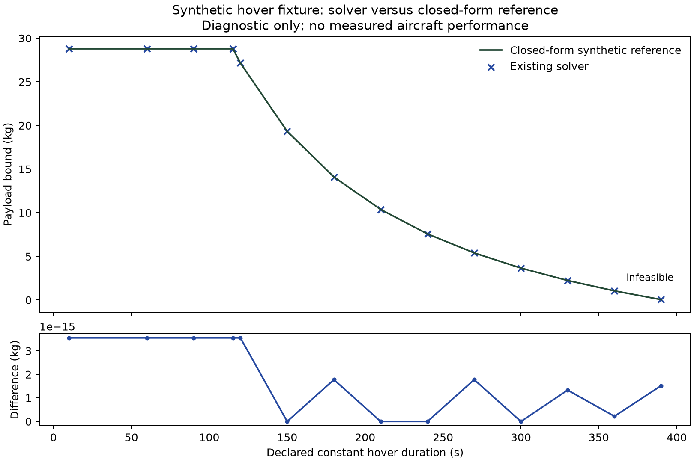

# Drone payload kickoff: evidence and next work

Date: 22 October 2026. Audited source: `73793c9e39f840864ebb885bd65b9b38706eaa07`.
Roles: Codex coordinator ran the software checks and diagnostic; a separate
physics-architect agent traced existing evidence. The spec-writer prepared
DR-01 separately. These are AI preparation roles, not human engineering approval
or a cross-family independent physics acceptance.

Verdict: **YELLOW for the existing synthetic workflow; customer aircraft payload
accuracy remains unestablished.** No feature is promoted to an accepted L0–L4
ladder by this kickoff.

## Confirmed intake

The user confirmed continued work on drone payload across required mission
cases, with plots and an evidence report. The customer organization/contact,
scientist reviewer, customer-approved accuracy and scientist-identified weakness
are unknown. The user asked the agent to propose the missing choices. Proposals
must remain identifiable as proposals; no scientist identity or approval is
inferred from that instruction.

The existing [client data request](../docs/client/aircraft-data-request.md)
describes the aircraft, map, mission and acceptance inputs needed. It remains
unsent. A proposed benchmark scope can be prepared while real inputs and review
are unavailable.

## Current state in five lines

1. Saved projects, original STL retention, revisions, capacity studies and
   reports exist in the current workbench.
2. The baseline payload model allocates declared rotor thrust while checking
   force/moment balance and fixed-pack power/energy under restricted conditions.
3. The opt-in V4 model adds conditioned maps, matching-map axial climb,
   stopped-rotor cases, deterministic scenarios and external caps.
4. Existing analytic checks are substantial; measurements and independent
   acceptance for the current aircraft/model claims are still missing.
5. The next task is qualification of the existing hover/energy model under a
   reviewable spec, before stateful battery or broader aircraft physics.

## Fresh checks performed

| Check | Actual result | What it establishes |
|---|---|---|
| Eight targeted model/contract files | 167 passed, one deprecation warning, 2.22 s | Existing unit, mathematical, refusal and contract checks reproduce at this source |
| Separate development reference suite | 118 passed, one deprecation warning, 0.56 s | Reference-code regression checks reproduce; this is not an independent L5 cross-code campaign |
| Existing synthetic hover fixture over 15 durations | 14 feasible, one infeasible | Diagnostic comparison with an independently calculated closed form for the same artificial inputs |
| Diagnostic Python lint | Passed | Evidence generator passes the configured Ruff rules |

Runtime: Python 3.11.16, NumPy 2.4.6, SciPy 1.17.1. Commands, counts and sanitized
logs are retained in [software-checks.json](assets/drone-kickoff-2026-10-22/software-checks.json).
The warning concerns Starlette's deprecated httpx TestClient integration; it did
not fail these checks. No fresh native CFD, service integration, browser,
release-image or held-out experimental campaign was performed for this kickoff.

### A plot you can inspect

The blue crosses are the existing solver. The green line is a closed-form
reference calculated at Decimal precision 28, then rounded to float, using the
fixture's declared 400 N thrust ceiling, 12 kg empty mass,
460,800 J usable energy and artificial linear electrical demand of 10 W/N:

`payload(t) = min(400, 460800 / (10 t)) / 9.80665 - 12` kg.

This reference is derived from static vertical force balance and constant-power
energy accounting. The inputs are software fixtures, not measured propulsion or
battery properties. At 400 s even zero payload exceeds this fixture's budget;
the solver returns infeasible, rather than displaying a negative payload.

Across the 14 comparable feasible points, the maximum absolute payload
difference was **3.553 × 10^-15 kg**, maximum absolute force residual was
**5.684 × 10^-14 N**, and maximum absolute moment residual was
**2.842 × 10^-14 N m**. These are numerical differences on this artificial case,
not a percentage accuracy claim for any aircraft. The diagnostic introduces no
new pass tolerance and grants no scientific acceptance.

Retained [data and source hashes](assets/drone-kickoff-2026-10-22/hover-duration.json),
[CSV observations](assets/drone-kickoff-2026-10-22/hover-duration.csv) and
[reproduction script](assets/drone-kickoff-2026-10-22/probe.py) make every plotted
point inspectable. The script reuses the existing input constructor but computes
its reference without calling the solver or importing the solver's gravity
constant. It is a diagnostic of existing code, not the future approved
validation-engineer's test suite.

## Evidence audit

| Capability | Evidence represented | Missing or restricted |
|---|---|---|
| Units, frames, atmosphere, mass and CG | Selected L0 and L2 fixtures in `tests/drone/test_wp02_foundations.py` | Constants/source/configuration traceability needs reconciliation |
| Static hover and fixed-pack energy | Selected L0/L1 equilibrium/energy and L2 analytic checks in `tests/drone/test_hover_pilot.py`; [scope](../docs/validation/local-hover-and-energy.md) | L3 applicability decision, published comparisons, current approval and aircraft measurements |
| Conditioned maps and axial climb | Synthetic CT/CQ and matching-condition/refusal checks; [record](../docs/validation/capacity-uncertainty.md) | Surrogate checks do not establish installed flow or real climb prediction |
| Motor-out and scenarios | Quad certificate, square-octo equilibrium and analytic correlated-scenario/cap checks | No fault transient, control authority, installation validation or statistical confidence |
| Native loads and GCI | Analytic tool fixtures; [sphere native-load record](../docs/validation/sphere_re100_loads.md) | Force reconciliation is not a complete fluid mass/energy conservation report |
| Sphere CFD | Historical fine Cd 1.120620183, +2.6463% frozen-correlation gap and qualified capped GCI sensitivity 0.408440535% | Historical evidence explicitly remains unverified; GCI is not total accuracy or aircraft validation |
| Integrated rotor CFD/BEM/turbulence | Separate [development reference implementations](../reference_impl/README.md) exist | No integrated, accepted aircraft prediction capability demonstrated by this audit |
| Real aircraft payload | Input and acceptance requirements recorded | L6 measurements, responsible reviewer and customer tolerance absent |

These rows identify checks with evidence; they do not fill gaps in the ladder
by inference. Mesh GCI is not meaningful for an algebraic allocation or exact
constant-power integration without a separately approved applicability decision.
The [existing V4 review prerequisite](../docs/qa/production-model-review-packet.md)
still applies before physics extensions.

## Source and threshold ledger: first reconciliation items

| Item currently used | Location/source | Current classification |
|---|---|---|
| `G0 = 9.80665 m/s²` | `drone/atmosphere.py`; conventional standard gravity, also documented by [NIST](https://www.nist.gov/system/files/documents/srd/jpcrd574.pdf), equation 30 | Conventional model value; actual local gravity is not measured by this input |
| `R_AIR = 287.05 J/(kg K)` | `drone/atmosphere.py`; [source manifest, atmosphere](../docs/source/manifest_v1.0_extracted.md) | Declared dry-air approximation; primary provenance/configuration approval unverified |
| Relative wrench threshold `1e-8`, absolute force/moment floors `1e-7 N` / `1e-7 N m` | `drone/trim.py:21-23`, `395-396` | Historical numerical fixture policy; not customer accuracy |
| Energy excess threshold `1e-7 × max(1 J, usable energy)` | `drone/mission_capacity.py:140` | Historical numerical bookkeeping policy; not battery uncertainty |
| All other relevant map/duty, source and power guards | Applicable code and approved-source records | Inventory and cite before approving the complete DR-01 protocol |

The new kit calls for centralized, cited configuration. This ledger identifies
the migration/reconciliation work without moving constants or changing values
during the audit. Any later move must preserve model identity and historical
result compatibility or explicitly version the change.

## Three risks and the next three specifications

1. **A mathematical payload limit could be mistaken for an aircraft allowance.**
   DR-01, [restricted hover and energy qualification](../specs/drone-hover-payload-baseline.md),
   defines evidence, scope, constants and numerical policies for what already
   exists. Status: awaiting scientist; reviewer unassigned.
2. **Input-map accuracy and installation coverage are unknown.** DR-02 should
   predeclare raw source metadata, a held-out comparison and uncertainty policy.
   [UIUC's official propeller database](https://m-selig.ae.illinois.edu/props/propDB.html)
   is a candidate source; using isolated measurements would qualify only the
   scoped source/interpolation comparison. No data campaign has been run here.
3. **Coupling could build on unaccepted V4 assumptions.** DR-03 should qualify
   conditioning, climb, stopped-rotor cases and shared-scenario semantics before
   the already proposed stateful battery/powertrain extension proceeds.

The [roadmap](../ROADMAP.md) now records these evidence states. Preparing the spec
and sources can continue; scientist approval remains required before implementing
new physics or claiming the new validation protocol has passed. The lead does
not need to invent an accuracy number to start this preparation.

## Documentation review

A fresh physics-auditor agent checked the equations and restrictions against
existing code, source/probe/log hashes, local links, the plot and approval claims.
It found no material acceptance overclaim. Its two precision findings were fixed:
the slope-guard inventory now distinguishes strict nonnegative slopes from the
convexity allowance, and the diagnostic states Decimal precision 28 with float
rounding. The diagnostic was regenerated with unchanged observations and lint
passed again. This was a same-family AI consistency review; the reviewer did not
rerun the suites or grant human/scientific acceptance. No solver, test assertion,
reference dataset or existing tolerance was changed.
